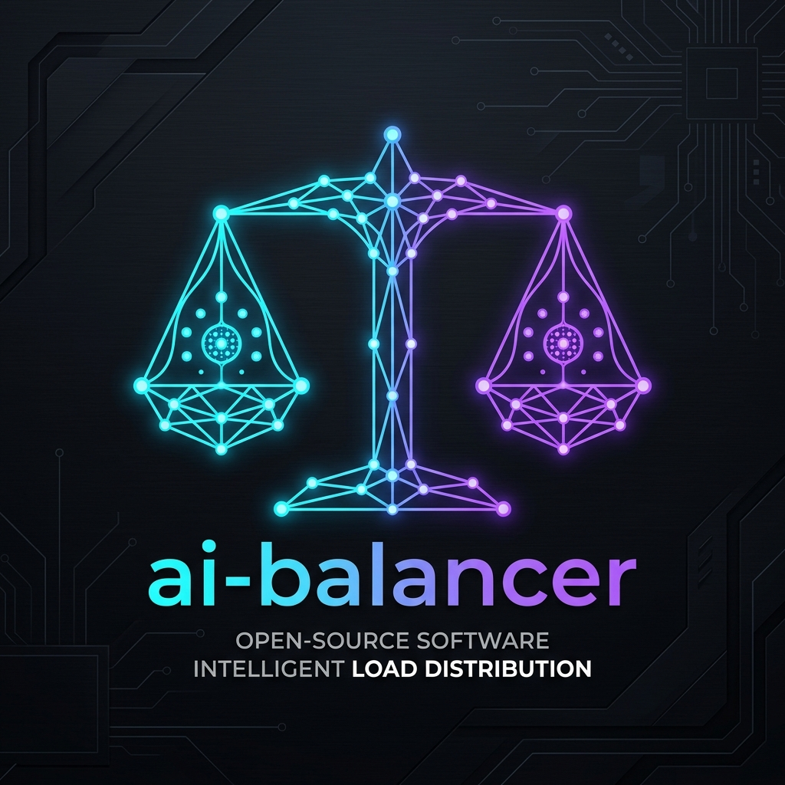
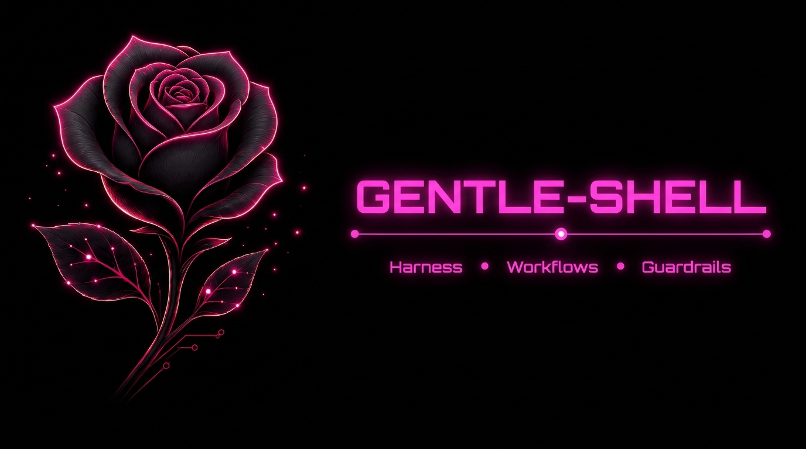
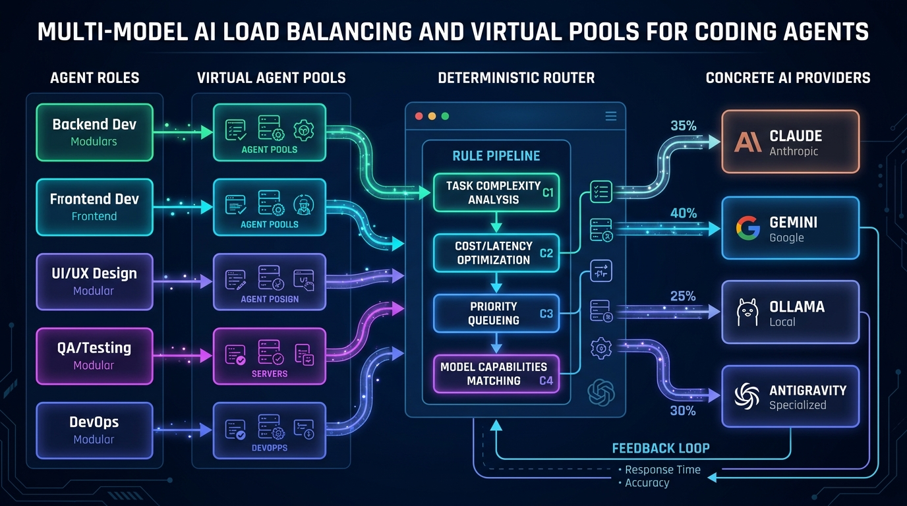
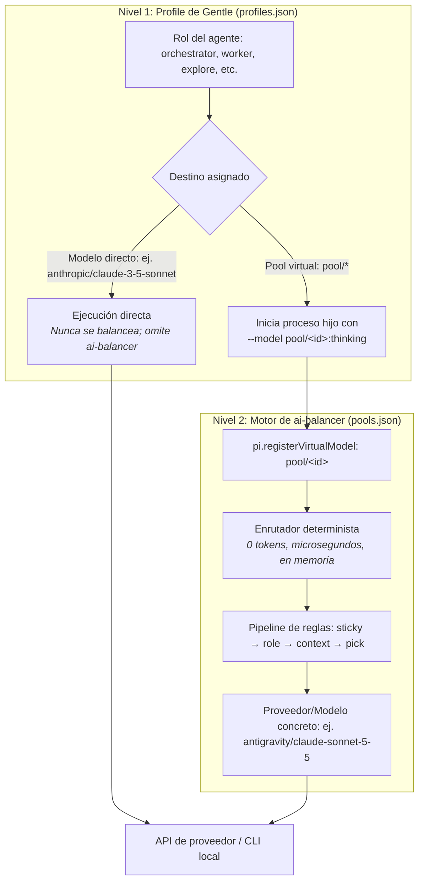
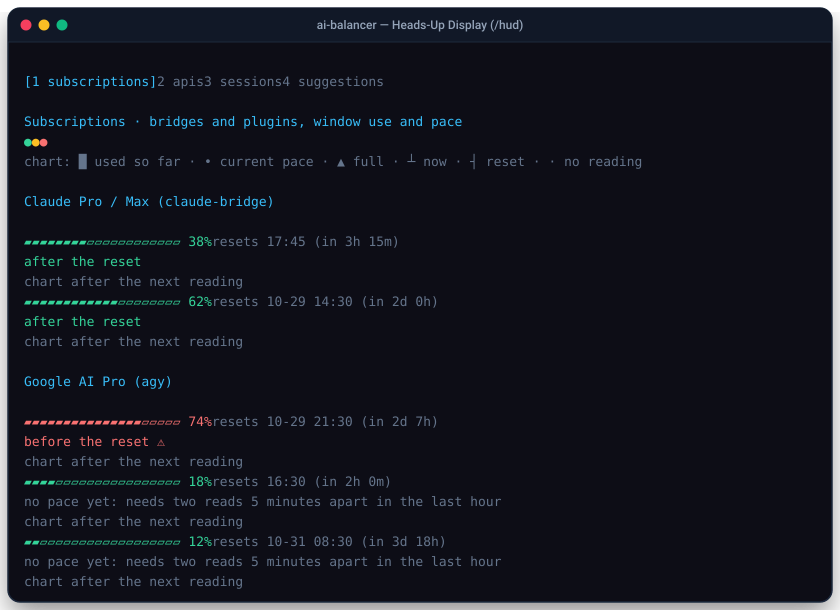
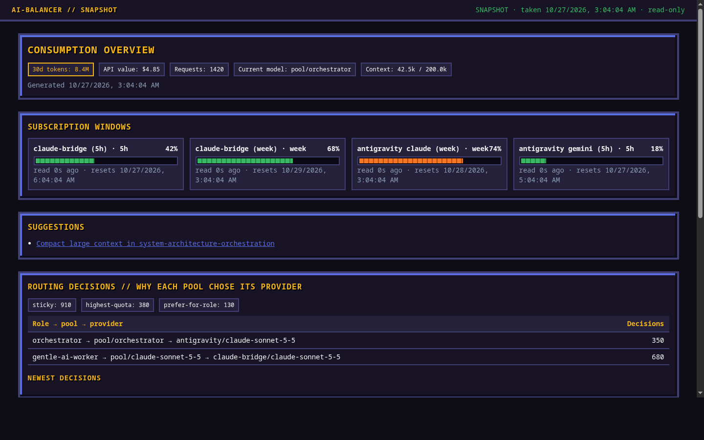

<p align="center">
  
</p>

<h1 align="center">ai-balancer</h1>

<p align="center">
  <strong>Enrutador determinista y balanceador de cuotas para modelos virtuales sin sobrecarga de tokens, diseñado para Gentle Shell y el entorno de agentes Pi.</strong>
</p>

<p align="center">
  <a href="https://github.com/3lAngel0/balanceria"></a>
  <a href="https://github.com/3lAngel0/balanceria"></a>
  <a href="https://github.com/3lAngel0/balanceria"></a>
  <a href="LICENSE"></a>
  
  
</p>

<p align="center">
  <a href="#características-principales">Características</a> •
  <a href="#cómo-funciona-dos-niveles-independientes">Arquitectura</a> •
  <a href="#proveedores-compatibles">Proveedores</a> •
  <a href="#inicio-rápido">Inicio Rápido</a> •
  <a href="#centro-de-control-interactivo-en-tui-y-web">Panel y HUD</a> •
  <a href="README.md"><b>🇬🇧 English Version</b></a>
</p>

<p align="center">
  <a href="https://github.com/Gentleman-Programming/gentle-shell">
    
  </a>
</p>

---

`ai-balancer` se ubica entre los roles de sus agentes y los proveedores de IA. En lugar de vincular los subagentes directamente a modelos o suscripciones individuales, se les asignan **pools virtuales** (por ejemplo, `pool/orchestrator`, `pool/claude-sonnet-5-5`). Antes de cada petición, un enrutador determinista selecciona el candidato óptimo basándose en el estado de cuota en tiempo real, el rol activo del agente, el tamaño del contexto de la sesión y un pipeline de reglas personalizable, **consumiendo cero tokens de LLM y sin añadir latencia**.

---

## ⚡ El problema

Los entornos modernos de desarrollo asistido por IA dependen de múltiples subagentes especializados (exploradores, ejecutores de tareas, revisores de código, jueces). Ejecutar estos flujos de trabajo sobre suscripciones individuales genera cuellos de botella operativos:

| Desafío | Impacto sin ai-balancer | Solución con ai-balancer |
|---|---|---|
| **Agotamiento de cuota** | Las ventanas rodantes de 5 horas o límites semanales se agotan a mitad de turno, arrojando errores duros `429` o `ResourceExhausted` y abandonando tareas en curso. | El monitoreo en tiempo real reescribe los errores de cuota en señales reintentables, ejecutando failover inmediato hacia candidatos alternativos. |
| **Ceguera de costos** | Las continuaciones saltan arbitrariamente entre proveedores, descartando prefijos en el prompt cache y generando penalizaciones de tokens fríos o reintentos costosos. | La afinidad sticky preserva los cachés de prompt; los reintentos tras el fallo de un modelo costoso se mantienen más económicos automáticamente. |
| **Asignación monolítica de modelos** | Búsquedas simples de archivos y revisiones arquitectónicas complejas usan el mismo nivel de modelo costoso debido a la complejidad del cambio manual. | Una arquitectura de dos niveles dirige tareas livianas (exploradores) a modelos rápidos y tareas complejas (workers, auditores) a pools de razonamiento profundo. |

---

## 🏗️ Cómo funciona: dos niveles independientes

<p align="center">
  
</p>

La asignación de modelos en `ai-balancer` está desacoplada en dos niveles independientes:



1. **Nivel 1 (Profile de Gentle)**: `~/.gentle-shell/config/gentle-ai/profiles.json` asigna cada rol de agente a un modelo directo o a un pool virtual (`pool/<id>`). Los procesos secundarios reciben su asignación mediante el argumento `--model <target>:thinking`.
2. **Nivel 2 (Pools virtuales)**: `pools.json` define los modelos candidatos y las reglas de enrutamiento. **Únicamente los roles que apuntan a un `pool/<id>` son balanceados.** Los roles que apuntan a un modelo directo físico omiten el balanceador y nunca son balanceados.

### Diferencia clave: Perfiles vs. Pools vs. Bridges

| Concepto | Pregunta | Responsabilidad | Configuración |
|---|---|---|---|
| **Perfil** | *¿Quién consume?* | Mapea el rol del agente (`orchestrator`, `worker`, etc.) a un destino. | `profiles.json` |
| **Pool** | *¿Bajo qué política y alternativas?* | Virtualiza un conjunto de modelos candidatos con failover, stickiness y control de costos. | `pools.json` |
| **Bridge** | *¿Por dónde se conecta físicamente?* | Adaptador hacia el proveedor o suscripción concreta (`claude-bridge`, `antigravity`, APIs). | `integrations.json` / CLI |

---

## ✨ Características principales

- 🎯 **Enrutamiento determinista**: Cero sobrecarga de LLM. Las decisiones se resuelven en TypeScript puro en memoria utilizando el estado de cuota y el conteo de tokens (< 1ms).
- 🧠 **Preservación de prompt cache (stickiness)**: Las continuaciones de sesión se mantienen en el proveedor que atendió el turno previo, conservando activos los bloques en caché y las firmas de razonamiento.
- 🔄 **Failover transparente**: Intercepta errores de agotamiento de cuota y bloqueos de proceso (stalls), reescribiéndolos en señales `429` reintentables que activan el reintento nativo de Pi con el siguiente candidato disponible.
- 🛡️ **Contención de costos en failover**: Cuando un candidato costoso (`input + output` > US$15/M, como Opus) falla, los reintentos filtran estrictamente por candidatos más económicos primero.
- ⚡ **Circuit Breaker**: Si todos los candidatos de un pool se agotan en simultáneo, el disyuntor detiene los reintentos de inmediato, guarda un punto de control de emergencia en `data/circuit-breaker-checkpoint.json` y alerta al usuario.
- 📊 **Centro de control interactivo en TUI y Web** (tablas en recuadros, colores pixel art y animación suave, y un recuadro de Ayuda en lenguaje simple que `?` alterna; se respetan `NO_COLOR` y `AI_BALANCER_REDUCE_MOTION=1`): Línea de estado en vivo, panel lateral desplegable (`Ctrl+Alt+B`), consola completa de uso en 5 pestañas (`Ctrl+Alt+U`), Heads-Up Display (`/hud`) y dashboard web autenticado local/LAN (`/balancer serve`).
- 🦫 **Centro interactivo de instalación conversacional (TUI y Web `/installer`)**: Instalador guiado en 3 columnas por una mascota Carpincho en pixel art con balanza animada. Incorpora glosario conceptual en lenguaje cotidiano, control de estrategias de respaldo (`hybrid`, `waterfall`, `highest-quota`), Búsqueda profunda con asesor IA y bloqueo anti-doble clic, resumen narrativo comprensible, copias fechadas sin sobrescritura con "Deshacer todo" exacto y entorno web aislado con CSP estricto.
- 🔒 **100% Privado y local**: Todos los datos se almacenan estrictamente en su disco local bajo `data/`. Sin telemetría externa, sin servidores remotos y sin almacenar claves API. Consulte [Seguridad y Privacidad](docs/SECURITY-AND-PRIVACY.md).

---

## 🖥️ Centro de control interactivo en TUI y Web

### Heads-Up Display en Terminal (`/hud`)
<p align="center">
  
</p>

### Centro de Control Web en Vivo (`/balancer serve`)
<p align="center">
  
</p>

Supervise en tiempo real el consumo de tokens, el estado de las cuotas por proveedor y las decisiones del enrutador directamente en su terminal o navegador:

```bash
# Alternar el HUD interactivo en terminal
/hud

# Abrir la consola de uso con 5 pestañas
/balancer usage

# Iniciar el servidor web local/LAN con autenticación
/balancer serve
```

---

## 🔌 Proveedores compatibles

| Proveedor | ID | Tipo | Detección / Integración |
|---|---|---|---|
| **Google AI Pro (Antigravity)** | `antigravity` | Suscripción | Binario CLI `agy`, `~/.local/bin/agy` o `@estebanforge/pi-antigravity-bridge` |
| **Claude Pro / Max** | `claude-bridge` | Suscripción | Paquete `pi-claude-bridge`, `CLAUDE_BRIDGE_PORT` o directorio de la extensión |
| **Claude Code CLI** | `claude-code` | Suscripción | Binario CLI `claude` o paquete `claude-code` |
| **OpenCode Engine** | `opencode` | Suscripción | Binario CLI `opencode` o paquete `opencode` |
| **Ollama (LLMs locales)** | `ollama` | Local | Binario CLI `ollama` en `PATH` |
| **Suscripciones con `/login` de Pi** (ChatGPT Plus/Pro, Claude Pro/Max, GitHub Copilot, Kimi…) | `openai-codex`, `anthropic`, `github-copilot`, … | Suscripción | Una entrada OAuth en el `auth.json` del agente (ejecutar `/login` en Pi); los modelos salen del registro de Pi |
| **Anthropic API** | `anthropic` | API paga | Variable de entorno `ANTHROPIC_API_KEY` |
| **Google Gemini API** | `google` | API paga | Variable de entorno `GEMINI_API_KEY` |
| **Proveedores personalizados de Pi** | *(cualquiera)* | Cualquiera | Cualquier modelo registrado en el catálogo de modelos de Pi declarado en `pools.json` |

---

## 🚀 Inicio rápido

### 1. Instalación

Instale `ai-balancer` en Gentle Shell:

```bash
gentle-shell install https://github.com/3lAngel0/balanceria
```

O como extensión directa de Pi:

```bash
pi install git:github.com/3lAngel0/balanceria
```

### 2. Centro interactivo de configuración

Ejecute el centro de configuración interactivo para detectar automáticamente los proveedores instalados, estructurar los pools y asignar roles:

```bash
/balancer setup
```

`/balancer setup` ejecuta un instalador conversacional con diseño en 3 columnas disponible tanto en consola de terminal (TUI) como vía navegador web local en `/installer`:

- **Diseño conversacional en 3 columnas**:
  - **Barra izquierda**: Lista estructurada de pasos con indicadores de estado (`✓` hecho, `●` actual, `○` pendiente) y contador de progreso ("Paso N de M").
  - **Columna central**: Escenario interactivo guiado por una mascota Carpincho en pixel art con una balanza mecánica animada y un bocadillo de diálogo explicativo, controles interactivos, diagramas de enrutamiento, un aviso explícito de tranquilidad ("*No se aplica nada hasta que confirmes*") y botones de acción protegidos con bloqueo anti-doble clic (*single-flight*).
  - **Panel derecho**: Ayuda detallada fija y visible en todo momento que desglosa "*Qué es*", "*Para qué sirve*", "*Si elegís esto*", el nombre técnico del concepto y el archivo de destino correspondiente.
- **Mascota Carpincho y animaciones de la balanza**:
  - El Carpincho reacciona dinámicamente con 3 posturas: `idle` (reposo habitual), `working` (activa durante la detección, la búsqueda profunda y la instalación) y `happy` (celebración en la pantalla de Listo).
  - Animaciones fluidas: respiración, parpadeo e inclinación de los platillos de la balanza.
  - Accesibilidad integrada: respeta estrictamente `AI_BALANCER_REDUCE_MOTION=1` o `prefers-reduced-motion: reduce`, congelando las animaciones en un cuadro estático sin fatiga visual.
- **Pantalla de bienvenida y glosario conceptual**:
  - Explicación previa de los conceptos clave en lenguaje cotidiano antes de modificar cualquier ajuste:
    - **Suscripción** (nombre técnico: provider / `integrations.json`): Planes de IA que pagás o en los que iniciaste sesión (Claude Pro, Google AI Pro).
    - **Respaldo** (pool / `pools.json`): Lista de suscripciones que ofrecen el mismo modelo para conmutar sin frenar el trabajo.
    - **Tarea del agente** (role / `profiles.json`): Trabajos específicos de los agentes (leer archivos, programar, auditar) asignados a modelos apropiados.
    - **Estrategia de enrutamiento** (Mixto/`hybrid`, En orden/`waterfall`, La que más le queda/`highest-quota`): Regla que define qué suscripción responde primero.
    - **Modo del agente principal** (`organic` vs `full-delegation`): Si el agente principal trabaja por su cuenta o delega todas las tareas.
  - Presenta de antemano el panorama de pasos y un enlace para apoyar el proyecto con una estrella en GitHub: [https://github.com/3lAngel0/balanceria](https://github.com/3lAngel0/balanceria).
- **Modelo final**: en **Respaldos** pulse `l` (o el botón **Modelo final**) para elegir un modelo barato, o **Ninguno**. Se guarda como `lastResort` en `pools.json`, aparece en el resumen y se descarta si se desactiva su suscripción.
- **Pipeline de respaldos y estrategias de enrutamiento**:
  - Control granular sobre los miembros de cada respaldo, su orden y la estrategia de selección:
    - **Mixto (`hybrid`)**: Hoy enruta exactamente igual que `highest-quota` (se mantiene en el mismo modelo durante la conversación y, si no, elige el que tiene más cuota libre). Todavía no tiene un umbral de "queda poco".
    - **En orden (`waterfall`)**: Agota completamente la primera opción antes de pasar a la segunda.
    - **La que más le queda (`highest-quota`)**: Consulta el margen de cuota disponible en tiempo real y asigna la suscripción con mayor capacidad libre.
- **Tareas de agentes y Búsqueda profunda ("Deep Analysis")**:
  - Permite asignar roles al instante sin consumir cuota con **Asignar lo recomendado**, o activar la **Búsqueda profunda** (*Realizar búsqueda profunda*).
  - La búsqueda profunda consulta a un modelo asesor de IA para evaluar la carga de cada rol frente a capacidades reales, benchmarks de razonamiento y eficiencia de costos.
  - Muestra progreso en vivo con una barra indeterminada animada y contador de segundos transcurridos.
  - Incorpora bloqueo de concurrencia (*single-flight lock*) para impedir clics repetidos o doble gasto accidental de cuota.
  - Despliega un banner de confirmación con los segundos requeridos, tokens consumidos y la suscripción facturada.
- **Resumen en lenguaje natural**:
  - Sintetiza la configuración en un párrafo narrativo en prosa antes de escribir cualquier archivo, acompañado por un desglose detallado con viñetas de suscripciones, respaldos, estrategias, mapeos de tareas y archivos modificados.
  - Incluye aviso de confirmación final que garantiza que nada se modifique sin tu visto bueno.
- **Integridad de la instalación y respaldos sin sobrescritura**:
  - **Preservación de respaldos existentes**: Si un perfil existente hace referencia a un `pool/<id>`, dicho respaldo se conserva intacto en `pools.json` y nunca se elimina.
  - **Copias fechadas por instalación**: Genera copias de seguridad únicas con marca de tiempo (`<archivo>.bak-installer-YYYYMMDDHHMMSS[-n]`) para cada archivo modificado, sin sobrescribir copias `.bak` anteriores.
  - **Deshacer todo exacto ("Deshacer todo")**: Opción en la pantalla final para revertir al estado exacto previo a la instalación con un solo clic y eliminar archivos nuevos creados.
- **Seguridad del instalador web**:
  - Opera bajo el aislamiento estricto de `/installer`: activo únicamente durante sesiones de instalación interactivas, autenticación obligatoria mediante token, mutaciones (`POST`) limitadas a loopback (`127.0.0.1`) o HTTPS (se rechazan sobre LAN HTTP plana) y cabeceras CSP estrictas (sin estilos inline, sin `eval` y sin `innerHTML`).

El detalle paso a paso está en la [guía](docs/guide.es.md#10-instalación-y-asistente-interactivo-de-configuración).

**Cómo empieza la configuración.** `/balancer setup` pregunta primero **Seleccionar lenguaje** (Español / English): `Enter` lo aplica solo a esta ejecución, `P` lo guarda de forma permanente, y toda la interfaz, la Ayuda incluida, cambia al instante. Después pregunta **¿Dónde querés hacer la instalación?**:

- **Instalación vía terminal**: el instalador se abre en la terminal.
- **Instalación vía web**: la terminal muestra los pasos para correrlo en un navegador y espera. Inicia el servidor web en `127.0.0.1:8787` (solo esta computadora; si ya había un servidor corriendo se reutiliza tal como lo configuraste), muestra el link con el token y un botón **[Abrir en el navegador]** cuando hay escritorio, y en una sesión SSH imprime el comando exacto del túnel para correr en tu propia computadora más el link que hay que abrir después. Luego muestra "Esperando que termines la instalación en el navegador..." con **[Cancelar]**; cuando el navegador termina, la terminal muestra el mismo resumen de "Listo". Cancelar apaga el servidor si lo arrancó el instalador. La página `/installer` existe solo mientras hay un instalador en marcha, exige el token, acepta cambios solo desde el mismo origen y los rechaza en una LAN con HTTP plano (solo `127.0.0.1` o HTTPS).

**Tipos de instalación.** **Recomendada** (preseleccionada: encuentra tus suscripciones, arma todo y salta al Resumen), **Personalizada** (cada opción se explica y elegs vos: suscripciones, respaldos, tareas de los agentes y agente principal) o **Avanzada** (el stepper técnico, igual que `setup --skip`). Si ai-balancer ya está instalado, la primera pantalla ofrece **Modificar** (Personalizada con lo actual cargado), **Reparar** (encuentra tareas de agentes que apuntan a respaldos o modelos que ya no existen y propone arreglos) o **Empezar de cero** (guarda copias `.bak` y arma de nuevo lo recomendado).

**Plain names.** El instalador dice *suscripción* (nombre técnico: provider), *respaldo* (pool), *tarea del agente* (role), *cómo elegir cuál usar primero* (strategy) y *agente principal* (modo del orquestador). Los nombres técnicos aparecen solo en el recuadro `[?]` y en Avanzada.

**Avanzada (stepper técnico).** Un overlay de cuatro pasos: **Providers → Estrategia → Roles → Confirmar**. Cada paso explica qué decide, el último muestra un diff exacto de lo que se escribirá, y nada cambia hasta que pulsa **Guardar** (**Descartar** o `Esc` dejan todos los archivos como están). Teclas: `←/→` pasos, `↑/↓` filas, `Espacio`/`Enter` alternar o ciclar, `u`/`d` reordenar candidatos, `s` guardar. El ratón y la rueda funcionan solo en terminales a pantalla completa; en otros casos las teclas hacen lo mismo. Sin interfaz, recurre al asistente clásico, que también se ejecuta con `/balancer setup classic`. En el paso Roles, la fila **Modo del orquestador** (`m`, o `Espacio`/`Enter`) fija `organic` o `full-delegation` para el perfil activo (`workflow.orchestratorMode` de Gentle Shell 4.7.0).

**Atajos hacia la configuración.**

- `/balancer setup --dummy` / `-d`, `/balancer dummy`, o `D` en el Centro de control (`d` en la pestaña Resumen): pregunta el idioma y abre el instalador en la terminal, sin la pregunta terminal/web.
- `/balancer setup --skip` / `-s`: pregunta el idioma y va directo al stepper técnico. `/balancer skip` abre el menú de acciones directamente.

**Idioma.** Se fija explícitamente con `AI_BALANCER_LANG=es|en`. Prioridad: `AI_BALANCER_LANG` > `LC_ALL` > `LC_MESSAGES` > `LANG` > `LANGUAGE`; `/balancer lang es|en|auto` guarda la elección en `~/.gentle-shell/agent/settings.json`.

El asistente clásico detecta los proveedores del sistema, orienta la elección de estrategia (`hybrid` o `waterfall`), permite reorganizar candidatos y prioridades por pool, e integra un Asesor de Roles con IA (seguro contra costos; nunca recomienda Opus). Las modificaciones se guardan de forma atómica con respaldos automáticos `.bak`.

### 3. Asignación de roles de agentes a pools

Seleccione un pool directamente en el chat mediante `/model pool/claude-sonnet-5-5` o configure sus roles en `~/.gentle-shell/config/gentle-ai/profiles.json`:

```json
{
  "kind": "gentle-pi.agent_model_profiles",
  "version": 1,
  "profiles": {
    "balanced": {
      "orchestrator": { "model": "pool/orchestrator", "thinking": "medium" },
      "gentle-ai-worker": { "model": "pool/claude-sonnet-5-5", "thinking": "medium" },
      "gentle-ai-explore": { "model": "pool/orchestrator", "thinking": "low" },
      "gentle-ai-verify": { "model": "pool/claude-sonnet-5-5", "thinking": "high" }
    }
  }
}
```

---

## ⌨️ Comandos y atajos principales

| Comando / Atajo | Descripción |
|---|---|
| `/balancer` | Menú interactivo con descripciones de comandos y atajos. |
| `/balancer panel` o `Ctrl+Alt+B` | Muestra u oculta el panel lateral y el Control Center de 4 pestañas. |
| `/balancer usage` o `Ctrl+Alt+U` | Abre la consola completa de uso en 5 pestañas (Now, Quotas, Days, Sessions, HUD). |
| `/balancer quota` | Muestra un resumen compacto de la cuota en vivo (% usado por ventana y hora de reinicio). `--copy` / `-c` (o `quota copy`) lo copia al portapapeles; `--raw` / `-r` lo imprime como texto plano. Los flags se pueden combinar; cualquier otro argumento se rechaza. |
| `/balancer setup` | Abre el instalador: idioma y luego **Instalación vía terminal** o **Instalación vía web**. |
| `/balancer setup --dummy` / `-d`, `/balancer dummy`, o `D` en el Centro de control | Abre el instalador en la terminal (primero el idioma, sin la pregunta terminal/web). |
| `/balancer setup --skip` / `-s` | Va directo al stepper técnico (Providers → Estrategia → Roles → Confirmar), después del idioma. |
| `/balancer skip` | Abre el menú de acciones directamente. |
| `/balancer setup classic` | Ejecuta el asistente anterior basado en preguntas. |
| `/balancer lang [es\|en\|auto]` | Consulta o modifica el idioma de la interfaz sin reiniciar la sesión. |
| `/balancer help` | Glosario breve: pool, candidato, préstamo, permiso, circuit breaker, rol, ritmo de ventana, contexto reenviado. |
| `/balancer serve [lan] [port]` | Inicia el dashboard web en tiempo real con autenticación (soporta LAN y TLS). |
| `/balancer lab` | Modo laboratorio: borrador, diferencias, simulación y aplicación segura de reglas. |
| `/balancer switch-cost` | Reporta el beneficio de retención de caché frente al costo de conmutación de proveedor. |
| `/hud` | Abre el Heads-Up Display de alta densidad en terminal. |

---

## ❓ Preguntas frecuentes

### ¿Quién decide qué modelo responde? ¿Lo decide el agente orquestador?

Lo decide el **balancer**, no una IA. Es código determinístico (sin tokens, menos de 1 ms) que lee la cuota registrada de cada suscripción y elige un modelo en cada pedido. Nunca le pregunta al orquestador ni a ningún otro modelo.

"orchestrator" quiere decir dos cosas distintas:

- **El rol orchestrator**: el agente principal con el que conversa. Coordina y delega en subagentes.
- **El pool `orchestrator`**: solo una lista de modelos (`pools.json`) asignada a ese rol, que se balancea como cualquier otro pool. No elige modelos para otros roles.

### Un rol apunta a un modelo directo (por ejemplo `antigravity/gemini-4-argon`). ¿Qué pasa cuando se agota?

**Nadie lo redirige.** Solo se balancean los roles que apuntan a `pool/<id>`. Un rol con modelo directo llama a ese proveedor directamente, así que cuando se agota la cuota el pedido falla con el error de cuota del proveedor. ai-balancer registra que se agotó y, en la sesión principal, muestra un aviso como `antigravity/gemini-4-argon se llenó. Cambiá a <modelo disponible> o a pool/orchestrator (/balancer).` El modelo sugerido es su **Modelo final** si está configurado y tiene cuota; si no, el primer candidato de un pool con cuota. `/installer` (Tareas de los agentes) y `/balancer` → **Roles** marcan estos roles con "Sin respaldo: si este modelo se agota, esta tarea se detiene". Los préstamos tampoco se aplican a modelos directos.

Si quiere que un rol siga funcionando cuando se agota su modelo, apúntelo a un pool: abra `/balancer`, entre a **Roles**, elija el rol y presione Enter para asignarle un `pool/<id>` que tenga ese modelo más alternativas.

### Un rol apunta a un pool. ¿Qué pasa cuando se agota el modelo que está usando?

El balancer lo marca como agotado hasta que se renueva su ventana y reintenta el pedido con el siguiente candidato disponible **del mismo pool**. Durante una conversación se mantiene en el modelo que respondió el turno anterior (para no perder el caché de prompts) y solo cambia cuando ese modelo deja de estar disponible o empieza un turno nuevo.

### ¿Cómo elige entre los candidatos de un pool?

Según la estrategia del pool:

| Estrategia | Comportamiento |
|---|---|
| **En orden** (`waterfall`) | Siempre el primer candidato disponible de la lista. Es la que sirve para "use Claude hasta que se acabe y después el siguiente". |
| **La que más le queda** (`highest-quota`) | El candidato con más cuota libre. Los que no tienen cuota conocida pierden contra cualquiera conocido; en empate gana el primero de la lista. |
| **Mixto** (`hybrid`) | Hoy se comporta exactamente igual que `highest-quota`. |

Con `hybrid` o `highest-quota`, un segundo candidato con más cuota libre responde **antes** de que se agote el primero. Si quiere un principal y un respaldo estrictos, use `waterfall`.

### ¿Qué pasa cuando se agotan todos los candidatos de un pool?

- **Modelo final (si está configurado)**: cuando se agotan todos los candidatos de un pool, responde **primero y automáticamente** el modelo final, en la sesión principal y en los subagentes, con un aviso de advertencia. El menú de abajo solo aparece cuando el modelo final también se agotó (o no hay uno configurado). Se configura en `/installer` → **Respaldos** → **Modelo final** (atajo `l`); elija **Ninguno** para quitarlo.
- **Sesión principal (con pantalla)**: aparece un menú para esperar a un candidato del pool (muestra cuándo se renueva cada uno), usar un modelo disponible **de otro pool**, usar **cualquier otro modelo de sus suscripciones activas que todavía tenga cuota** (aunque ningún pool lo liste, por ejemplo sus modelos de OpenAI cuando se agota Claude), compactar la sesión o cancelar. Los modelos agotados no se ofrecen.
- **Subagentes (sin pantalla)**: no hay menú. El pedido va al candidato que se renueva primero y falla con el mensaje de cuota del proveedor, salvo que aplique un **préstamo** (ver abajo).

### ¿Un respaldo puede mezclar proveedores, por ejemplo Claude primero y OpenAI cuando Claude se agota?

Sí. Abra `/installer`, entre a **Respaldos**, elija **+ Crear otro respaldo** y después **Respaldo propio**. Las plantillas Claude Opus y Claude Sonnet solo preseleccionan modelos con ese nombre, así que ahí los de OpenAI arrancan sin marcar.

1. **Qué suscripciones**: moverse con ↑↓ y marcar con **Espacio**.
2. **Orden**: ↑↓ sube o baja la suscripción resaltada. La primera se usa primero.
3. **Estrategia**: elija **En orden** (`waterfall`).
4. En **Tareas de agentes**, asigne el respaldo nuevo a los roles que lo van a usar. Un respaldo que ningún rol usa no hace nada.

La alternativa es un **préstamo**: deja el pool solo con Claude y autoriza una ruta temporal a otro modelo mientras el pool está agotado (`/balancer loans`, `/balancer permissions`). Con un permiso `auto` cambia sin preguntar y vuelve cuando se renueva la ventana. Los préstamos solo se aplican a roles que apuntan a un pool. Puede configurarlo sin escribir comandos: `/installer` → Respaldos → **Préstamos automáticos** (tecla `a`) le deja elegir, para cada respaldo, el modelo que sus tareas toman prestado cuando se agota (por ejemplo un respaldo de Claude que toma un modelo de OpenAI). El instalador lo guarda como un permiso `auto` para todas las tareas que usan ese respaldo, válido por un año (vuelva a instalar para renovarlo), y no toca ningún otro permiso.

### ¿Por qué la lista de respaldos solo muestra modelos de Claude si tengo OpenAI?

La lista solo muestra modelos de suscripciones **detectadas y activadas** en el paso **Suscripciones**. OpenAI ChatGPT Plus/Pro (`openai-codex`) se detecta cuando inició sesión con `/login` de Pi; una API key no cuenta como esa suscripción. Si está detectada pero desmarcada, márquela en **Suscripciones**.

Los respaldos automáticos solo agrupan suscripciones que ofrecen el **mismo** modelo, así que un modelo de OpenAI nunca termina solo en un respaldo de Claude. Cree un respaldo propio como se explica arriba.

### ¿Conviene asignar `pool/orchestrator` a todos los roles?

No. Todos los subagentes gastarían la cuota del agente principal, y cuando se agote también se corta su conversación principal. Además arranca con un modelo elegido para coordinar, no para explorar o escribir código. Dé a cada rol un pool acorde a su trabajo, con otro proveedor al final de la lista o un préstamo.

### ¿Qué significa "Effective routing" en `/balancer` → Roles?

Para un rol con pool muestra el modelo al que el pool enrutó **la última vez**, seguido de la lista completa de candidatos en orden: `claude-bridge/claude-opus-5-5 [antigravity/gemini-4-argon → …]`. Ahí el último pedido fue a `claude-bridge/claude-opus-5-5`, aunque `gemini-4-argon` es el primero de la lista. Para un rol con modelo directo muestra ese modelo.

---

## 📖 Documentación

- **[Guía completa paso a paso](docs/guide.es.md)**: Manual exhaustivo sobre la configuración de dos niveles, pipeline determinista de reglas, failover, incorporación de proveedores, ejemplos prácticos de roles y resolución de problemas.
- **[Complete Step-by-Step Guide (English)](docs/guide.md)**: Versión canónica en inglés de la guía completa y arquitectura.
- **[Seguridad y Privacidad](docs/SECURITY-AND-PRIVACY.md)**: Estructura de almacenamiento local, límites de privacidad y lista de verificación previa a la publicación.
- **[Lectura del HUD y consola de uso](docs/reading-the-hud.es.md)**: Análisis detallado de telemetría de tokens, caching y sugerencias heurísticas.
- **[Guía de contribución](CONTRIBUTING.md)**: Ejecución de pruebas, convenciones de pull requests y estándares de código.

---

## 🧪 Desarrollo

Ejecute la suite completa de pruebas unitarias:

```bash
npm test
```

Las pruebas se ejecutan fijando el idioma del entorno en `AI_BALANCER_LANG=en` para garantizar validaciones deterministas e independientes de la máquina de desarrollo.

---

## 📄 Licencia

Apache-2.0. Ver [LICENSE](LICENSE) y [NOTICE](NOTICE).
