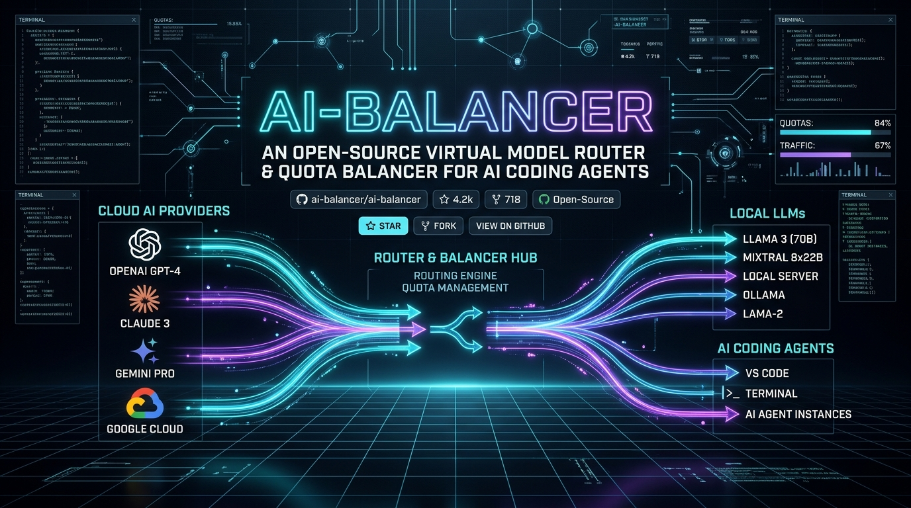
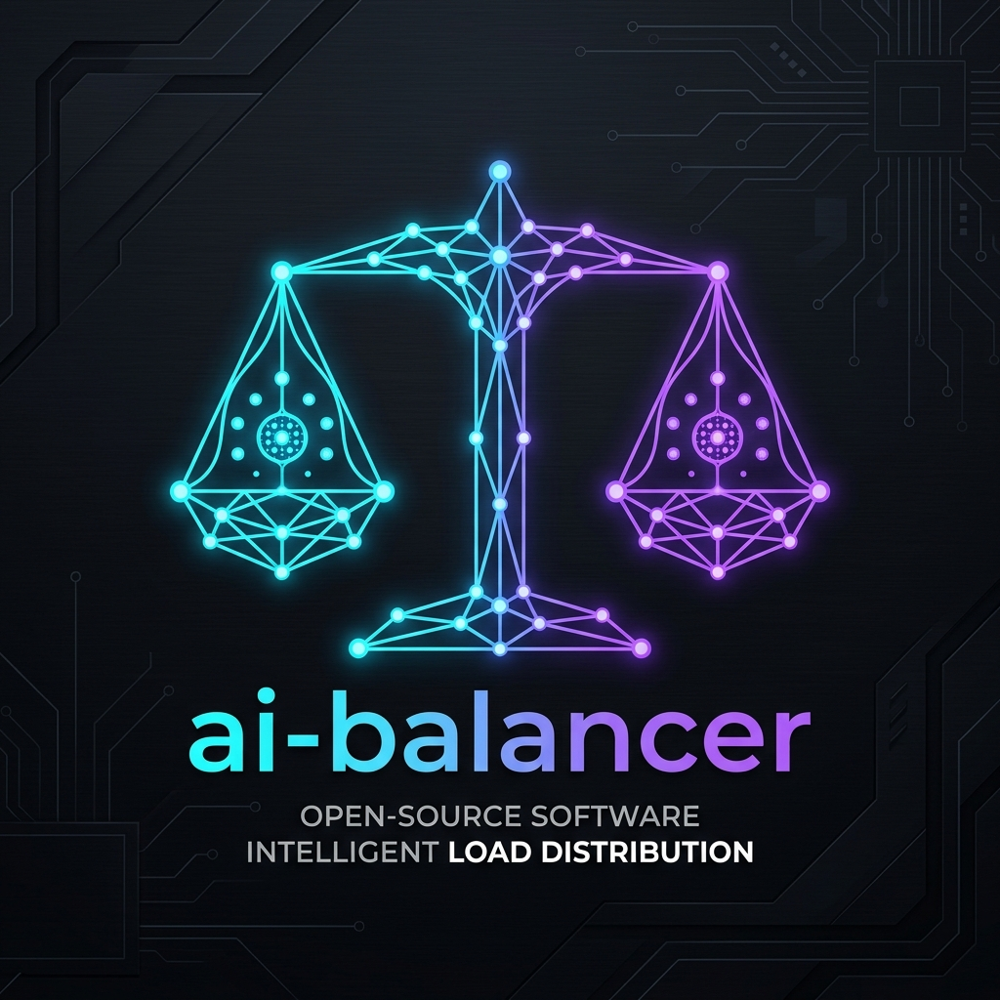
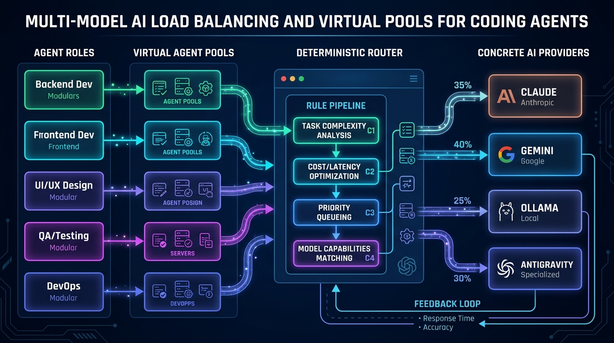
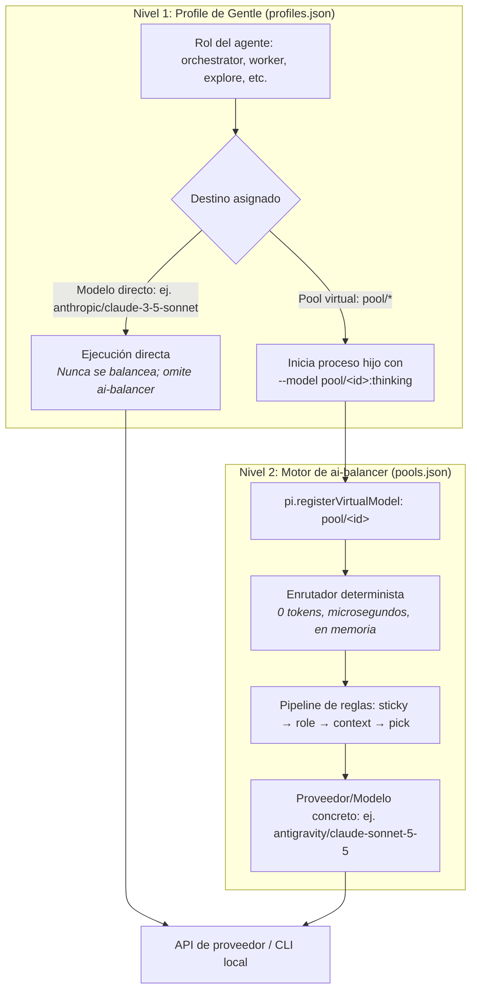
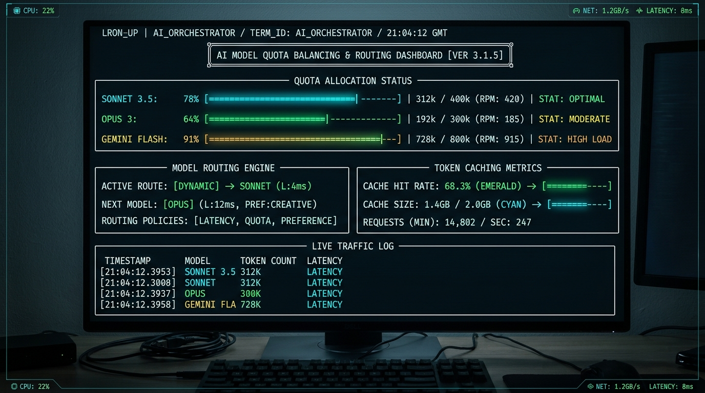

<p align="center">
  
</p>

<p align="center">
  
</p>

<h1 align="center">ai-balancer</h1>

<p align="center">
  <strong>Enrutador determinista y balanceador de cuotas para modelos virtuales sin sobrecarga de tokens, diseñado para Gentle Shell y el entorno de agentes Pi.</strong>
</p>

<p align="center">
  <a href="https://github.com/3lAngel0/balanceria"></a>
  <a href="https://github.com/3lAngel0/balanceria"></a>
  <a href="https://github.com/3lAngel0/balanceria"></a>
  <a href="LICENSE"></a>
  
  
</p>

<p align="center">
  <a href="#características-principales">Características</a> •
  <a href="#cómo-funciona-dos-niveles-independientes">Arquitectura</a> •
  <a href="#proveedores-compatibles">Proveedores</a> •
  <a href="#inicio-rápido">Inicio Rápido</a> •
  <a href="#centro-de-control-interactivo-en-tui-y-web">Panel y HUD</a> •
  <a href="README.md"><b>🇬🇧 English Version</b></a>
</p>

---

`ai-balancer` se ubica entre los roles de sus agentes y los proveedores de IA. En lugar de vincular los subagentes directamente a modelos o suscripciones individuales, se les asignan **pools virtuales** (por ejemplo, `pool/orchestrator`, `pool/claude-sonnet-5-5`). Antes de cada petición, un enrutador determinista selecciona el candidato óptimo basándose en el estado de cuota en tiempo real, el rol activo del agente, el tamaño del contexto de la sesión y un pipeline de reglas personalizable, **consumiendo cero tokens de LLM y sin añadir latencia**.

---

## ⚡ El problema

Los entornos modernos de desarrollo asistido por IA dependen de múltiples subagentes especializados (exploradores, ejecutores de tareas, revisores de código, jueces). Ejecutar estos flujos de trabajo sobre suscripciones individuales genera cuellos de botella operativos:

| Desafío | Impacto sin ai-balancer | Solución con ai-balancer |
|---|---|---|
| **Agotamiento de cuota** | Las ventanas rodantes de 5 horas o límites semanales se agotan a mitad de turno, arrojando errores duros `429` o `ResourceExhausted` y abandonando tareas en curso. | El monitoreo en tiempo real reescribe los errores de cuota en señales reintentables, ejecutando failover inmediato hacia candidatos alternativos. |
| **Ceguera de costos** | Las continuaciones saltan arbitrariamente entre proveedores, descartando prefijos en el prompt cache y generando penalizaciones de tokens fríos o reintentos costosos. | La afinidad sticky preserva los cachés de prompt; los reintentos tras el fallo de un modelo costoso se mantienen más económicos automáticamente. |
| **Asignación monolítica de modelos** | Búsquedas simples de archivos y revisiones arquitectónicas complejas usan el mismo nivel de modelo costoso debido a la complejidad del cambio manual. | Una arquitectura de dos niveles dirige tareas livianas (exploradores) a modelos rápidos y tareas complejas (workers, auditores) a pools de razonamiento profundo. |

---

## 🏗️ Cómo funciona: dos niveles independientes

<p align="center">
  
</p>

La asignación de modelos en `ai-balancer` está desacoplada en dos niveles independientes:



1. **Nivel 1 (Profile de Gentle)**: `~/.gentle-shell/config/gentle-ai/profiles.json` asigna cada rol de agente a un modelo directo o a un pool virtual (`pool/<id>`). Los procesos secundarios reciben su asignación mediante el argumento `--model <target>:thinking`.
2. **Nivel 2 (Pools virtuales)**: `pools.json` define los modelos candidatos y las reglas de enrutamiento. **Únicamente los roles que apuntan a un `pool/<id>` son balanceados.** Los roles que apuntan a un modelo directo físico omiten el balanceador y nunca son balanceados.

---

## ✨ Características principales

- 🎯 **Enrutamiento determinista**: Cero sobrecarga de LLM. Las decisiones se resuelven en TypeScript puro en memoria utilizando el estado de cuota y el conteo de tokens (< 1ms).
- 🧠 **Preservación de prompt cache (stickiness)**: Las continuaciones de sesión se mantienen en el proveedor que atendió el turno previo, conservando activos los bloques en caché y las firmas de razonamiento.
- 🔄 **Failover transparente**: Intercepta errores de agotamiento de cuota y bloqueos de proceso (stalls), reescribiéndolos en señales `429` reintentables que activan el reintento nativo de Pi con el siguiente candidato disponible.
- 🛡️ **Contención de costos en failover**: Cuando un candidato costoso (`input + output` > US$15/M, como Opus) falla, los reintentos filtran estrictamente por candidatos más económicos primero.
- ⚡ **Circuit Breaker**: Si todos los candidatos de un pool se agotan en simultáneo, el disyuntor detiene los reintentos de inmediato, guarda un punto de control de emergencia en `data/circuit-breaker-checkpoint.json` y alerta al usuario.
- 📊 **Centro de control interactivo en TUI y Web**: Línea de estado en vivo, panel lateral desplegable (`Ctrl+Alt+B`), consola completa de uso en 5 pestañas (`Ctrl+Alt+U`), Heads-Up Display (`/hud`) y dashboard web autenticado local/LAN (`/balancer serve`).
- 🔒 **100% Privado y local**: Todos los datos se almacenan estrictamente en su disco local bajo `data/`. Sin telemetría externa, sin servidores remotos y sin almacenar claves API. Consulte [Seguridad y Privacidad](docs/SECURITY-AND-PRIVACY.md).

---

## 🖥️ Centro de control interactivo en TUI y Web

<p align="center">
  
</p>

Supervise en tiempo real el consumo de tokens, el estado de las cuotas por proveedor y las decisiones del enrutador directamente en su terminal o navegador:

```bash
# Alternar el HUD interactivo en terminal
/hud

# Abrir la consola de uso con 5 pestañas
/balancer usage

# Iniciar el servidor web local/LAN con autenticación
/balancer serve
```

---

## 🔌 Proveedores compatibles

| Proveedor | ID | Tipo | Detección / Integración |
|---|---|---|---|
| **Google AI Pro (Antigravity)** | `antigravity` | Suscripción | Binario CLI `agy`, `~/.local/bin/agy` o `@estebanforge/pi-antigravity-bridge` |
| **Claude Pro / Max** | `claude-bridge` | Suscripción | Paquete `pi-claude-bridge`, `CLAUDE_BRIDGE_PORT` o directorio de la extensión |
| **Claude Code CLI** | `claude-code` | Suscripción | Binario CLI `claude` o paquete `claude-code` |
| **OpenCode Engine** | `opencode` | Suscripción | Binario CLI `opencode` o paquete `opencode` |
| **Ollama (LLMs locales)** | `ollama` | Local | Binario CLI `ollama` en `PATH` |
| **Anthropic API** | `anthropic` | API paga | Variable de entorno `ANTHROPIC_API_KEY` |
| **Google Gemini API** | `google` | API paga | Variable de entorno `GEMINI_API_KEY` |
| **Proveedores personalizados de Pi** | *(cualquiera)* | Cualquiera | Cualquier modelo registrado en el catálogo de modelos de Pi declarado en `pools.json` |

---

## 🚀 Inicio rápido

### 1. Instalación

Instale `ai-balancer` en Gentle Shell:

```bash
gentle-shell install https://github.com/3lAngel0/balanceria
```

O como extensión directa de Pi:

```bash
pi install git:github.com/3lAngel0/balanceria
```

### 2. Asistente interactivo de configuración

Ejecute el centro de configuración interactivo para detectar automáticamente los proveedores instalados, estructurar los pools y asignar roles:

```bash
/balancer setup
```

El asistente detecta los proveedores del sistema, orienta la elección de estrategia (`hybrid` o `waterfall`), permite reorganizar candidatos y prioridades por pool, e integra un Asesor de Roles con IA (seguro contra costos; nunca recomienda Opus). Las modificaciones se guardan de forma atómica con respaldos automáticos `.bak`.

### 3. Asignación de roles de agentes a pools

Seleccione un pool directamente en el chat mediante `/model pool/claude-sonnet-5-5` o configure sus roles en `~/.gentle-shell/config/gentle-ai/profiles.json`:

```json
{
  "kind": "gentle-pi.agent_model_profiles",
  "version": 1,
  "profiles": {
    "balanced": {
      "orchestrator": { "model": "pool/orchestrator", "thinking": "medium" },
      "gentle-ai-worker": { "model": "pool/claude-sonnet-5-5", "thinking": "medium" },
      "gentle-ai-explore": { "model": "pool/orchestrator", "thinking": "low" },
      "gentle-ai-verify": { "model": "pool/claude-sonnet-5-5", "thinking": "high" }
    }
  }
}
```

---

## ⌨️ Comandos y atajos principales

| Comando / Atajo | Descripción |
|---|---|
| `/balancer` | Menú interactivo con descripciones de comandos y atajos. |
| `/balancer panel` o `Ctrl+Alt+B` | Muestra u oculta el panel lateral y el Control Center de 4 pestañas. |
| `/balancer usage` o `Ctrl+Alt+U` | Abre la consola completa de uso en 5 pestañas (Now, Quotas, Days, Sessions, HUD). |
| `/balancer setup` | Ejecuta el asistente interactivo de configuración y detección de proveedores. |
| `/balancer lang [es\|en\|auto]` | Consulta o modifica el idioma de la interfaz sin reiniciar la sesión. |
| `/balancer serve [lan] [port]` | Inicia el dashboard web en tiempo real con autenticación (soporta LAN y TLS). |
| `/balancer lab` | Modo laboratorio: borrador, diferencias, simulación y aplicación segura de reglas. |
| `/balancer switch-cost` | Reporta el beneficio de retención de caché frente al costo de conmutación de proveedor. |
| `/hud` | Abre el Heads-Up Display de alta densidad en terminal. |

---

## 📖 Documentación

- **[Guía completa paso a paso](docs/guide.es.md)**: Manual exhaustivo sobre la configuración de dos niveles, pipeline determinista de reglas, failover, incorporación de proveedores, ejemplos prácticos de roles y resolución de problemas.
- **[Complete Step-by-Step Guide (English)](docs/guide.md)**: Versión canónica en inglés de la guía completa y arquitectura.
- **[Seguridad y Privacidad](docs/SECURITY-AND-PRIVACY.md)**: Estructura de almacenamiento local, límites de privacidad y lista de verificación previa a la publicación.
- **[Lectura del HUD y consola de uso](docs/reading-the-hud.es.md)**: Análisis detallado de telemetría de tokens, caching y sugerencias heurísticas.
- **[Guía de contribución](CONTRIBUTING.md)**: Ejecución de pruebas, convenciones de pull requests y estándares de código.

---

## 🧪 Desarrollo

Ejecute la suite completa de pruebas unitarias:

```bash
npm test
```

Las pruebas se ejecutan fijando el idioma del entorno en `AI_BALANCER_LANG=en` para garantizar validaciones deterministas e independientes de la máquina de desarrollo.

---

## 📄 Licencia

Apache-2.0. Ver [LICENSE](LICENSE) y [NOTICE](NOTICE).
