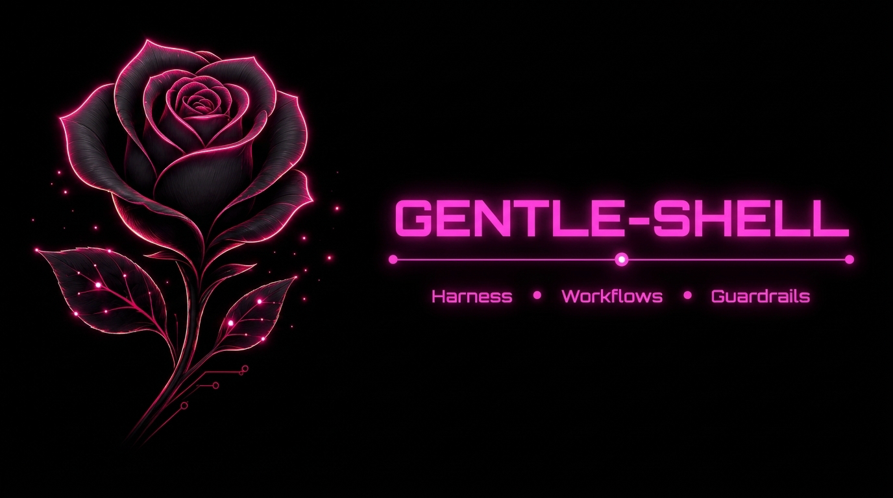
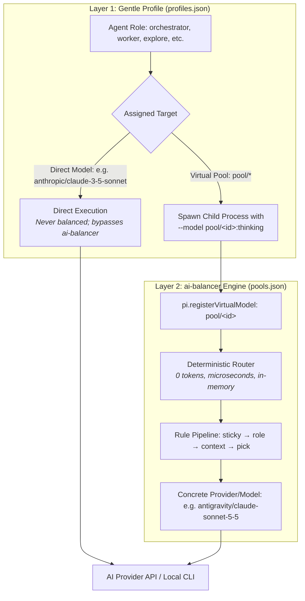
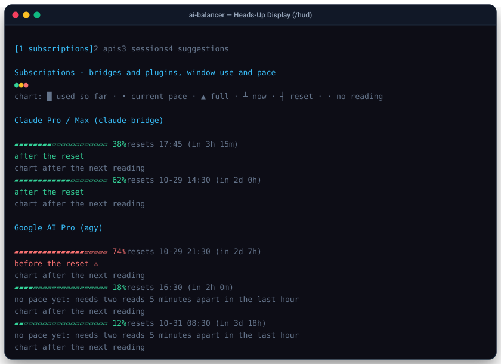
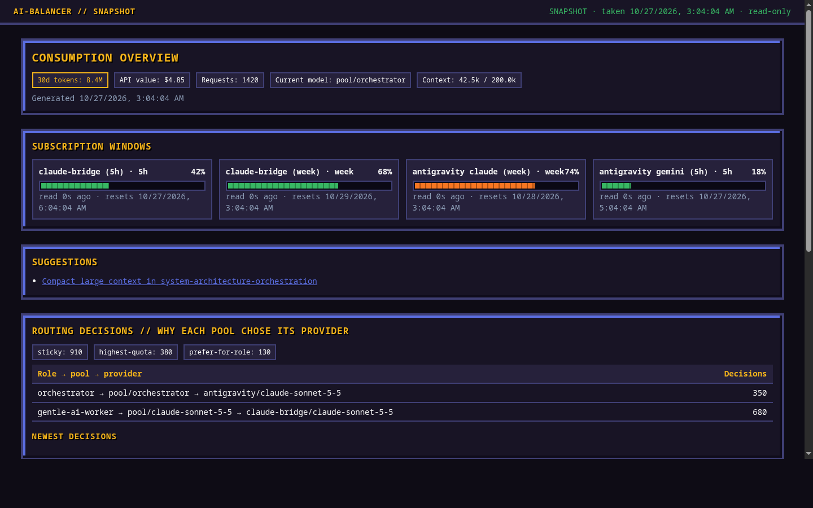

<p align="center">
  
</p>

<h1 align="center">ai-balancer</h1>

<p align="center">
  <strong>Deterministic, zero-overhead virtual model router and quota balancer for Gentle Shell and Pi coding agents.</strong>
</p>

<p align="center">
  <a href="https://github.com/3lAngel0/balanceria"></a>
  <a href="https://github.com/3lAngel0/balanceria"></a>
  <a href="https://github.com/3lAngel0/balanceria"></a>
  <a href="LICENSE"></a>
  
  
</p>

<p align="center">
  <a href="#key-features">Features</a> •
  <a href="#how-it-works-two-independent-layers">Architecture</a> •
  <a href="#supported-providers">Providers</a> •
  <a href="#quick-start">Quick Start</a> •
  <a href="#interactive-tui--web-dashboard">Control Center</a> •
  <a href="README.es.md"><b>🇪🇸 Versión en Español</b></a>
</p>

<p align="center">
  <a href="https://github.com/Gentleman-Programming/gentle-shell">
    
  </a>
</p>

---

`ai-balancer` sits between your agent roles and AI providers. Instead of binding subagents directly to individual models or single API keys, you point them at **virtual pools** (e.g., `pool/orchestrator`, `pool/claude-sonnet-5-5`). Before every request, a deterministic router picks the optimal provider candidate based on real-time quota state, active agent role, session context size, and customizable rule pipelines—**spending zero LLM tokens and adding no latency**.

---

## ⚡ The Problem

Modern agentic coding harnesses rely on multiple specialized subagents (explorers, task workers, code reviewers, judges). Running these workloads against single subscriptions quickly creates operational bottlenecks:

| Challenge | Impact Without ai-balancer | Solution with ai-balancer |
|---|---|---|
| **Quota Exhaustion** | 5-hour rolling windows and weekly limits deplete mid-turn, throwing hard `429` or `ResourceExhausted` errors and abandoning tasks mid-session. | Real-time quota tracking automatically rewrites quota errors into retryable signals, seamlessly failing over to alternative providers. |
| **Cost Blindness** | Continuations hop between providers haphazardly, discarding prompt cache prefixes and racking up massive cold-cache token charges or expensive retries. | Sticky continuations preserve prompt caches; retries after expensive model failures automatically stay cheaper. |
| **Monolithic Model Assignment** | Simple file searches and deep architectural reviews use the same expensive model tier because switching is manual and tedious. | A two-layer architecture routes cheap tasks (explorers) to fast models and complex tasks (workers, auditors) to deep reasoning pools. |

---

## 🏗️ How It Works: Two Independent Layers

<p align="center">
  
</p>

Model assignment in `ai-balancer` is cleanly decoupled into two layers:



1. **Layer 1 (Gentle Profile)**: `~/.gentle-shell/config/gentle-ai/profiles.json` maps each agent role to either a direct model or a virtual pool (`pool/<id>`). Child processes receive their assignment via `--model <target>:thinking`.
2. **Layer 2 (Virtual Pools)**: `pools.json` defines candidate models and routing rules. **Only roles pointing at a `pool/<id>` are balanced.** Roles pointing at a direct physical model bypass the balancer completely.

---

## ✨ Key Features

- 🎯 **Deterministic Routing**: Zero LLM overhead. Decisions execute in pure TypeScript using in-memory cached quota state and token counts (< 1ms).
- 🧠 **Cache-Preserving Stickiness**: Continuation turns pin to the provider that handled the previous turn, keeping prompt caches and thinking signatures warm.
- 🔄 **Transparent Failover**: Intercepts provider quota exhaustion and stalls, rewriting them into retryable `429` signals that trigger Pi's native retry against the next available candidate.
- 🛡️ **Failover Cost Containment**: When an expensive candidate (`input + output` > $15/M, such as Opus) fails, retries strictly filter for cheaper candidates first.
- ⚡ **Circuit Breaker**: When all candidates in a pool are exhausted, the circuit breaker halts retries immediately, saves an emergency checkpoint to `data/circuit-breaker-checkpoint.json`, and alerts the user.
- 📊 **Interactive TUI & Web Control Center** (boxed tables with a plain-language Help box, `?` toggles it): Live status bar, side panel overlay (`Ctrl+Alt+B`), comprehensive 5-tab usage console (`Ctrl+Alt+U`), Heads-Up Display (`/hud`), and an authenticated local/LAN web dashboard (`/balancer serve`).
- 🔒 **100% Offline & Private**: All data is stored strictly on your local disk in `data/`. No external telemetry, no remote tracker, and no stored API keys. See [Security and Privacy](docs/SECURITY-AND-PRIVACY.md).

---

## 🖥️ Interactive TUI & Web Dashboard

### Terminal Heads-Up Display (`/hud`)
<p align="center">
  
</p>

### Live Web Control Center (`/balancer serve`)
<p align="center">
  
</p>

Monitor live token throughput, model health, quota windows, and real-time routing decisions right inside your terminal or in the browser:

```bash
# Toggle the interactive HUD in terminal
/hud

# Open the 5-tab usage console
/balancer usage

# Launch the secure local/LAN web console
/balancer serve
```

---

## 🔌 Supported Providers

| Provider | ID | Kind | Detection / Integration |
|---|---|---|---|
| **Google AI Pro (Antigravity)** | `antigravity` | Subscription | CLI binary `agy`, `~/.local/bin/agy`, or `@estebanforge/pi-antigravity-bridge` |
| **Claude Pro / Max** | `claude-bridge` | Subscription | Package `pi-claude-bridge`, `CLAUDE_BRIDGE_PORT`, or extension folder |
| **Claude Code CLI** | `claude-code` | Subscription | CLI binary `claude` or package `claude-code` |
| **OpenCode Engine** | `opencode` | Subscription | CLI binary `opencode` or package `opencode` |
| **Ollama (Local LLMs)** | `ollama` | Local | CLI binary `ollama` in `PATH` |
| **Anthropic API** | `anthropic` | Paid API | Environment variable `ANTHROPIC_API_KEY` |
| **Google Gemini API** | `google` | Paid API | Environment variable `GEMINI_API_KEY` |
| **Custom Pi Providers** | *(any)* | Any | Any model declared in Pi's model registry placed in `pools.json` |

---

## 🚀 Quick Start

### 1. Installation

Install `ai-balancer` into Gentle Shell:

```bash
gentle-shell install https://github.com/3lAngel0/balanceria
```

Or install it as a standard Pi extension:

```bash
pi install git:github.com/3lAngel0/balanceria
```

### 2. Interactive Setup Wizard

Launch the configuration hub to auto-detect installed providers, configure pools, and assign agent roles:

```bash
/balancer setup
```

`/balancer setup` opens a four-step overlay: **Providers → Strategy → Roles → Confirm**. Each step explains what it decides, the last step shows a diff of exactly what will be written, and nothing changes until you press **Save** (**Discard** or `Esc` leaves every file as it is). Keys: `←/→` steps, `↑/↓` rows, `Space`/`Enter` toggle or cycle, `u`/`d` reorder candidates, `s` save. Mouse clicks and the wheel work in fullscreen terminals only; elsewhere the keys do the same. Without a UI it falls back to the classic wizard, which you can also run with `/balancer setup classic`.

The classic wizard detects local providers, guides strategy selection (`hybrid` or `waterfall`), lets you customize candidate priorities, and provides an AI Setup Advisor (cost-safe; never recommends Opus) to optimize role assignments. Changes are written safely with automatic `.bak` backups.

### 3. Assign Agent Roles to Pools

Select a pool model directly in chat via `/model pool/claude-sonnet-5-5` or configure your roles in `~/.gentle-shell/config/gentle-ai/profiles.json`:

```json
{
  "kind": "gentle-pi.agent_model_profiles",
  "version": 1,
  "profiles": {
    "balanced": {
      "orchestrator": { "model": "pool/orchestrator", "thinking": "medium" },
      "gentle-ai-worker": { "model": "pool/claude-sonnet-5-5", "thinking": "medium" },
      "gentle-ai-explore": { "model": "pool/orchestrator", "thinking": "low" },
      "gentle-ai-verify": { "model": "pool/claude-sonnet-5-5", "thinking": "high" }
    }
  }
}
```

---

## ⌨️ Commands & Shortcuts

| Command / Shortcut | Description |
|---|---|
| `/balancer` | Opens the Control Center overlay (click or use the keys). `/balancer roles\|pools\|advisor` jumps to a tab; `/balancer menu` (or `/` inside the overlay) lists every action. |
| `/balancer panel` or `Ctrl+Alt+B` | Toggle live sidebar overlay and 4-tab Control Center. |
| `/balancer usage` or `Ctrl+Alt+U` | Open full 5-tab Usage Console (Now, Quotas, Days, Sessions, HUD). |
| `/balancer setup` | Open the step-by-step setup overlay (Providers → Strategy → Roles → Confirm). `/balancer setup classic` runs the previous prompt-based wizard. |
| `/balancer lang [es\|en\|auto]` | Inspect or switch active UI language without restarting. |
| `/balancer help` | Short glossary: pool, candidate, loan, grant, circuit breaker, role, window pace, context re-sent. |
| `/balancer serve [lan] [port]` | Start real-time authenticated web dashboard (supports LAN mode & TLS). |
| `/balancer lab` | Sandbox mode: create, diff, simulate, and safely apply pool rule changes. |
| `/balancer switch-cost` | Report prompt cache retention benefits vs. provider switching costs. |
| `/hud` | Open the high-density terminal Heads-Up Display. |

---

## 📖 Documentation

- **[Complete Step-by-Step Guide](docs/guide.md)**: Exhaustive manual covering two-layer configuration, deterministic rule pipelines, failover mechanics, adding providers, worked multi-role examples, and troubleshooting.
- **[Guía completa en Español](docs/guide.es.md)**: Versión en español de la guía exhaustiva y arquitectura.
- **[Security and Privacy](docs/SECURITY-AND-PRIVACY.md)**: Local filesystem footprint, privacy boundaries, and pre-publication verification checklist.
- **[Reading the HUD & Usage Console](docs/reading-the-hud.md)**: Deep dive into token caching telemetry, metrics, and heuristic suggestions.
- **[Contributing Guidelines](CONTRIBUTING.md)**: Test suite execution, PR conventions, and code standards.

---

## 🧪 Development

Run the automated test suite with the built-in Node.js runner:

```bash
npm test
```

Tests execute under `AI_BALANCER_LANG=en` to guarantee deterministic evaluation across environments.

---

## 📄 License

Apache-2.0. See [LICENSE](LICENSE) and [NOTICE](NOTICE).
