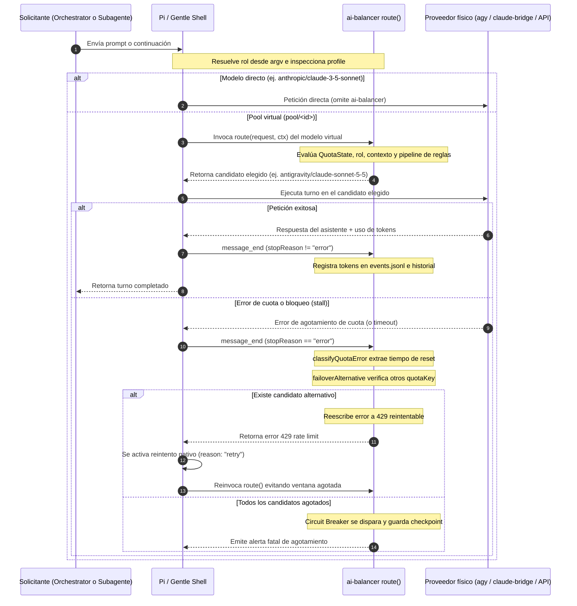
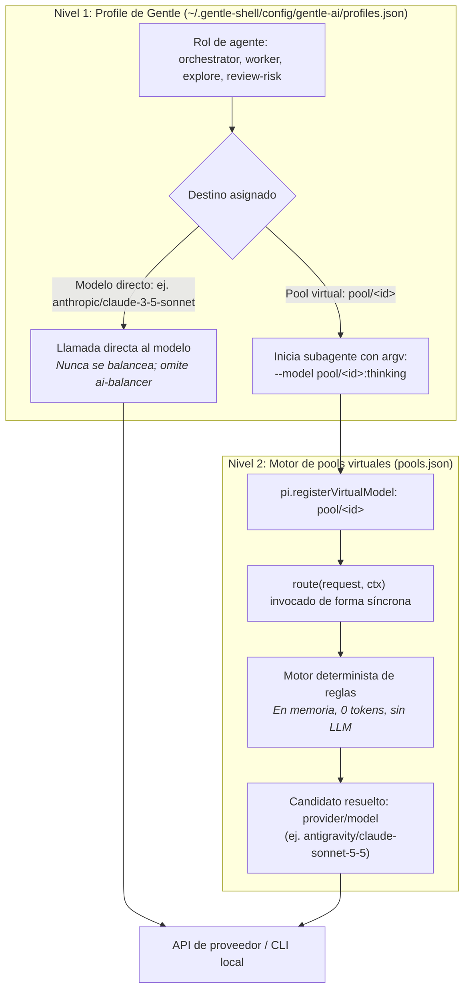
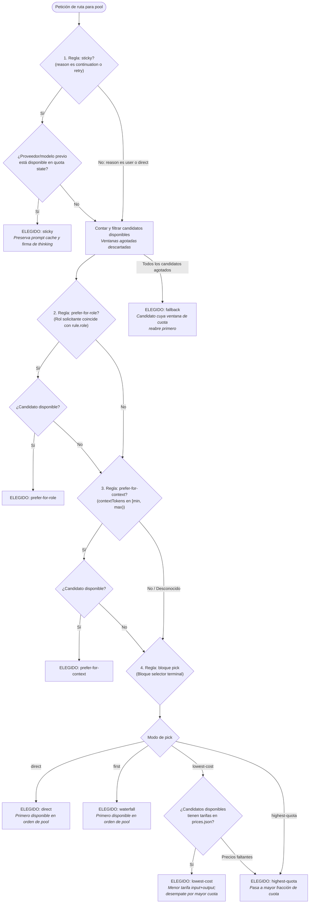
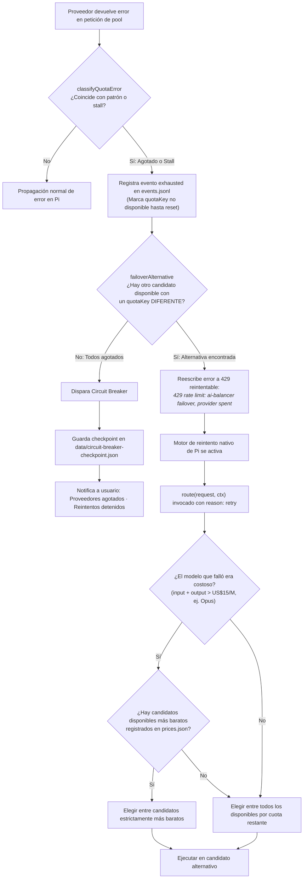

# Guía completa de ai-balancer

[English version](guide.md)

`ai-balancer` es una extensión para Gentle Shell / Pi que proporciona enrutamiento determinista de modelos virtuales, balanceo de carga consciente de cuotas, preservación de prompt cache, conmutación automática ante fallos (failover) y telemetría operativa para flujos de trabajo con agentes de desarrollo.

**No** está limitada a un único bridge: `ai-balancer` detecta, unifica y balancea cualquier proveedor disponible en Gentle Shell, incluyendo:
- **Google AI Pro (Antigravity / `agy`)**: Claude Opus 5.5, Claude Sonnet 5.5, Gemini 4 Argon, Gemini 3.8 Flash.
- **Claude Pro / Max (`claude-bridge`)**: Claude Opus 5.5, Claude Sonnet 5.5, Claude 3.7 Sonnet.
- **Claude Code CLI (`claude-code`)**: Claude 3.7 Sonnet.
- **OpenCode Engine (`opencode`)**: opencode-code-v1.
- **LLMs locales vía Ollama (`ollama`)**: Qwen 2.5 Coder, Llama 3.2, DeepSeek Coder.
- **APIs directas pagas**: Anthropic (`ANTHROPIC_API_KEY`) y Google Gemini (`GEMINI_API_KEY`).
- **Cualquier proveedor de Pi**: Cualquier modelo accesible a través del Model Registry de Pi declarado en `pools.json`.

---

## Tabla de contenidos

1. [Visión general de la arquitectura y ciclo de vida de la petición](#1-visión-general-de-la-arquitectura-y-ciclo-de-vida-de-la-petición)
2. [Asignación de modelos en dos niveles (Profiles de Gentle vs. Pools virtuales)](#2-asignación-de-modelos-en-dos-niveles-profiles-de-gentle-vs-pools-virtuales)
3. [Enrutamiento determinista de peticiones](#3-enrutamiento-determinista-de-peticiones)
4. [Especificación del pipeline de reglas](#4-especificación-del-pipeline-de-reglas)
5. [Intercepción de cuotas, Failover y Circuit Breaker](#5-intercepción-de-cuotas-failover-y-circuit-breaker)
6. [Estrategias de contención de costos](#6-estrategias-de-contención-de-costos)
7. [Incorporación de un nuevo proveedor paso a paso](#7-incorporación-de-un-nuevo-proveedor-paso-a-paso)
8. [Ejemplo práctico: Configuración de un equipo multi-rol](#8-ejemplo-práctico-configuración-de-un-equipo-multi-rol)
9. [Lectura de trazas de enrutamiento para ajustar umbrales de contexto](#9-lectura-de-trazas-de-enrutamiento-para-ajustar-umbrales-de-contexto)
10. [Instalación y asistente interactivo de configuración](#10-instalación-y-asistente-interactivo-de-configuración)
11. [Control Center y paneles TUI](#11-control-center-y-paneles-tui)
12. [Referencia completa de comandos](#12-referencia-completa-de-comandos)
13. [Atajos de teclado y combinaciones](#13-atajos-de-teclado-y-combinaciones)
14. [Solución de problemas y preguntas frecuentes](#14-solución-de-problemas-y-preguntas-frecuentes)

---

## 1. Visión general de la arquitectura y ciclo de vida de la petición

`ai-balancer` opera estrictamente dentro del proceso de Pi. Evalúa las reglas de enrutamiento de forma síncrona antes de cada turno de LLM, interceptando las respuestas para detectar el agotamiento de cuotas.



### Progresión del turno
1. **Recepción del turno**: La petición inicia desde el prompt del usuario o desde un subagente hijo autónomo.
2. **Detección de rol**: `src/roles.ts` lee `process.argv` para determinar el rol del agente (ej. `gentle-ai-explore`, `gentle-ai-worker` u `orchestrator`).
3. **Búsqueda en profile**: Gentle Shell consulta el modelo asignado al rol en el profile activo (`profiles.json`).
4. **Hook de ruta de pool**: Si el objetivo es un pool virtual (`pool/<id>`), `pi.registerVirtualModel` ejecuta el hook `route()`.
5. **Resolución del candidato**: El pipeline de reglas evalúa disponibilidad, afinidad (sticky), preferencias de rol, tamaño de contexto y tarifas de costo, retornando un `provider/model` concreto.
6. **Ejecución y telemetría**: El turno se ejecuta en el proveedor seleccionado. Al concluir (`message_end`), el consumo de tokens (`input`, `output`, `cacheRead`, `cacheWrite`) se añade a los archivos de historial local.
7. **Failover transparente**: Si el proveedor falla por cuota o stall, `ai-balancer` reescribe el error a código `429` reintentable, activando un reintento inmediato en un candidato alternativo saludable.

---

## 2. Asignación de modelos en dos niveles (Profiles de Gentle vs. Pools virtuales)

La configuración de modelos se estructura en dos niveles totalmente independientes:



| Nivel | Responsabilidad | Archivo de configuración | Concepto clave |
|---|---|---|---|
| **Nivel 1: Rol → Modelo** | Gentle Shell | `~/.gentle-shell/config/gentle-ai/profiles.json` | Asigna a cada rol de agente una cadena de modelo (`direct` o `pool/<id>`) y un nivel de thinking (`low`, `medium`, `high`). Se pasa a los procesos hijos mediante `--model target:thinking`. |
| **Nivel 2: Pool → Candidato** | `ai-balancer` | `pools.json` | Define los candidatos que respaldan cada `pool/<id>` y el pipeline de reglas para elegir entre ellos. |

> [!IMPORTANT]
> **Únicamente los roles asignados a un pool virtual (`pool/<id>`) son balanceados.**
> Si un rol está configurado con un modelo directo (ej. `anthropic/claude-3-5-sonnet` o `antigravity/gemini-3-8-flash`), Gentle Shell invoca directamente a ese proveedor. `ai-balancer` queda fuera del flujo y no habrá failover automático ante agotamiento de cuota.

---

## 3. Enrutamiento determinista de peticiones

El enrutador (`src/router.ts`) es estrictamente determinista. Nunca ejecuta un LLM, no realiza llamadas de red y corre en microsegundos antes de cada petición.

### Razones de petición (reasons)
Pi suministra el parámetro `reason` en cada invocación de ruta de modelo virtual:

- **`user`**: Turno inicial de una sesión interactiva o de un subagente. Evalúa preferencias de rol, tamaños de contexto y estrategias de selección (`highest-quota`, `lowest-cost` o `waterfall`).
- **`continuation`**: Turno consecutivo dentro de una sesión en curso. La regla `sticky` lo atiende para proteger los cachés de prompt.
- **`retry`**: Reintento tras un fallo previo. Es gestionado por la regla `sticky` (si el fallo fue transitorio) o por la lógica de failover (si la cuota se agotó). Si un modelo costoso falla, los reintentos filtran candidatos más económicos.
- **`direct`**: Petición directa al pool fuera del flujo conversacional estándar. Omite heurísticas y selecciona el primer candidato disponible en el orden del pool.

### Detección de roles en tiempo real (`src/roles.ts`)
Los subagentes se ejecutan en procesos hijos aislados de Pi. Mientras que Gentle Shell escribe los metadatos de tareas en disco tras finalizar la tarea, las decisiones de enrutamiento deben ocurrir *antes* de iniciar el primer turno.

`ai-balancer` resuelve los roles en tiempo real:
- **Orchestrator principal**: Si el proceso no es hijo, resuelve a `orchestrator` (`source: "none"`).
- **Subagente secundario**: Inspecciona `process.argv` buscando el flag `--append-system-prompt`. Gentle Shell apunta este flag a una ruta con la estructura:
  ```
  .../gentle-pi-subagent-<rol>-<hash>/instructions.md
  ```
  La expresión regular extrae el nombre del rol (ej. `gentle-ai-worker`, `gentle-ai-explore`, `review-risk`) con `source: "argv"`.
- **Reconciliación histórica**: Al consultar el historial, `readAgentTasks` cruza los IDs de sesión con los archivos de tareas en `~/.gentle-shell/agent/gentle-agents/tasks/*.json` para identificar roles antiguos desconocidos.

### Estado de cuota en caché (`src/state.ts`)
El motor de enrutamiento verifica la disponibilidad frente a `QuotaState`:
- `isAvailable(quotaKey, now)`: Devuelve `false` si la ventana de cuota fue marcada como agotada y el tiempo de reapertura (`availableAt`) no ha transcurrido.
- `remainingFraction(quotaKey)`: Retorna la fracción de capacidad disponible conocida (`0.0` a `1.0`).
- `availableAt(quotaKey, now)`: Retorna la marca de tiempo epoch en milisegundos cuando la ventana agotada volverá a abrirse.

---

## 4. Especificación del pipeline de reglas

Los pools pueden definir un arreglo explícito de `rules` en `pools.json`. Cuando se declara, las reglas se evalúan de forma secuencial en orden estricto hasta que una de ellas elija un candidato.



### Catálogo de bloques de reglas

| Bloque de regla | Parámetros | Comportamiento |
|---|---|---|
| `sticky` | *(ninguno)* | Coincide con el proveedor y modelo del turno previo exitoso en `continuation` o `retry`. Si el candidato está disponible, lo elige de inmediato para preservar aciertos de prompt cache. Puede aparecer como máximo una vez. |
| `prefer-for-role` | `role`, `candidate` | Si el rol del solicitante coincide con `role` y `candidate` está disponible, lo elige de inmediato. El `candidate` debe pertenecer al pool. |
| `prefer-for-context` | `candidate`, `minTokens`?, `maxTokens`? | Evalúa el tamaño del contexto de la sesión: `tokens >= minTokens` (inclusivo) y `tokens < maxTokens` (exclusivo). Requiere al menos un límite. Se omite si el contexto es desconocido o está fuera de rango. |
| `pick` | `mode` (`"first"` \| `"highest-quota"` \| `"lowest-cost"`) | Bloque selector terminal. **Debe aparecer exactamente una vez al final del arreglo de reglas.** |

### Modos del bloque selector terminal (pick)
- **`first` (Waterfall)**: Elige el primer candidato disponible en el orden declarado en el pool.
- **`highest-quota` (Híbrido por defecto)**: Compara la fracción de cuota restante (`0.0` a `1.0`) de todos los candidatos disponibles. Gana el candidato con mayor cuota disponible. Los empates se resuelven por el orden de candidatos en el pool.
- **`lowest-cost`**: Calcula la tarifa de tokens (`input + output` USD por millón de tokens) desde `prices.json`. Selecciona el candidato con el costo más bajo. Los empates se resuelven por mayor cuota restante. **Si algún candidato disponible carece de precio en `prices.json`, este modo actúa automáticamente como `highest-quota`.**

### Garantías fijas del sistema
Existen dos garantías fijas que no pueden ser eliminadas ni reordenadas:
1. **Filtro de disponibilidad**: Cualquier candidato cuya ventana de cuota esté agotada (`!isAvailable`) es descartado antes de evaluar reglas de rol, contexto o selección.
2. **Fallback por reapertura más temprana**: Si todos los candidatos del pool están agotados, el enrutador elige el candidato cuya ventana de cuota reabra primero (`availableAt`). Esto garantiza que el mensaje de error provenga del proveedor que estará disponible antes.

---

## 5. Intercepción de cuotas, Failover y Circuit Breaker



### Clasificación de errores de cuota (`src/quota-errors.ts`)
Los entornos de desarrollo habituales tratan el agotamiento de cuota como un error fatal no reintentable. `ai-balancer` intercepta los mensajes de respuesta antes de su finalización.

Patrones reconocidos:
- **Google AI Pro (Antigravity)**: `"Individual quota reached. Please upgrade... Resets in 154h55m28s"` o `"hit your weekly limit"`.
- **Claude Bridge**: `"Claude quota exceeded — rate limit... resets..."`.
- **Claude Code CLI**: `"You're out of extra usage · resets 6:30pm"`.
- **Límites de ritmo genéricos**: `"resource_exhausted"`, `"usage limit reached"`.
- **Bloqueos de proceso y tiempos de espera (stalls)**: Procesos de CLI o bridges que se cuelgan sin emitir salida activan una clasificación de stall con un enfriamiento de 3 minutos (`DEFAULT_STALL_COOLDOWN_MS = 180_000`).

### La reescritura a 429
Al reconocerse una falla de cuota, `ai-balancer` reescribe el mensaje de error como:
```
429 rate limit: ai-balancer failover, <provider> subscription window is spent
```
Esta cadena específica asegura que el clasificador de reintentos de Pi reconozca el error como un límite de ritmo reintentable, evitando términos no reintentables (`"quota exceeded"`, `"billing"`, `"insufficient_quota"`).

### Failover por Quota Key
`failoverAlternative` comprueba los candidatos mediante su **`quotaKey`**, no solo por su nombre de proveedor. Esto es fundamental debido a que un mismo proveedor puede gestionar ventanas de cuota independientes (por ejemplo, en Antigravity la ventana `gemini-weekly` se mantiene al 100% incluso cuando la ventana Claude `3p-weekly` está al 0%).

### Reintentos tras modelos costosos (`EXPENSIVE_RATE = 15`)
Si el candidato que falló era costoso (`input + output > US$15/M`, como Claude Opus con $4 de entrada + $20 de salida = US$24/M), los reintentos filtran con `cheaperThanFailed`. El enrutador restringe las opciones estrictamente a modelos disponibles más económicos (ej. Sonnet o Argon). Si no hay modelos más baratos o faltan tarifas, decide la cuota restante.

### Disyuntor (Circuit Breaker) (`src/circuit-breaker.ts`)
Si todos los candidatos de un pool se agotan en simultáneo, los reintentos automáticos ciclarían indefinidamente. El Circuit Breaker actúa:
1. Detecta que `failoverAlternative` devolvió `undefined`.
2. Se activa pasando a estado disparado (`tripped = true`).
3. Guarda un punto de control persistente en `data/circuit-breaker-checkpoint.json` con el ID de sesión, proyecto, marca temporal y tiempo límite de reapertura.
4. Detiene el ciclo de reintentos y emite una alerta en la interfaz.

---

## 6. Estrategias de contención de costos

1. **Excluir modelos costosos de pools generales**:
   - Reserve modelos de alto costo (ej. Claude Opus) únicamente para pools de auditoría especializada o roles críticos (ej. `review-risk`).
2. **Exclusión de Opus en el Asesor de Configuración**:
   - El asesor interactivo de configuración (`src/setup-advisor.ts`) implementa un filtro estricto por expresión regular (`OPUS = /opus/i`).
   - Los objetivos Opus se eliminan antes de enviar el prompt al modelo asesor y se rechazan si aparecen en las respuestas. La contención de costos se garantiza por código, nunca por decisión del LLM.
3. **Segmentación por contexto**:
   - Configure reglas `prefer-for-context` en `pools.json` para que sesiones con contextos amplios se desvíen hacia modelos económicos de ventana grande (como Gemini Argon o Flash), previniendo cargos elevados en modelos premium.

---

## 7. Incorporación de un nuevo proveedor paso a paso

Para integrar un nuevo proveedor (por ejemplo, una pasarela local o un nuevo endpoint):

### Paso 1: Registrar o detectar el proveedor
Asegúrese de que el proveedor esté visible en el catálogo de modelos de Pi mediante su paquete o binario en `PATH`.

### Paso 2: Definir adaptador de Quota Key (`src/providers/registry.ts`)
En `src/providers/registry.ts`, declare el mapeo de clave de cuota:
```typescript
registerProviderAdapter("mi-proveedor", {
  quotaKey(model: string): string {
    return `mi-proveedor/${model}`;
  }
});
```

### Paso 3: Registrar tarifas en `prices.json`
Añada los precios en USD por millón de tokens en la sección `models` de `prices.json`:
```json
{
  "models": {
    "mi-modelo": {
      "input": 1.5,
      "output": 6.0,
      "cacheRead": 0.15,
      "cacheWrite": 1.5
    }
  }
}
```

### Paso 4: Agregar el candidato a `pools.json`
Incluya `"mi-proveedor/mi-modelo"` en la lista de candidatos del pool:
```json
{
  "id": "orchestrator",
  "name": "Pool de Orchestrator",
  "strategy": "hybrid",
  "candidates": [
    "antigravity/gemini-4-argon",
    "mi-proveedor/mi-modelo",
    "claude-bridge/claude-sonnet-5-5"
  ]
}
```

### Paso 5: Asignar roles en `profiles.json`
Apunte los roles correspondientes a `pool/orchestrator` en `~/.gentle-shell/config/gentle-ai/profiles.json`.

---

## 8. Ejemplo práctico: Configuración de un equipo multi-rol

Ejemplo completo y verificado para segmentar un equipo de agentes:
- **Explorador** (`gentle-ai-explore`): Exploración de código rápida y económica usando Gemini Flash.
- **Worker** (`gentle-ai-worker`): Pool balanceado intermedio usando Sonnet y Argon.
- **Revisores y jueces** (`review-risk`, `jd-judge-a`, `gentle-ai-verify`): Modelos de alto razonamiento con mayor nivel de thinking.

### `pools.json`
```json
{
  "pools": [
    {
      "id": "orchestrator-pool",
      "name": "Pool de Orchestrator y Exploración",
      "candidates": [
        "antigravity/gemini-3-8-flash",
        "antigravity/gemini-4-argon",
        "claude-bridge/claude-sonnet-5-5"
      ],
      "strategy": "hybrid",
      "rules": [
        { "rule": "sticky" },
        { "rule": "prefer-for-role", "role": "gentle-ai-explore", "candidate": "antigravity/gemini-3-8-flash" },
        { "rule": "prefer-for-context", "candidate": "antigravity/gemini-4-argon", "minTokens": 50000 },
        { "rule": "pick", "mode": "highest-quota" }
      ]
    },
    {
      "id": "worker-pool",
      "name": "Pool de Implementación Worker",
      "candidates": [
        "antigravity/claude-sonnet-5-5",
        "claude-bridge/claude-sonnet-5-5",
        "antigravity/gemini-4-argon"
      ],
      "strategy": "hybrid",
      "rules": [
        { "rule": "sticky" },
        { "rule": "pick", "mode": "highest-quota" }
      ]
    },
    {
      "id": "audit-pool",
      "name": "Pool de Auditoría y Verificación Profunda",
      "candidates": [
        "antigravity/claude-sonnet-5-5",
        "claude-bridge/claude-sonnet-5-5"
      ],
      "strategy": "waterfall",
      "rules": [
        { "rule": "sticky" },
        { "rule": "pick", "mode": "first" }
      ]
    }
  ]
}
```

### `profiles.json` (`~/.gentle-shell/config/gentle-ai/profiles.json`)
```json
{
  "kind": "gentle-pi.agent_model_profiles",
  "version": 1,
  "profiles": {
    "balanced-team": {
      "orchestrator": {
        "model": "pool/orchestrator-pool",
        "thinking": "medium"
      },
      "gentle-ai-explore": {
        "model": "pool/orchestrator-pool",
        "thinking": "low"
      },
      "gentle-ai-worker": {
        "model": "pool/worker-pool",
        "thinking": "medium"
      },
      "gentle-ai-verify": {
        "model": "pool/audit-pool",
        "thinking": "medium"
      },
      "review-risk": {
        "model": "pool/audit-pool",
        "thinking": "high"
      },
      "jd-judge-a": {
        "model": "pool/audit-pool",
        "thinking": "high"
      }
    }
  }
}
```

---

## 9. Lectura de trazas de enrutamiento para ajustar umbrales de contexto

Cuando `ai-balancer` toma una decisión donde el candidato o la regla varían, registra una traza explicativa en `data/history/YYYY-MM-DD.jsonl`:

```json
{
  "kind": "route",
  "ts": 1729987200000,
  "session": "39aa04bb-dda2-43e2-a54f-78f7205ecf66",
  "project": "mi-proyecto",
  "pool": "orchestrator-pool",
  "reason": "continuation",
  "role": { "role": "gentle-ai-worker", "source": "argv" },
  "contextTokens": 62450,
  "candidate": { "provider": "antigravity", "model": "gemini-4-argon" },
  "trace": {
    "decidedBy": "prefer-for-context",
    "steps": [
      { "rule": "sticky", "result": "skipped", "why": "antigravity/claude-sonnet-5-5 spent until 2026-10-27T04:00:00.000Z" },
      { "rule": "available", "result": "2 of 3", "why": "antigravity/claude-sonnet-5-5 spent until 2026-10-27T04:00:00.000Z" },
      { "rule": "prefer-for-role", "result": "skipped", "why": "role is gentle-ai-worker, not gentle-ai-explore" },
      { "rule": "prefer-for-context", "result": "chosen", "why": "context 62450 tokens is at least 50000, prefers antigravity/gemini-4-argon" }
    ],
    "candidates": [
      { "provider": "antigravity", "quotaKey": "antigravity/claude", "available": false, "remaining": 0 },
      { "provider": "antigravity", "quotaKey": "antigravity/gemini-argon", "available": true, "remaining": 0.85 },
      { "provider": "claude-bridge", "quotaKey": "claude-bridge/claude-sonnet-5-5", "available": true, "remaining": 0.42 }
    ]
  }
}
```

### Ajuste de umbrales
1. **Inspeccionar tamaños históricos**: Revise `data/history/` o ejecute `/balancer usage` (Pestaña 4: Sessions) para identificar tamaños típicos de contexto.
2. **Evaluar penalización de cambio de caché**: Ejecute `/balancer switch-cost` para verificar si cambiar de proveedor en un contexto de 60k tokens cuesta más en retransmisión fría que esperar la reapertura de la ventana.
3. **Ajustar límites**:
   - Si las sesiones cambian prematuramente, incremente el valor `minTokens` en `prefer-for-context`.
   - Si sesiones muy extensas saturan modelos pequeños, configure un `maxTokens` para redirigir contextos masivos a modelos de ventana extendida.

---

## 10. Instalación y asistente interactivo de configuración

### Instalación
```bash
gentle-shell install <path-to-repo>
```

### Asistente interactivo de configuración (`/balancer setup`)
Al ejecutar `/balancer setup` se abre un overlay paso a paso: **Providers → Estrategia → Roles → Confirmar**. Cada paso muestra una descripción breve; el paso Confirmar muestra un diff de lo que Guardar escribirá en `pools.json`, `integrations.json` y `profiles.json`. No se escribe nada hasta **Guardar**; **Descartar** (o `Esc`, que pregunta primero si hay cambios) deja todos los archivos intactos. Teclas: `←/→`/`h`/`l` o `Tab`/`Shift+Tab` cambian de paso, `↑/↓`/`j`/`k` mueven entre filas, `Espacio`/`Enter` alternan o ciclan (provider, candidato, estrategia del pool, modelo del rol), `u`/`d` reordenan un candidato, `t` cicla el thinking de un rol, `s` guarda en el paso Confirmar. El ratón (clic en pasos, filas y botones; la rueda desplaza) solo funciona cuando Pi corre a pantalla completa (`TuiAltScreen`); en otros casos el overlay es solo de teclado. Sin interfaz, o si los overlays no están disponibles, `/balancer setup` recurre al asistente clásico. El asesor de roles con IA solo está en el asistente clásico.

`/balancer setup classic` ejecuta el asistente anterior basado en preguntas:
1. **Detección automática**: Detecta herramientas de línea de comandos instaladas (`agy`, `claude`, `opencode`, `ollama`), paquetes de Pi y variables de entorno.
2. **Selección de estrategia**: Elija `hybrid` (recomendada) o `waterfall`.
3. **Resolución de perfil**:
   - **Perfil activo detectado**: Consulta `"Tenés un perfil activo: '<nombre>'. ¿Querés armar uno personalizado con el balanceador?"`, permitiendo conservar el perfil actual o crear uno nuevo bajo la convención `balanceador_<identificador>`.
   - **Sin perfil activo**: Dispara automáticamente `"profiles.json: No hay un perfil activo. ¿Creamos un perfil para vos?"` para generar `balanceador_<identificador>`.
4. **Reordenamiento de candidatos**: Suba o baje la prioridad de candidatos (`u`/`d`), o actívelos/desactívelos.
5. **Asesor de asignación de roles**: Ejecute el asesor heurístico o con IA ligera (~350 tokens) para optimizar destinos por rol.
6. **Menú del Hub**: Acceso a la creación o derivación de perfiles (`👤 Nuevo perfil (balanceador_<id>)…`) en cualquier momento.
7. **Guardado atómico**: Escribe `pools.json`, `integrations.json` y `profiles.json` con copias de respaldo estampadas (`.bak`).

---

## 11. Control Center y paneles TUI

### Panel lateral y Control Center (`Ctrl+Alt+B` o `/balancer panel`)
- **Pestaña 1 `[Overview]`**: Profile activo, candidatos enrutados, medidores de suscripción y estado de cuotas.
- **Pestaña 2 `[Roles]`**: Matriz interactiva de los 11 roles del catálogo. Presione `m` para cambiar modelo, `t` para ajustar thinking y `a` para aplicar recomendaciones.
- **Pestaña 3 `[Pools]`**: Inspección de candidatos y prioridades en tiempo real. Presione `Space` para activar/desactivar, `u`/`d` para reordenar y `s` para alternar hybrid/waterfall.
- **Pestaña 4 `[Advisor]`**: Visualice y aplique recomendaciones para roles.

### Consola de uso (`Ctrl+Alt+U` o `/balancer usage`)
- **Now**: Tokens de la sesión activa, medidor de contexto, histograma horario de 24h y tarjetas de cuota activa.
- **Quotas**: Histogramas de picos a 30 días, cantidad de llenados de cuota, tiempo de llenado y duraciones de bloqueo.
- **Days**: Desglose de tokens a 30 días y tabla diaria con distribución de proveedores y costo equivalente en API.
- **Sessions**: Historial de sesiones clasificadas por consumo y contexto máximo.
- **HUD**: Vista compacta del Heads-Up Display.

### HUD en terminal (`/hud`)
Superposición operativa en terminal que muestra la velocidad de consumo de suscripciones (`+X%/h`), plazos de reset, gasto en APIs, sesiones de mayor consumo y sugerencias de optimización.

---

## 12. Referencia completa de comandos

| Comando | Argumentos | Descripción |
|---|---|---|
| `/balancer` | *(ninguno)* | Abre el Centro de control; `roles`, `pools`, `advisor` saltan a una pestaña, `menu` lista todas las acciones. El ratón solo funciona en pantalla alterna. |
| `/balancer panel` | *(ninguno)* | Muestra u oculta el panel lateral y el Control Center (`Ctrl+Alt+B`). |
| `/balancer usage` | *(ninguno)* | Abre la consola de uso y cuotas en 5 pestañas (`Ctrl+Alt+U`). |
| `/balancer setup` | *(ninguno)* | Abre el overlay de configuración paso a paso. |
| `/balancer setup classic` | *(ninguno)* | Ejecuta el asistente anterior basado en preguntas (incluye el asesor de roles con IA). |
| `/balancer refresh` | *(ninguno)* | Fuerza una consulta inmediata del uso de Antigravity. |
| `/balancer report` | *(ninguno)* | Genera el reporte estático e independiente en HTML (`report.html`). |
| `/balancer serve` | `[puerto]` | Inicia el dashboard web local (puerto por defecto: 8787). |
| `/balancer serve lan` | `[puerto]` | Inicia el dashboard web en la red de área local privada. |
| `/balancer serve setup` | *(ninguno)* | Ejecuta el asistente de configuración para LAN y TLS. |
| `/balancer serve status` | *(ninguno)* | Muestra la URL activa y el modo del servidor web. |
| `/balancer serve stop` | *(ninguno)* | Detiene el servidor web en ejecución. |
| `/balancer lab` | *(ninguno)* | Consulta el estado del borrador en modo laboratorio. |
| `/balancer lab new` | *(ninguno)* | Crea copias sandbox de la configuración en `data/lab/`. |
| `/balancer lab diff` | *(ninguno)* | Compara las reglas del borrador frente a los archivos reales. |
| `/balancer lab simulate` | *(ninguno)* | Simula el historial de 30 días sobre el borrador sandbox. |
| `/balancer lab apply` | *(ninguno)* | Aplica el borrador atómicamente generando respaldos. |
| `/balancer lab undo` | *(ninguno)* | Revierte la última configuración aplicada desde laboratorio. |
| `/balancer lab discard` | *(ninguno)* | Descarta el borrador sandbox activo. |
| `/balancer switch-cost` | *(ninguno)* | Genera reporte de retención de caché frente a costo de cambio. |
| `/balancer loans` | *(ninguno)* | Abre la consola de préstamos temporales de modelos. |
| `/balancer help` | *(ninguno)* | Muestra un glosario breve de los términos del balanceador. |
| `/balancer permissions` | *(ninguno)* | Lista permisos autónomos activos para préstamos de modelos. |
| `/balancer lang` | `[es\|en\|auto]` | Consulta o modifica el idioma de la interfaz. |
| `/hud` | *(ninguno)* | Abre el Heads-Up Display en terminal. |

---

## 13. Atajos de teclado y combinaciones

| Combinación | Ámbito | Acción |
|---|---|---|
| `Ctrl+Alt+B` | Global | Alternar panel lateral / Control Center. |
| `Ctrl+Alt+U` | Global | Abrir consola de uso. |
| `1` – `5` | Consola de uso | Cambiar pestañas: Now, Quotas, Days, Sessions, HUD. |
| `1` – `4` | Control Center | Cambiar pestañas: Overview, Roles, Pools, Advisor. |
| `Tab` | Superposiciones | Ciclar a la siguiente pestaña. |
| `PgUp` / `PgDn` | Superposiciones | Desplazar vista verticalmente. |
| `q` o `Esc` | Superposiciones | Cerrar superposición o cancelar diálogo. |
| `m` | Pestaña Roles | Ciclar modelo asignado al rol resaltado. |
| `t` | Pestaña Roles | Ciclar nivel de thinking (`low` → `medium` → `high`). |
| `a` | Roles / Asesor | Aplicar recomendaciones del Asesor con IA. |
| `s` | Pestaña Pools | Alternar estrategia del pool (`hybrid` ↔ `waterfall`). |
| `u` / `d` | Candidatos de pool | Subir o bajar prioridad del candidato. |
| `x` | Sesiones HUD | Compactar la sesión seleccionada. |
| `f` | Sesiones HUD | Bifurcar y compactar en una sesión nueva. |

---

## 14. Solución de problemas y preguntas frecuentes

### P: ¿Por qué mi sesión conmutó a otro modelo a mitad de turno?
**R**: El candidato activo superó el límite de cuota o sufrió un bloqueo de proceso (stall). `ai-balancer` clasificó la falla, verificó la disponibilidad en `QuotaState`, reescribió el rechazo a código `429` reintentable y Pi conmutó de inmediato al siguiente candidato saludable del pool sin perder el contexto de la sesión.

### P: ¿Por qué el conteo de tokens alcanza millones si el modelo generó pocos párrafos?
**R**: Los modelos LLM reenvían el contexto completo de la conversación en cada turno. En una sesión de 20 turnos con 80k tokens de contexto, se transmiten más de 1.6 millones de tokens. La mayor parte corresponde a tokens `cacheRead`, que son más económicos pero computan contra los límites de ritmo. Ejecute `/compact` para reducir el tamaño del contexto.

### P: ¿Cómo configuro un rol para que omita el balanceador por completo?
**R**: En `~/.gentle-shell/config/gentle-ai/profiles.json`, asigne al rol un modelo físico directo (ej. `"model": "anthropic/claude-3-5-sonnet"`) en lugar de `"pool/..."`. Los modelos directos omiten `ai-balancer` en su totalidad.

### P: ¿Qué sucede si todos los proveedores de un pool agotan su cuota?
**R**: El Circuit Breaker se dispara de inmediato. Detiene los reintentos automáticos, registra un punto de control de emergencia en `data/circuit-breaker-checkpoint.json` y alerta al usuario indicando el tiempo más cercano de reapertura.
