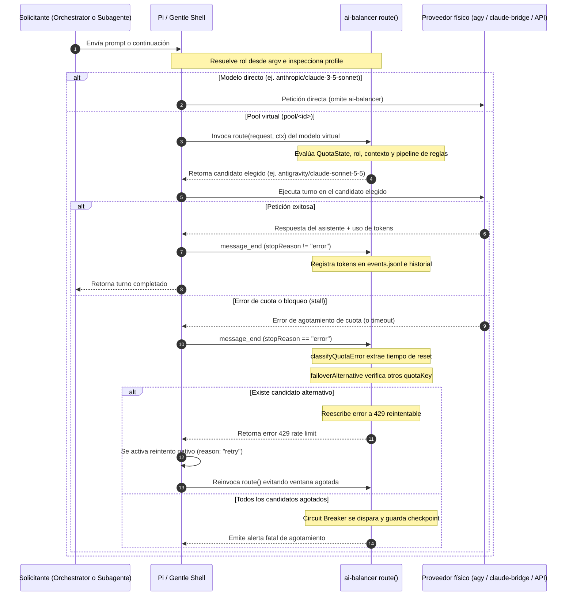
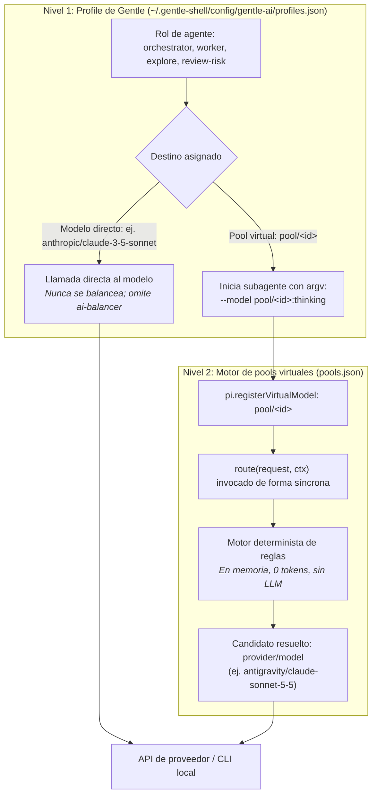
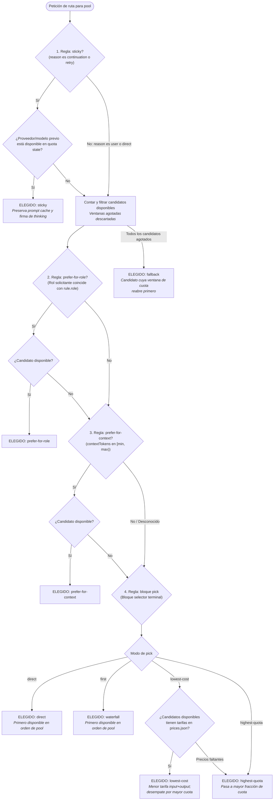
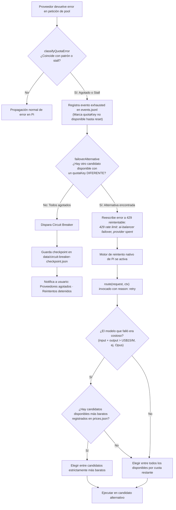

# Guía completa de ai-balancer

[English version](guide.md)

`ai-balancer` es una extensión para Gentle Shell / Pi que proporciona enrutamiento determinista de modelos virtuales, balanceo de carga consciente de cuotas, preservación de prompt cache, conmutación automática ante fallos (failover) y telemetría operativa para flujos de trabajo con agentes de desarrollo.

**No** está limitada a un único bridge: `ai-balancer` detecta, unifica y balancea cualquier proveedor disponible en Gentle Shell, incluyendo:
- **Google AI Pro (Antigravity / `agy`)**: Claude Opus 5.5, Claude Sonnet 5.5, Gemini 4 Argon, Gemini 3.8 Flash.
- **Claude Pro / Max (`claude-bridge`)**: Claude Opus 5.5, Claude Sonnet 5.5, Claude 3.7 Sonnet.
- **Claude Code CLI (`claude-code`)**: Claude 3.7 Sonnet.
- **OpenCode Engine (`opencode`)**: opencode-code-v1.
- **LLMs locales vía Ollama (`ollama`)**: Qwen 2.5 Coder, Llama 3.2, DeepSeek Coder.
- **Suscripciones con `/login` de Pi** (`openai-codex` para ChatGPT Plus/Pro, `anthropic`, `github-copilot`, …): se detectan por su entrada OAuth en `auth.json`.
- **APIs directas pagas**: Anthropic (`ANTHROPIC_API_KEY`) y Google Gemini (`GEMINI_API_KEY`).
- **Cualquier proveedor de Pi**: Cualquier modelo accesible a través del Model Registry de Pi declarado en `pools.json`.

---

## Tabla de contenidos

1. [Visión general de la arquitectura y ciclo de vida de la petición](#1-visión-general-de-la-arquitectura-y-ciclo-de-vida-de-la-petición)
2. [Asignación de modelos en dos niveles (Profiles de Gentle vs. Pools virtuales)](#2-asignación-de-modelos-en-dos-niveles-profiles-de-gentle-vs-pools-virtuales)
3. [Enrutamiento determinista de peticiones](#3-enrutamiento-determinista-de-peticiones)
4. [Especificación del pipeline de reglas](#4-especificación-del-pipeline-de-reglas)
5. [Intercepción de cuotas, Failover y Circuit Breaker](#5-intercepción-de-cuotas-failover-y-circuit-breaker)
6. [Estrategias de contención de costos](#6-estrategias-de-contención-de-costos)
7. [Incorporación de un nuevo proveedor paso a paso](#7-incorporación-de-un-nuevo-proveedor-paso-a-paso)
8. [Ejemplo práctico: Configuración de un equipo multi-rol](#8-ejemplo-práctico-configuración-de-un-equipo-multi-rol)
9. [Lectura de trazas de enrutamiento para ajustar umbrales de contexto](#9-lectura-de-trazas-de-enrutamiento-para-ajustar-umbrales-de-contexto)
10. [Instalación y asistente interactivo de configuración](#10-instalación-y-asistente-interactivo-de-configuración)
11. [Control Center y paneles TUI](#11-control-center-y-paneles-tui)
12. [Referencia completa de comandos](#12-referencia-completa-de-comandos)
13. [Atajos de teclado y combinaciones](#13-atajos-de-teclado-y-combinaciones)
14. [Solución de problemas y preguntas frecuentes](#14-solución-de-problemas-y-preguntas-frecuentes)

---

## 1. Visión general de la arquitectura y ciclo de vida de la petición

`ai-balancer` opera estrictamente dentro del proceso de Pi. Evalúa las reglas de enrutamiento de forma síncrona antes de cada turno de LLM, interceptando las respuestas para detectar el agotamiento de cuotas.



### Progresión del turno
1. **Recepción del turno**: La petición inicia desde el prompt del usuario o desde un subagente hijo autónomo.
2. **Detección de rol**: `src/roles.ts` lee `process.argv` para determinar el rol del agente (ej. `gentle-ai-explore`, `gentle-ai-worker` u `orchestrator`).
3. **Búsqueda en profile**: Gentle Shell consulta el modelo asignado al rol en el profile activo (`profiles.json`).
4. **Hook de ruta de pool**: Si el objetivo es un pool virtual (`pool/<id>`), `pi.registerVirtualModel` ejecuta el hook `route()`.
5. **Resolución del candidato**: El pipeline de reglas evalúa disponibilidad, afinidad (sticky), preferencias de rol, tamaño de contexto y tarifas de costo, retornando un `provider/model` concreto.
6. **Ejecución y telemetría**: El turno se ejecuta en el proveedor seleccionado. Al concluir (`message_end`), el consumo de tokens (`input`, `output`, `cacheRead`, `cacheWrite`) se añade a los archivos de historial local.
7. **Failover transparente**: Si el proveedor falla por cuota o stall, `ai-balancer` reescribe el error a código `429` reintentable, activando un reintento inmediato en un candidato alternativo saludable.

---

## 2. Asignación de modelos en dos niveles (Profiles de Gentle vs. Pools virtuales)

La configuración de modelos se estructura en dos niveles totalmente independientes:



| Nivel | Responsabilidad | Archivo de configuración | Concepto clave |
|---|---|---|---|
| **Nivel 1: Rol → Modelo** | Gentle Shell | `~/.gentle-shell/config/gentle-ai/profiles.json` | Asigna a cada rol de agente una cadena de modelo (`direct` o `pool/<id>`) y un nivel de thinking (`low`, `medium`, `high`). Se pasa a los procesos hijos mediante `--model target:thinking`. |
| **Nivel 2: Pool → Candidato** | `ai-balancer` | `pools.json` | Define los candidatos que respaldan cada `pool/<id>` y el pipeline de reglas para elegir entre ellos. |

> [!IMPORTANT]
> **Únicamente los roles asignados a un pool virtual (`pool/<id>`) son balanceados.**
> Si un rol está configurado con un modelo directo (ej. `anthropic/claude-3-5-sonnet` o `antigravity/gemini-3-8-flash`), Gentle Shell invoca directamente a ese proveedor. `ai-balancer` queda fuera del flujo y no habrá failover automático ante agotamiento de cuota.

### Perfiles vs. Pools vs. Bridges: La diferencia conceptual

Para comprender la arquitectura con total claridad, es fundamental distinguir tres piezas que resuelven responsabilidades distintas en el sistema:

| Concepto | Pregunta que responde | Responsabilidad | Dónde se configura | Ejemplo concreto |
|---|---|---|---|---|
| **Perfil** (*Profiles*) | *¿Quién consume?* | Asocia la función o rol de un agente (`orchestrator`, `worker`, `explore`, `verify`) con un destino. | `~/.gentle-shell/config/gentle-ai/profiles.json` | El rol `gentle-ai-worker` tiene asignado `pool/claude-sonnet-5-5`. |
| **Pool** (*Virtual Pool*) | *¿Qué alternativas y qué resiliencia aplican?* | Define un modelo virtual que agrupa múltiples candidatos físicos y aplica reglas deterministas (failover, stickiness de caché, límites de costo). | `pools.json` | `pool/claude-sonnet-5-5` agrupa `antigravity/claude-sonnet-5-5`, `claude-bridge/claude-sonnet-5-5` y fallback a `flash`. |
| **Bridge / Integración** | *¿Cómo y por dónde se conecta físicamente el cable?* | Proporciona el adaptador o canal de transporte hacia el proveedor o suscripción concreta (CLI local, socket o API). | `integrations.json` / Extensiones de Pi / Variables de entorno | `claude-bridge` expone Claude Pro/Max; `antigravity` conecta con `agy`; `anthropic` conecta con la API directa. |

El flujo completo de una llamada ilustra la interacción:
$$\text{Agente (Perfil)} \longrightarrow \text{Pool Virtual} \xrightarrow[\text{cuotas / stickiness}]{\text{Enrutador}} \text{Candidato físico} \longrightarrow \text{Bridge / Proveedor}$$

- Si en el **Perfil** asignás un modelo directo (ej. `anthropic/claude-3-5-sonnet`), el **Pool** se omite por completo y la petición viaja directo al **Bridge/Proveedor** sin balanceo ni failover.
- Si en el **Perfil** apuntás a un `pool/*`, el enrutador inspecciona las cuotas de los candidatos provistos por cada **Bridge** y despacha la petición al mejor candidato disponible.

---

## 3. Enrutamiento determinista de peticiones

El enrutador (`src/router.ts`) es estrictamente determinista. Nunca ejecuta un LLM, no realiza llamadas de red y corre en microsegundos antes de cada petición.

### Razones de petición (reasons)
Pi suministra el parámetro `reason` en cada invocación de ruta de modelo virtual:

- **`user`**: Turno inicial de una sesión interactiva o de un subagente. Evalúa preferencias de rol, tamaños de contexto y estrategias de selección (`highest-quota`, `lowest-cost` o `waterfall`).
- **`continuation`**: Turno consecutivo dentro de una sesión en curso. La regla `sticky` lo atiende para proteger los cachés de prompt.
- **`retry`**: Reintento tras un fallo previo. Es gestionado por la regla `sticky` (si el fallo fue transitorio) o por la lógica de failover (si la cuota se agotó). Si un modelo costoso falla, los reintentos filtran candidatos más económicos.
- **`direct`**: Petición directa al pool fuera del flujo conversacional estándar. Omite heurísticas y selecciona el primer candidato disponible en el orden del pool.

### Detección de roles en tiempo real (`src/roles.ts`)
Los subagentes se ejecutan en procesos hijos aislados de Pi. Mientras que Gentle Shell escribe los metadatos de tareas en disco tras finalizar la tarea, las decisiones de enrutamiento deben ocurrir *antes* de iniciar el primer turno.

`ai-balancer` resuelve los roles en tiempo real:
- **Orchestrator principal**: Si el proceso no es hijo, resuelve a `orchestrator` (`source: "none"`).
- **Subagente secundario**: Inspecciona `process.argv` buscando el flag `--append-system-prompt`. Gentle Shell apunta este flag a una ruta con la estructura:
  ```
  .../gentle-pi-subagent-<rol>-<hash>/instructions.md
  ```
  La expresión regular extrae el nombre del rol (ej. `gentle-ai-worker`, `gentle-ai-explore`, `review-risk`) con `source: "argv"`.
- **Reconciliación histórica**: Al consultar el historial, `readAgentTasks` cruza los IDs de sesión con los archivos de tareas en `~/.gentle-shell/agent/gentle-agents/tasks/*.json` para identificar roles antiguos desconocidos.

### Estado de cuota en caché (`src/state.ts`)
El motor de enrutamiento verifica la disponibilidad frente a `QuotaState`:
- `isAvailable(quotaKey, now)`: Devuelve `false` si la ventana de cuota fue marcada como agotada y el tiempo de reapertura (`availableAt`) no ha transcurrido.
- `remainingFraction(quotaKey)`: Retorna la fracción de capacidad disponible conocida (`0.0` a `1.0`).
- `availableAt(quotaKey, now)`: Retorna la marca de tiempo epoch en milisegundos cuando la ventana agotada volverá a abrirse.

---

## 4. Especificación del pipeline de reglas

Los pools pueden definir un arreglo explícito de `rules` en `pools.json`. Cuando se declara, las reglas se evalúan de forma secuencial en orden estricto hasta que una de ellas elija un candidato.



### Catálogo de bloques de reglas

| Bloque de regla | Parámetros | Comportamiento |
|---|---|---|
| `sticky` | *(ninguno)* | Coincide con el proveedor y modelo del turno previo exitoso en `continuation` o `retry`. Si el candidato está disponible, lo elige de inmediato para preservar aciertos de prompt cache. Puede aparecer como máximo una vez. |
| `prefer-for-role` | `role`, `candidate` | Si el rol del solicitante coincide con `role` y `candidate` está disponible, lo elige de inmediato. El `candidate` debe pertenecer al pool. |
| `prefer-for-context` | `candidate`, `minTokens`?, `maxTokens`? | Evalúa el tamaño del contexto de la sesión: `tokens >= minTokens` (inclusivo) y `tokens < maxTokens` (exclusivo). Requiere al menos un límite. Se omite si el contexto es desconocido o está fuera de rango. |
| `pick` | `mode` (`"first"` \| `"highest-quota"` \| `"lowest-cost"`) | Bloque selector terminal. **Debe aparecer exactamente una vez al final del arreglo de reglas.** |

### Modos del bloque selector terminal (pick)
- **`first` (Waterfall)**: Elige el primer candidato disponible en el orden declarado en el pool.
- **`highest-quota` (Híbrido por defecto)**: Compara la fracción de cuota restante (`0.0` a `1.0`) de todos los candidatos disponibles. Gana el candidato con mayor cuota disponible. Los empates se resuelven por el orden de candidatos en el pool.
- **`lowest-cost`**: Calcula la tarifa de tokens (`input + output` USD por millón de tokens) desde `prices.json`. Selecciona el candidato con el costo más bajo. Los empates se resuelven por mayor cuota restante. **Si algún candidato disponible carece de precio en `prices.json`, este modo actúa automáticamente como `highest-quota`.**

### Garantías fijas del sistema
Existen dos garantías fijas que no pueden ser eliminadas ni reordenadas:
1. **Filtro de disponibilidad**: Cualquier candidato cuya ventana de cuota esté agotada (`!isAvailable`) es descartado antes de evaluar reglas de rol, contexto o selección.
2. **Fallback por reapertura más temprana**: Si todos los candidatos del pool están agotados, el enrutador elige el candidato cuya ventana de cuota reabra primero (`availableAt`). Esto garantiza que el mensaje de error provenga del proveedor que estará disponible antes.

---

## 5. Intercepción de cuotas, Failover y Circuit Breaker



### Clasificación de errores de cuota (`src/quota-errors.ts`)
Los entornos de desarrollo habituales tratan el agotamiento de cuota como un error fatal no reintentable. `ai-balancer` intercepta los mensajes de respuesta antes de su finalización.

Patrones reconocidos:
- **Google AI Pro (Antigravity)**: `"Individual quota reached. Please upgrade... Resets in 154h55m28s"` o `"hit your weekly limit"`.
- **Claude Bridge**: `"Claude quota exceeded — rate limit... resets..."`.
- **Claude Code CLI**: `"You're out of extra usage · resets 6:30pm"`.
- **Límites de ritmo genéricos**: `"resource_exhausted"`, `"usage limit reached"`.
- **Bloqueos de proceso y tiempos de espera (stalls)**: Procesos de CLI o bridges que se cuelgan sin emitir salida activan una clasificación de stall con un enfriamiento de 6 minutos (`DEFAULT_STALL_COOLDOWN_MS = 360_000`).
- **Qué tan rápido se detecta un stall**: lo decide el bridge de Antigravity, no `ai-balancer`. El bridge falla el turno con `agy stalled for <N>m with no output` después de `inactivityTimeoutMin` minutos sin salida (5 por defecto; se configura en `~/.pi/agent/antigravity-bridge/config.json` o con `AGY_INACTIVITY_TIMEOUT_MIN`, en minutos enteros, mínimo 1). Después, el pool cambia de modelo con el reintento normal de Pi. Los subagentes de Gentle AI se rinden a los 4 minutos aproximadamente si no reciben un primer evento, así que con 2 el pool alcanza a cambiar de modelo antes.

### La reescritura a 429
Al reconocerse una falla de cuota, `ai-balancer` reescribe el mensaje de error como:
```
429 rate limit: ai-balancer failover, <provider> subscription window is spent
```
Esta cadena específica asegura que el clasificador de reintentos de Pi reconozca el error como un límite de ritmo reintentable, evitando términos no reintentables (`"quota exceeded"`, `"billing"`, `"insufficient_quota"`).

### Failover por Quota Key
`failoverAlternative` comprueba los candidatos mediante su **`quotaKey`**, no solo por su nombre de proveedor. Esto es fundamental debido a que un mismo proveedor puede gestionar ventanas de cuota independientes (por ejemplo, en Antigravity la ventana `gemini-weekly` se mantiene al 100% incluso cuando la ventana Claude `3p-weekly` está al 0%).

### Reintentos tras modelos costosos (`EXPENSIVE_RATE = 15`)
Si el candidato que falló era costoso (`input + output > US$15/M`, como Claude Opus con $4 de entrada + $20 de salida = US$24/M), los reintentos filtran con `cheaperThanFailed`. El enrutador restringe las opciones estrictamente a modelos disponibles más económicos (ej. Sonnet o Argon). Si no hay modelos más baratos o faltan tarifas, decide la cuota restante.

### Disyuntor (Circuit Breaker) (`src/circuit-breaker.ts`)
Si todos los candidatos de un pool se agotan en simultáneo, los reintentos automáticos ciclarían indefinidamente. El Circuit Breaker actúa:
1. Detecta que `failoverAlternative` devolvió `undefined`.
2. Se activa pasando a estado disparado (`tripped = true`).
3. Guarda un punto de control persistente en `data/circuit-breaker-checkpoint.json` con el ID de sesión, proyecto, marca temporal y tiempo límite de reapertura.
4. Detiene el ciclo de reintentos y emite una alerta en la interfaz.

---

## 6. Estrategias de contención de costos

1. **Excluir modelos costosos de pools generales**:
   - Reserve modelos de alto costo (ej. Claude Opus) únicamente para pools de auditoría especializada o roles críticos (ej. `review-risk`).
2. **Exclusión de Opus en el Asesor de Configuración**:
   - El asesor interactivo de configuración (`src/setup-advisor.ts`) implementa un filtro estricto por expresión regular (`OPUS = /opus/i`).
   - Los objetivos Opus se eliminan antes de enviar el prompt al modelo asesor y se rechazan si aparecen en las respuestas. La contención de costos se garantiza por código, nunca por decisión del LLM.
3. **Segmentación por contexto**:
   - Configure reglas `prefer-for-context` en `pools.json` para que sesiones con contextos amplios se desvíen hacia modelos económicos de ventana grande (como Gemini Argon o Flash), previniendo cargos elevados en modelos premium.

---

## 7. Incorporación de un nuevo proveedor paso a paso

Para integrar un nuevo proveedor (por ejemplo, una pasarela local o un nuevo endpoint):

### Paso 1: Registrar o detectar el proveedor
Asegúrese de que el proveedor esté visible en el catálogo de modelos de Pi mediante su paquete o binario en `PATH`.

### Paso 2: Definir adaptador de Quota Key (`src/providers/registry.ts`)
En `src/providers/registry.ts`, declare el mapeo de clave de cuota:
```typescript
registerProviderAdapter("mi-proveedor", {
  quotaKey(model: string): string {
    return `mi-proveedor/${model}`;
  }
});
```

### Paso 3: Registrar tarifas en `prices.json`
Añada los precios en USD por millón de tokens en la sección `models` de `prices.json`:
```json
{
  "models": {
    "mi-modelo": {
      "input": 1.5,
      "output": 6.0,
      "cacheRead": 0.15,
      "cacheWrite": 1.5
    }
  }
}
```

### Paso 4: Agregar el candidato a `pools.json`
Incluya `"mi-proveedor/mi-modelo"` en la lista de candidatos del pool:
```json
{
  "id": "orchestrator",
  "name": "Pool de Orchestrator",
  "strategy": "hybrid",
  "candidates": [
    "antigravity/gemini-4-argon",
    "mi-proveedor/mi-modelo",
    "claude-bridge/claude-sonnet-5-5"
  ]
}
```

### Paso 5: Asignar roles en `profiles.json`
Apunte los roles correspondientes a `pool/orchestrator` en `~/.gentle-shell/config/gentle-ai/profiles.json`.

---

## 8. Ejemplo práctico: Configuración de un equipo multi-rol

Ejemplo completo y verificado para segmentar un equipo de agentes:
- **Explorador** (`gentle-ai-explore`): Exploración de código rápida y económica usando Gemini Flash.
- **Worker** (`gentle-ai-worker`): Pool balanceado intermedio usando Sonnet y Argon.
- **Revisores y jueces** (`review-risk`, `jd-judge-a`, `gentle-ai-verify`): Modelos de alto razonamiento con mayor nivel de thinking.

### `pools.json`

`lastResort` (opcional, nivel superior): un `provider/model` que responde primero y automáticamente cuando se agotan todos los candidatos de un pool (sesión principal y subagentes). Se configura en `/installer` → Respaldos → "Modelo final" (tecla `l`); el instalador y las demás herramientas que editan pools lo conservan.

```json
{
  "lastResort": "antigravity/gemini-3-8-flash",
  "pools": [
    {
      "id": "orchestrator-pool",
      "name": "Pool de Orchestrator y Exploración",
      "candidates": [
        "antigravity/gemini-3-8-flash",
        "antigravity/gemini-4-argon",
        "claude-bridge/claude-sonnet-5-5"
      ],
      "strategy": "hybrid",
      "rules": [
        { "rule": "sticky" },
        { "rule": "prefer-for-role", "role": "gentle-ai-explore", "candidate": "antigravity/gemini-3-8-flash" },
        { "rule": "prefer-for-context", "candidate": "antigravity/gemini-4-argon", "minTokens": 50000 },
        { "rule": "pick", "mode": "highest-quota" }
      ]
    },
    {
      "id": "worker-pool",
      "name": "Pool de Implementación Worker",
      "candidates": [
        "antigravity/claude-sonnet-5-5",
        "claude-bridge/claude-sonnet-5-5",
        "antigravity/gemini-4-argon"
      ],
      "strategy": "hybrid",
      "rules": [
        { "rule": "sticky" },
        { "rule": "pick", "mode": "highest-quota" }
      ]
    },
    {
      "id": "audit-pool",
      "name": "Pool de Auditoría y Verificación Profunda",
      "candidates": [
        "antigravity/claude-sonnet-5-5",
        "claude-bridge/claude-sonnet-5-5"
      ],
      "strategy": "waterfall",
      "rules": [
        { "rule": "sticky" },
        { "rule": "pick", "mode": "first" }
      ]
    }
  ]
}
```

### `profiles.json` (`~/.gentle-shell/config/gentle-ai/profiles.json`)
```json
{
  "kind": "gentle-pi.agent_model_profiles",
  "version": 1,
  "profiles": {
    "balanced-team": {
      "orchestrator": {
        "model": "pool/orchestrator-pool",
        "thinking": "medium"
      },
      "gentle-ai-explore": {
        "model": "pool/orchestrator-pool",
        "thinking": "low"
      },
      "gentle-ai-worker": {
        "model": "pool/worker-pool",
        "thinking": "medium"
      },
      "gentle-ai-verify": {
        "model": "pool/audit-pool",
        "thinking": "medium"
      },
      "review-risk": {
        "model": "pool/audit-pool",
        "thinking": "high"
      },
      "jd-judge-a": {
        "model": "pool/audit-pool",
        "thinking": "high"
      }
    }
  }
}
```

---

## 9. Lectura de trazas de enrutamiento para ajustar umbrales de contexto

Cuando `ai-balancer` toma una decisión donde el candidato o la regla varían, registra una traza explicativa en `data/history/YYYY-MM-DD.jsonl`:

```json
{
  "kind": "route",
  "ts": 1729987200000,
  "session": "39aa04bb-dda2-43e2-a54f-78f7205ecf66",
  "project": "mi-proyecto",
  "pool": "orchestrator-pool",
  "reason": "continuation",
  "role": { "role": "gentle-ai-worker", "source": "argv" },
  "contextTokens": 62450,
  "candidate": { "provider": "antigravity", "model": "gemini-4-argon" },
  "trace": {
    "decidedBy": "prefer-for-context",
    "steps": [
      { "rule": "sticky", "result": "skipped", "why": "antigravity/claude-sonnet-5-5 spent until 2026-10-27T04:00:00.000Z" },
      { "rule": "available", "result": "2 of 3", "why": "antigravity/claude-sonnet-5-5 spent until 2026-10-27T04:00:00.000Z" },
      { "rule": "prefer-for-role", "result": "skipped", "why": "role is gentle-ai-worker, not gentle-ai-explore" },
      { "rule": "prefer-for-context", "result": "chosen", "why": "context 62450 tokens is at least 50000, prefers antigravity/gemini-4-argon" }
    ],
    "candidates": [
      { "provider": "antigravity", "quotaKey": "antigravity/claude", "available": false, "remaining": 0 },
      { "provider": "antigravity", "quotaKey": "antigravity/gemini-argon", "available": true, "remaining": 0.85 },
      { "provider": "claude-bridge", "quotaKey": "claude-bridge/claude-sonnet-5-5", "available": true, "remaining": 0.42 }
    ]
  }
}
```

### Ajuste de umbrales
1. **Inspeccionar tamaños históricos**: Revise `data/history/` o ejecute `/balancer usage` (Pestaña 4: Sessions) para identificar tamaños típicos de contexto.
2. **Evaluar penalización de cambio de caché**: Ejecute `/balancer switch-cost` para verificar si cambiar de proveedor en un contexto de 60k tokens cuesta más en retransmisión fría que esperar la reapertura de la ventana.
3. **Ajustar límites**:
   - Si las sesiones cambian prematuramente, incremente el valor `minTokens` en `prefer-for-context`.
   - Si sesiones muy extensas saturan modelos pequeños, configure un `maxTokens` para redirigir contextos masivos a modelos de ventana extendida.

---

## 10. Instalación y asistente interactivo de configuración

### Instalación
```bash
gentle-shell install <path-to-repo>
```

### Asistente interactivo de configuración (`/balancer setup`)

Al ejecutar `/balancer setup` se inicia el centro conversacional de configuración e instalación. El asistente detecta automáticamente los proveedores de IA del sistema, estructura pools virtuales de modelos con estrategias de failover a medida y optimiza la asignación de roles de agentes a través de dos canales unificados:
- **Consola de terminal (TUI)**: Funciona directamente en su terminal con navegación por teclado y soporte de ratón en pantalla completa (`TuiAltScreen`).
- **Instalador web (`/installer`)**: Funciona en cualquier navegador de escritorio o móvil mediante un servidor en loopback local o túnel SSH seguro.

Ambos canales ejecutan exactamente sobre el mismo modelo de estado y motor de planificación, lo que garantiza decisiones, textos, recomendaciones y validaciones idénticas.

#### 1. Diseño conversacional en tres columnas
La interfaz del instalador se organiza en 3 columnas pensadas para eliminar la sobrecarga cognitiva:

```
+-------------------+------------------------------------------+------------------------+
| 1. Bienvenida  ✓  |  [ Carpincho y balanza ]                 | [?] AYUDA DETALLADA    |
| 2. Modo        ●  |  "Elijamos la estrategia de respaldo..." | Qué es:                |
| 3. Suscripción ○  |                                          | Estrategia híbrida.    |
| 4. Respaldos   ○  |  [ Escenario interactivo ]               |                        |
| 5. Tareas      ○  |  ( ) Mixto (hybrid)                      | Para qué sirve:        |
| 6. Resumen     ○  |  ( ) En orden (waterfall)                | Balancea la carga y    |
|                   |  ( ) La que más le queda (highest-quota) | preserva la caché.     |
|                   |                                          |                        |
|                   |  --------------------------------------- | Si elegís esto:        |
|                   |  No se aplica nada hasta que confirmes   | Arranca con la 1.ª y   |
|                   |  [ Atrás ] [ Siguiente ]                 | pasa fluidamente.      |
| Paso 2 de 6       |                                          | Destino: pools.json    |
+-------------------+------------------------------------------+------------------------+
```

- **Barra izquierda (Navegación de pasos)**:
  - Muestra la secuencia ordenada de pasos de instalación con iconos de estado en vivo:
    - `✓` (`done`): Pasos completados.
    - `●` (`current`): Paso activo actual.
    - `○` (`todo`): Pasos pendientes.
  - Incluye un indicador explícito de avance ("Paso N de M"). En terminales angostas, la barra se reduce automáticamente a un encabezado de estado compacto.
- **Columna central (Guía conversacional y Escenario)**:
  - **Guía conversacional**: Presenta a la mascota Carpincho en pixel art con su balanza mecánica animada y un bocadillo de diálogo que explica el paso en lenguaje llano.
  - **Escenario interactivo**: Despliega controles específicos del paso, listas de opciones, controles de reordenamiento de candidatos y diagramas de enrutamiento dinámicos en ASCII y SVG.
  - **Aviso de tranquilidad al cierre**: Muestra de forma destacada en la base del escenario: "*No se aplica nada hasta que confirmes*" (`Nothing is applied until you confirm`).
  - **Botones de navegación**: Botones estándar (`[Atrás]`, `[Siguiente]`, `[Cancelar]`, `[Instalar]`) equipados con un bloqueo de concurrencia anti-doble clic (*single-flight guard*) que congela eventos repetidos mientras se procesa la acción. En la terminal los botones se ven sin resaltar en reposo (`[ Siguiente ▶ ]`); `Tab` mueve el foco entre ellos y solo el que tiene el foco se rellena (marcado con `▸`). `Enter` sin ningún botón con foco aprieta **Siguiente**.
- **Panel derecho (Ayuda detallada fija)**:
  - Un panel de contexto visible en todo momento que se actualiza sincrónicamente con el elemento en foco:
    - **Qué es**: Definición clara y concisa de la opción seleccionada.
    - **Para qué sirve**: Por qué esta decisión es importante para su equipo de agentes.
    - **Si elegís esto**: Impacto operativo, implicancias sobre la caché de prompts y comportamiento ante failover.
    - **Nombre técnico**: Clave formal de configuración (mostrada en tono gris tenue).
    - **Archivo de destino**: Archivo exacto donde se persiste la elección (`pools.json`, `integrations.json`, `profiles.json`).

#### 2. Mascota Carpincho y animaciones de la balanza
El instalador incorpora una mascota Carpincho en pixel art junto a una balanza mecánica animada. El carpincho actúa como un compañero visual intuitivo que refleja el estado de la instalación:

- **Posturas expresivas**:
  - `idle`: Postura de reposo durante los pasos habituales de revisión y toma de decisiones.
  - `working`: Postura activa de trabajo durante el escaneo de proveedores, la evaluación con búsqueda profunda y la escritura final de archivos.
  - `happy`: Postura de celebración en la pantalla final de "Listo" cuando la instalación concluye con éxito.
- **Animaciones procedurales**:
  - Respiración sutil de la mascota y parpadeo ocular periódico.
  - Inclinación mecánica del brazo de la balanza y oscilación de los platillos reflejando el balanceo de carga.
- **Accesibilidad y reducción de movimiento**:
  - Respeta de forma estricta las preferencias de accesibilidad. Si se define `AI_BALANCER_REDUCE_MOTION=1` en el entorno o el navegador reporta `prefers-reduced-motion: reduce` (o la clase `.still`), todas las animaciones se detienen de inmediato. El carpincho y la balanza quedan congelados en cuadros estáticos y nítidos, evitando cualquier fatiga visual.

#### 3. Pantalla de bienvenida y glosario conceptual
La pantalla de bienvenida introduce los conceptos clave de arquitectura en lenguaje simple y sin jerga técnica antes de solicitar configuraciones:

| Nombre cotidiano | Nombre técnico | Archivo de destino | Descripción |
|---|---|---|---|
| **Suscripción** | `provider` | `integrations.json` | Plan de IA que pagás o en el que iniciaste sesión (por ejemplo, Claude Pro/Max o Google AI Pro). Cada suscripción tiene sus propios límites de uso y ventanas de reinicio. |
| **Respaldo** | `pool` | `pools.json` | Lista ordenada y priorizada de suscripciones que ofrecen el mismo modelo. Cuando la primera se agota, tus agentes pasan a la siguiente sin interrumpir la sesión. |
| **Tarea del agente** | `role` | `profiles.json` | Trabajo específico que realizan los subagentes (leer archivos, programar, auditar código, razonamiento arquitectónico). Cada tarea puede apuntar a un modelo rápido y económico o a un pool de razonamiento profundo. |
| **Estrategia de enrutamiento** | `strategy` | `pools.json` | Regla determinista que sigue un respaldo para decidir qué suscripción responde ahora (`hybrid`, `waterfall`, `highest-quota`). |
| **Agente principal** | `orchestratorMode` | `profiles.json` | Modo del coordinador principal: si trabaja de manera autónoma en las tareas (`organic`) o si delega estrictamente todo el trabajo a subagentes especializados (`full-delegation`). |

La pantalla de bienvenida también presenta un panorama de lo que hará el instalador (detectar suscripciones sin gastar cuota, armar respaldos, asignar tareas de forma óptima y preparar cambios de forma segura), junto con una invitación a dejar una estrella en GitHub: [https://github.com/3lAngel0/balanceria](https://github.com/3lAngel0/balanceria).

#### 4. Pipeline de respaldos y configuración de estrategias
Cuando varias suscripciones ofrecen modelos equivalentes, el instalador sugiere respaldos virtuales y permite configurar completamente los integrantes, su orden y el algoritmo de selección:

- **Mixto / Híbrido (`hybrid` - Recomendado)**:
  - Comienza utilizando la primera suscripción y pasa de forma gradual a una con mayor espacio libre cuando el margen de cuota se reduce.
  - *Compromiso*: Maximiza la reutilización de la caché de prompts durante turnos activos a la vez que previene caídas `429` a mitad de turno.
- **En orden / Cascada (`waterfall`)**:
  - Utiliza estrictamente la primera opción hasta agotar por completo su cuota antes de pasar a la siguiente en orden de prioridad.
  - *Compromiso*: Modelo mental predecible; ideal para consumir íntegramente una suscripción primaria antes de tocar límites secundarios.
- **La que más le queda / Mayor cuota (`highest-quota`)**:
  - Consulta dinámicamente y asigna cada turno a la suscripción que tenga el mayor porcentaje de cuota disponible en ese momento.
  - *Compromiso*: Distribuye el consumo de manera homogénea; puede requerir regenerar la caché de prompts con mayor frecuencia al alternar entre proveedores.

Los candidatos de un respaldo pueden reordenarse con las teclas `u` (subir) y `d` (bajar) o mediante controles interactivos. El instalador alerta si se mezclan modelos económicos (como Flash) con modelos premium en un mismo respaldo sin contención de costos.

#### 5. Tareas de los agentes y Búsqueda profunda ("Deep Analysis")
El instalador mapea las tareas de los agentes a lo largo del catálogo de 11 roles (lectura de archivos, escritura de código, revisión de resultados, etc.). Existen dos vías de asignación:

1. **Asignar lo recomendado ("Assign the recommended")**:
   - Asignación heurística instantánea con costo 0. Evalúa los pools disponibles frente a perfiles probados de agentes en 0 ms y 0 tokens de LLM.
2. **Búsqueda profunda ("Realizar búsqueda profunda")**:
   - Consulta a un modelo asesor de IA para evaluar la asignación de cada tarea considerando capacidades reales, benchmarks de razonamiento, requerimientos de contexto y techos de costo.
   - **Progreso animado en vivo**: Muestra una barra indeterminada con desplazamiento animado y un contador de segundos transcurridos.
   - **Bloqueo de concurrencia single-flight**: Aplica un bloqueo atómico durante el análisis. Se deshabilitan clics sucesivos y pulsaciones de Enter, impidiendo llamadas concurrentes o consumo doble de cuota.
   - **Banner de confirmación**: Despliega un recuadro informativo al finalizar indicando la duración en segundos, los tokens utilizados y la suscripción facturada:
     `Consultado: tardó 4.2 s, gastó 348 tokens de la suscripción Google AI Pro`

#### 6. Resumen en lenguaje natural y revisión
Antes de modificar cualquier archivo en disco, el instalador presenta un resumen completo y legible dividido en dos bloques complementarios:

- **Narrativa en prosa**:
  - Un párrafo en lenguaje natural que explica cómo funcionará el entorno balanceado:
    > *"Vas a balancear la carga entre estos proveedores: Google AI Pro, Claude Pro. Después tenés este pool de suscripciones que vienen incluidas en cada proveedor y ofrecen el mismo modelo, para que tus agentes no se frenen: Claude Sonnet 3.5 (Google AI Pro, Claude Pro), conjuntamente con la estrategia Mixto. Tu agente principal: organic."*
- **Desglose detallado con viñetas**:
  - Suscripciones conectadas.
  - Respaldos configurados, orden de candidatos y estrategias asignadas.
  - Asignación de tareas a respaldos o modelos directos.
  - Respaldos preservados (si perfiles guardados dependen de ellos).
  - Archivos de configuración que serán modificados (`integrations.json`, `pools.json`, `profiles.json`).
- **Aviso de confirmación y cierre**:
  - Concluye con el recordatorio: "*No se aplica nada hasta que confirmes*". Pulsar `Enter` o hacer clic en `[Instalar]` aplica los cambios de forma atómica; pulsar `Esc` o `[Cancelar]` sale dejando todos los archivos intactos.

#### 7. Integridad de la instalación y respaldos sin sobrescritura
El instalador garantiza una configuración atómica segura y cero pérdida de datos mediante tres mecanismos:

- **Preservación de respaldos existentes ("Kept Backups")**:
  - Si un perfil existente en `profiles.json` apunta a un respaldo (`pool/<id>`), dicho pool se preserva en `pools.json` y nunca se descarta. Si todas las suscripciones de un respaldo necesario están desactivadas, el instalador notifica una advertencia bloqueante en lugar de romper las tareas del usuario.
- **Copias fechadas por instalación**:
  - Antes de escribir cualquier archivo, el instalador crea una instantánea fechada e independiente:
    `<archivo>.bak-installer-YYYYMMDDHHMMSS` (o `-2`, `-3` si se repite en el mismo segundo).
  - A diferencia de los esquemas que sobrescriben un único `.bak`, cada sesión de instalación mantiene su propia copia histórica inalterable.
- **Deshacer todo exacto ("Deshacer todo")**:
  - En la pantalla de "Listo", la acción **[Deshacer todo]** restaura de inmediato los archivos exactos previos a esa instalación y elimina de forma limpia cualquier archivo nuevo que se haya creado. Las copias de respaldo previas se conservan para auditoría.

#### 8. Seguridad y aislamiento del instalador web
Al ejecutar la instalación vía web (`/balancer setup` -> Instalación vía web, o navegando a `/installer`):

- **Ciclo de vida efímero**: La página `/installer` y sus endpoints (`GET /api/installer`, `POST /api/installer`) existen únicamente mientras hay una sesión de instalación activa.
- **Autenticación por token**: Toda petición exige el token criptográfico generado por el servidor.
- **Política de seguridad de contenido estricta (CSP)**:
  - Prohíbe estilos inline (`style-src 'self'`).
  - Prohíbe evaluación dinámica de código (`script-src 'self'`, sin `eval`).
  - Seguridad estricta en el DOM: sin uso de `innerHTML` en el cliente; toda actualización se construye con elementos DOM y nodos de texto nativos.
- **Forzado de loopback y HTTPS**:
  - Las mutaciones de estado (`POST`) se autorizan exclusivamente sobre loopback (`127.0.0.1`) o conexiones TLS/HTTPS.
  - Las conexiones HTTP planas sobre LAN se rechazan (`actions are permitted only over loopback or HTTPS`), neutralizando ataques de DNS rebinding y robo de credenciales.
- **Acceso remoto seguro (SSH)**:
  - En sesiones SSH remotas, la terminal imprime el comando exacto para crear el túnel seguro (`ssh -N -L 8787:127.0.0.1:8787 <usuario>@<servidor>`), posibilitando configurar el balanceador cómodamente desde el navegador de su equipo local.

---

**Cómo empieza la configuración.** `/balancer setup` pregunta primero **Seleccionar lenguaje** (Español / English): `Enter` lo aplica solo a esta ejecución, `P` lo guarda de forma permanente, y toda la interfaz, la Ayuda incluida, cambia al instante. Después pregunta **¿Dónde querés hacer la instalación?**:

- **Instalación vía terminal**: el instalador se abre en la terminal.
- **Instalación vía web**: la terminal muestra los pasos específicos y espera:
  1. El servidor web arranca en `127.0.0.1:8787` (solo esta computadora). Si ya hay un servidor web corriendo se reutiliza tal como lo configuraste, nunca se amplía.
  2. La terminal muestra el link con el token y, cuando hay sesión de escritorio, un botón **[Abrir en el navegador]** (`O`).
  3. En una sesión remota (SSH) imprime además el comando exacto del túnel para correr en tu propia computadora y dejar abierto, y después el link para abrir en el navegador de tu computadora.
  4. Muestra "Esperando que termines la instalación en el navegador..." con **[Cancelar]** (`Esc`). Cuando el navegador termina, la terminal muestra el mismo resumen de "Listo". Cancelar apaga el servidor si lo arrancó el instalador; si terminaste con **[Ver el panel]**, el servidor sigue arriba porque también sirve el panel.

**Tipos de instalación.** La segunda pantalla pregunta cómo instalar:

- **Recomendada** (preseleccionada): detecta tus suscripciones, arma todo y salta al Resumen.
- **Personalizada**: cada opción se explica y elegís vos.
- **Avanzada**: el stepper técnico (abajo), igual que `/balancer setup --skip`.

Si ai-balancer ya está instalado, la primera pantalla ofrece en cambio:

- **Modificar**: Personalizada con lo actual cargado, así que solo ajustás lo que quieras.
- **Reparar**: encuentra tareas de agentes que apuntan a respaldos o modelos que ya no existen y propone arreglos (las marcadas se aplican).
- **Empezar de cero**: guarda copias `.bak` y arma de nuevo la configuración recomendada.

**Pasos del instalador** (Recomendada y Reparar recorren solo algunos):

1. **Bienvenida**: qué hace ai-balancer, glosario de conceptos, cuánto tarda (unos 2 minutos), enlace de estrella en GitHub y aviso de que no se cambia nada hasta confirmar.
2. **Tipo de instalación** (Recomendada / Personalizada / Avanzada).
3. **Buscando suscripciones**: progreso con un ✓ por cada una encontrada, sin gastar uso. Si no encuentra ninguna muestra qué hacer (iniciar sesión en una suscripción) y **[Reintentar]**.
4. **Tus suscripciones**: marcá las que ai-balancer puede usar; cada una muestra sus modelos y límites de cuota independientes.
5. **Respaldos**: diagramas interactivos según lo seleccionado (Tu agente → Respaldo → 1.ª suscripción, 2.ª suscripción al agotarse). Permite configurar miembros, orden de prioridad y estrategias (Mixto, En orden, La que más le queda).
6. **Tareas de los agentes**: catálogo de tareas con descripciones claras, consumo estimado y sugerencias. Permite elegir **[Asignar lo recomendado]** (0 cuota) o **[Búsqueda profunda]** (evaluación con modelo asesor IA con progreso en vivo y bloqueo anti-doble clic).
7. **Agente principal**: si trabaja solo (`organic`) o reparte todo el trabajo (`full-delegation`).
8. **Resumen**: narrativa comprensible y desglose estructurado en viñetas antes de modificar archivos.
9. **Instalando**: progreso con confirmación de copias fechadas de respaldo, configuración de pools y verificación de suscripciones.
10. **Listo**: qué cambió, con **[Ver el panel]**, **[Salir]** y **[Deshacer todo]** (que restaura el estado exacto anterior).

**Avanzada (stepper técnico).** Un overlay de cuatro pasos: **Providers → Estrategia → Roles → Confirmar**. Cada paso muestra una descripción breve; el paso Confirmar muestra un diff de lo que Guardar escribirá en `pools.json`, `integrations.json` y `profiles.json`. No se escribe nada hasta **Guardar**; **Descartar** (o `Esc`, que pregunta primero si hay cambios) deja todos los archivos intactos. Teclas: `←/→`/`h`/`l` o `Tab`/`Shift+Tab` cambian de paso, `↑/↓`/`j`/`k` mueven entre filas, `Espacio`/`Enter` alternan o ciclan (provider, candidato, estrategia del pool, modelo del rol), `u`/`d` reordenan un candidato, `t` cicla el thinking de un rol, `s` guarda en el paso Confirmar. El ratón (clic en pasos, filas y botones; la rueda desplaza) solo funciona cuando Pi corre a pantalla completa (`TuiAltScreen`); en otros casos el overlay es solo de teclado. Sin interfaz, o si los overlays no están disponibles, `/balancer setup` recurre al asistente clásico. En el paso Roles, la fila **Modo del orquestador** (`m`, o `Espacio`/`Enter`) fija `organic` o `full-delegation` para el perfil activo (`workflow.orchestratorMode` de Gentle Shell 4.7.0).

**Atajos hacia la configuración.**

- `/balancer setup --dummy` / `-d`, `/balancer dummy`, o `D` en el Centro de control (`d` en la pestaña Resumen): pregunta el idioma y abre el instalador en la terminal, sin la pregunta terminal/web.
- `/balancer setup --skip` / `-s`: pregunta el idioma y va directo al stepper técnico. `/balancer skip` abre el menú de acciones directamente.

**Idioma.** Se fija explícitamente con `AI_BALANCER_LANG=es|en`. Prioridad: `AI_BALANCER_LANG` > `LC_ALL` > `LC_MESSAGES` > `LANG` > `LANGUAGE`; `/balancer lang es|en|auto` guarda la elección en `~/.gentle-shell/agent/settings.json`.

`/balancer setup classic` ejecuta el asistente anterior basado en preguntas:
1. **Detección automática**: Detecta herramientas de línea de comandos instaladas (`agy`, `claude`, `opencode`, `ollama`), paquetes de Pi y variables de entorno.
2. **Selección de estrategia**: Elija `hybrid` (recomendada) o `waterfall`.
3. **Resolución de perfil**:
   - **Perfil activo detectado**: Consulta `"Tenés un perfil activo: '<nombre>'. ¿Querés armar uno personalizado con el balanceador?"`, permitiendo conservar el perfil actual o crear uno nuevo bajo la convención `balanceador_<identificador>`.
   - **Sin perfil activo**: Dispara automáticamente `"profiles.json: No hay un perfil activo. ¿Creamos un perfil para vos?"` para generar `balanceador_<identificador>`.
4. **Reordenamiento de candidatos**: Suba o baje la prioridad de candidatos (`u`/`d`), o actívelos/desactívelos.
5. **Asesor de asignación de roles**: Ejecute el asesor heurístico o con IA ligera (~350 tokens) para optimizar destinos por rol.
6. **Menú del Hub**: Acceso a la creación o derivación de perfiles (`👤 Nuevo perfil (balanceador_<id>)…`) en cualquier momento.
7. **Atomic Writing**: Escribe `pools.json`, `integrations.json` y `profiles.json` con copias de respaldo estampadas (`.bak`).

---

## 11. Control Center y paneles TUI

### Panel lateral y Control Center (`Ctrl+Alt+B` o `/balancer panel`)
- **Pestaña 1 `[Overview]`**: Profile activo, candidatos enrutados, medidores de suscripción y estado de cuotas.
- **Pestaña 2 `[Roles]`**: Matriz interactiva de los 11 roles del catálogo. Presione `m` para cambiar modelo, `t` para ajustar thinking y `a` para aplicar recomendaciones.
- **Pestaña 3 `[Pools]`**: Inspección de candidatos y prioridades en tiempo real. Presione `Space` para activar/desactivar, `u`/`d` para reordenar y `s` para alternar hybrid/waterfall.
- **Pestaña 4 `[Advisor]`**: Visualice y aplique recomendaciones para roles.

Cada pestaña se dibuja con recuadros con título y tablas alineadas (la fila del cursor empieza con `▸`), y el asistente de configuración usa el mismo diseño. Un recuadro de **Ayuda** explica la vista actual en lenguaje simple: va a la derecha cuando el overlay tiene al menos 96 columnas útiles y se apila debajo del contenido en overlays más angostos. Presione `?` para mostrarlo u ocultarlo. El glosario completo sigue en `/balancer help`.

Los paneles usan una paleta pixel art pequeña (la misma del panel web): los tipos de rol y las estrategias de los pools son chips de color, los niveles de razonamiento son puntos (`▰▰▱`), las ventanas de cuota son barras segmentadas coloreadas según lo que queda (verde, dorado, rojo) y el Resumen muestra una balanza como mascota. En una terminal con truecolor (`COLORTERM=truecolor`) se dibujan en RGB; en otras usan los colores de su tema; con `NO_COLOR` definido son solo formas, y cada estado conserva su palabra o su forma, nunca solo el color. Una animación suave (la balanza que se mece, la flecha que avanza por la ruta activa, un brillo que recorre las barras y barras que se llenan al abrir una pestaña) corre solo mientras un panel está abierto; con `AI_BALANCER_REDUCE_MOTION=1` se ven cuadros fijos. Dentro de tmux (`TERM=*256color`) el truecolor se detecta solo; definí `AI_BALANCER_COLOR_MODE=truecolor|ansi|none` para forzar un modo.

### Consola de uso (`Ctrl+Alt+U` o `/balancer usage`)
- **Now**: Tokens de la sesión activa, medidor de contexto, histograma horario de 24h y tarjetas de cuota activa.
- **Quotas**: Histogramas de picos a 30 días, cantidad de llenados de cuota, tiempo de llenado y duraciones de bloqueo.
- **Days**: Desglose de tokens a 30 días y tabla diaria con distribución de proveedores y costo equivalente en API.
- **Sessions**: Historial de sesiones clasificadas por consumo y contexto máximo.
- **HUD**: Vista compacta del Heads-Up Display.

### HUD en terminal (`/hud`)
Superposición operativa en terminal que muestra la velocidad de consumo de suscripciones (`+X%/h`), plazos de reset, gasto en APIs, sesiones de mayor consumo y sugerencias de optimización.

---

## 12. Referencia completa de comandos

| Comando | Argumentos | Descripción |
|---|---|---|
| `/balancer` | *(ninguno)* | Abre el Centro de control; `roles`, `pools`, `advisor` saltan a una pestaña, `menu` lista todas las acciones. El ratón solo funciona en pantalla alterna. |
| `/balancer panel` | *(ninguno)* | Muestra u oculta el panel lateral y el Control Center (`Ctrl+Alt+B`). |
| `/balancer usage` | *(ninguno)* | Abre la consola de uso y cuotas en 5 pestañas (`Ctrl+Alt+U`). |
| `/balancer quota` | `--copy` / `-c` (o `copy`), `--raw` / `-r` | Muestra un resumen compacto de la cuota en vivo (% usado por ventana y hora de reinicio). `--copy` lo copia al portapapeles; `--raw` lo imprime como texto plano. Los flags se pueden combinar; cualquier otro argumento se rechaza. |
| `/balancer setup` | *(ninguno)* | Abre el instalador: idioma y luego **Instalación vía terminal** o **Instalación vía web**. |
| `/balancer setup --dummy` / `-d`, `/balancer dummy`, o `D` en el Centro de control | *(ninguno)* | Abre el instalador en la terminal (primero el idioma, sin la pregunta terminal/web). |
| `/balancer setup --skip` / `-s` | *(ninguno)* | Va directo al stepper técnico (Providers → Estrategia → Roles → Confirmar), después del idioma. |
| `/balancer skip` | *(ninguno)* | Abre el menú de acciones directamente. |
| `/balancer setup classic` | *(ninguno)* | Ejecuta el asistente anterior basado en preguntas (incluye el asesor de roles con IA). |
| `/balancer refresh` | *(ninguno)* | Fuerza una consulta inmediata del uso de Antigravity. |
| `/balancer report` | *(ninguno)* | Genera el reporte estático e independiente en HTML (`report.html`). |
| `/balancer serve` | `[puerto]` | Inicia el dashboard web local (puerto por defecto: 8787). |
| `/balancer serve lan` | `[puerto]` | Inicia el dashboard web en la red de área local privada. |
| `/balancer serve setup` | *(ninguno)* | Ejecuta el asistente de configuración para LAN y TLS. |
| `/balancer serve status` | *(ninguno)* | Muestra la URL activa y el modo del servidor web. |
| `/balancer serve stop` | *(ninguno)* | Detiene el servidor web en ejecución. |
| `/balancer lab` | *(ninguno)* | Consulta el estado del borrador en modo laboratorio. |
| `/balancer lab new` | *(ninguno)* | Crea copias sandbox de la configuración en `data/lab/`. |
| `/balancer lab diff` | *(ninguno)* | Compara las reglas del borrador frente a los archivos reales. |
| `/balancer lab simulate` | *(ninguno)* | Simula el historial de 30 días sobre el borrador sandbox. |
| `/balancer lab apply` | *(ninguno)* | Aplica el borrador atómicamente generando respaldos. |
| `/balancer lab undo` | *(ninguno)* | Revierte la última configuración aplicada desde laboratorio. |
| `/balancer lab discard` | *(ninguno)* | Descarta el borrador sandbox activo. |
| `/balancer switch-cost` | *(ninguno)* | Genera reporte de retención de caché frente a costo de cambio. |
| `/balancer loans` | *(ninguno)* | Abre la consola de préstamos temporales de modelos. |
| `/balancer help` | *(ninguno)* | Muestra un glosario breve de los términos del balanceador. |
| `/balancer permissions` | *(ninguno)* | Lista permisos autónomos activos para préstamos de modelos. |
| `/balancer lang` | `[es\|en\|auto]` | Consulta o modifica el idioma de la interfaz. |
| `/hud` | *(ninguno)* | Abre el Heads-Up Display en terminal. |

---

## 13. Atajos de teclado y combinaciones

| Combinación | Ámbito | Acción |
|---|---|---|
| `Ctrl+Alt+B` | Global | Alternar panel lateral / Control Center. |
| `Ctrl+Alt+U` | Global | Abrir consola de uso. |
| `1` – `5` | Consola de uso | Cambiar pestañas: Now, Quotas, Days, Sessions, HUD. |
| `1` – `4` | Control Center | Cambiar pestañas: Overview, Roles, Pools, Advisor. |
| `Tab` | Superposiciones | Ciclar a la siguiente pestaña. |
| `PgUp` / `PgDn` | Superposiciones | Desplazar vista verticalmente. |
| `q` o `Esc` | Superposiciones | Cerrar superposición o cancelar diálogo. |
| `m` | Pestaña Roles | Ciclar modelo asignado al rol resaltado. |
| `t` | Pestaña Roles | Ciclar nivel de thinking (`low` → `medium` → `high`). |
| `a` | Roles / Asesor | Aplicar recomendaciones del Asesor con IA. |
| `s` | Pestaña Pools | Alternar estrategia del pool (`hybrid` ↔ `waterfall`). |
| `u` / `d` | Candidatos de pool | Subir o bajar prioridad del candidato. |
| `x` | Sesiones HUD | Compactar la sesión seleccionada. |
| `f` | Sesiones HUD | Bifurcar y compactar en una sesión nueva. |

---

## 14. Solución de problemas y preguntas frecuentes

### P: ¿Por qué mi sesión conmutó a otro modelo a mitad de turno?
**R**: El candidato activo superó el límite de cuota o sufrió un bloqueo de proceso (stall). `ai-balancer` clasificó la falla, verificó la disponibilidad en `QuotaState`, reescribió el rechazo a código `429` reintentable y Pi conmutó de inmediato al siguiente candidato saludable del pool sin perder el contexto de la sesión.

### P: ¿Por qué el conteo de tokens alcanza millones si el modelo generó pocos párrafos?
**R**: Los modelos LLM reenvían el contexto completo de la conversación en cada turno. En una sesión de 20 turnos con 80k tokens de contexto, se transmiten más de 1.6 millones de tokens. La mayor parte corresponde a tokens `cacheRead`, que son más económicos pero computan contra los límites de ritmo. Ejecute `/compact` para reducir el tamaño del contexto.

### P: ¿Cómo configuro un rol para que omita el balanceador por completo?
**R**: En `~/.gentle-shell/config/gentle-ai/profiles.json`, asigne al rol un modelo físico directo (ej. `"model": "anthropic/claude-3-5-sonnet"`) en lugar de `"pool/..."`. Los modelos directos omiten `ai-balancer` en su totalidad.

### P: ¿Qué sucede si todos los proveedores de un pool agotan su cuota?
**R**: El Circuit Breaker se dispara de inmediato. Detiene los reintentos automáticos, registra un punto de control de emergencia en `data/circuit-breaker-checkpoint.json` y alerta al usuario indicando el tiempo más cercano de reapertura.
