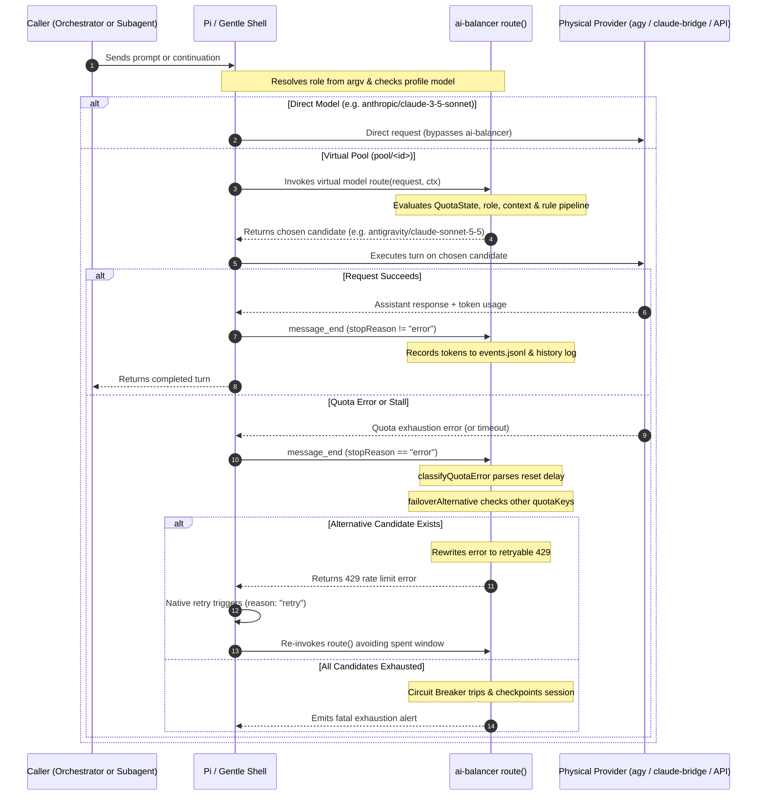
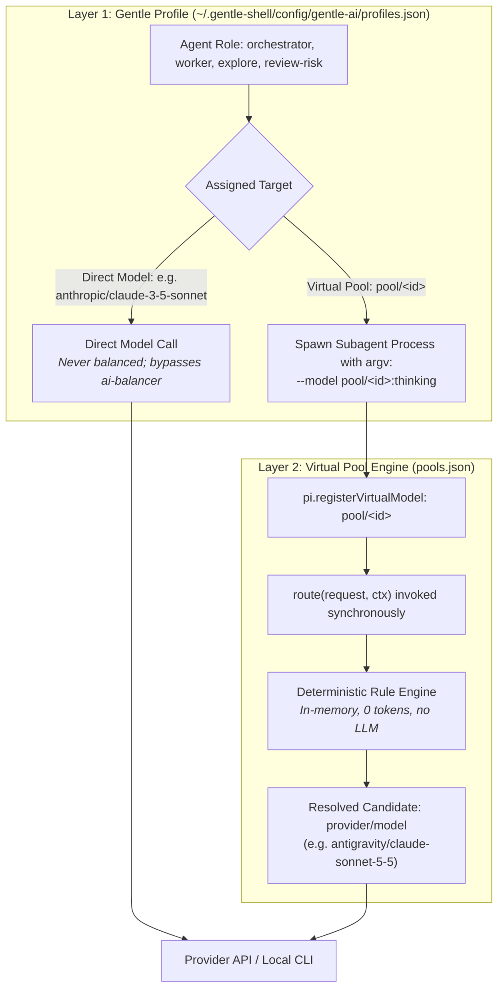
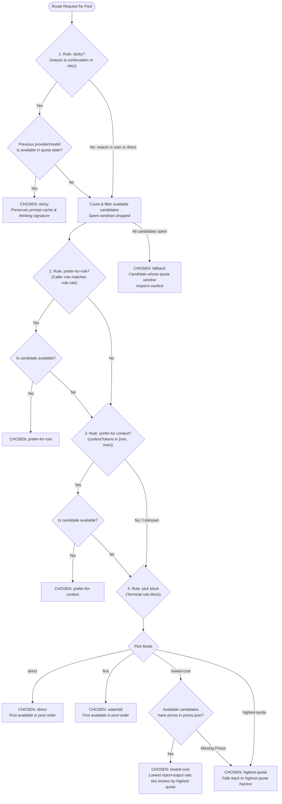
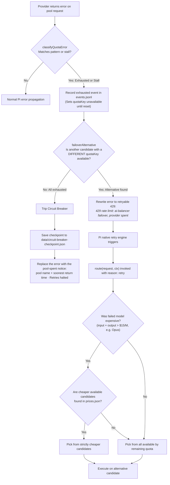

# Complete Guide to ai-balancer

[Versión en español](guide.es.md)

`ai-balancer` is a Gentle Shell / Pi extension that brings deterministic virtual model routing, quota-aware load balancing, prompt cache preservation, automatic failover, and operational telemetry to coding-agent workflows.

It is **not** limited to a single bridge: `ai-balancer` discovers, unifies, and balances across any provider exposed to Gentle Shell, including:
- **Google AI Pro (Antigravity / `agy`)**: Claude Opus 5.5, Claude Sonnet 5.5, Gemini 4 Argon, Gemini 3.8 Flash.
- **Claude Pro / Max (`claude-bridge`)**: Claude Opus 5.5, Claude Sonnet 5.5, Claude 3.7 Sonnet.
- **Claude Code CLI (`claude-code`)**: Claude 3.7 Sonnet.
- **OpenCode Engine (`opencode`)**: opencode-code-v1.
- **Local LLMs via Ollama (`ollama`)**: Qwen 2.5 Coder, Llama 3.2, DeepSeek Coder.
- **Pi `/login` subscriptions** (`openai-codex` for ChatGPT Plus/Pro, `anthropic`, `github-copilot`, …): detected from their OAuth entry in `auth.json`.
- **Direct Paid APIs**: Anthropic (`ANTHROPIC_API_KEY`) and Google Gemini (`GEMINI_API_KEY`).
- **Any Pi Provider**: Any model reachable through Pi's Model Registry declared in `pools.json`.

---

## Table of Contents

1. [Architectural Overview & Request Lifecycle](#1-architectural-overview--request-lifecycle)
2. [Two-Layer Model Assignment (Gentle Profiles vs. Virtual Pools)](#2-two-layer-model-assignment-gentle-profiles-vs-virtual-pools)
3. [Deterministic Request Routing](#3-deterministic-request-routing)
4. [The Rule Pipeline Specification](#4-the-rule-pipeline-specification)
5. [Quota Interception, Failover & Circuit Breaker](#5-quota-interception-failover--circuit-breaker)
6. [Cost Containment Strategies](#6-cost-containment-strategies)
7. [Adding a New Provider Step-by-Step](#7-adding-a-new-provider-step-by-step)
8. [Worked Example: Multi-Role Agent Team Configuration](#8-worked-example-multi-role-agent-team-configuration)
9. [Reading Routing Traces to Tune Context Thresholds](#9-reading-routing-traces-to-tune-context-thresholds)
10. [Installation & Interactive Setup Hub](#10-installation--interactive-setup-hub)
11. [Control Center & TUI Dashboards](#11-control-center--tui-dashboards)
12. [Full Commands Reference](#12-full-commands-reference)
13. [Keybindings & Shortcuts](#13-keybindings--shortcuts)
14. [Troubleshooting & FAQ](#14-troubleshooting--faq)

---

## 1. Architectural Overview & Request Lifecycle

`ai-balancer` operates strictly in-process inside Pi. It evaluates routing rules synchronously before each LLM turn, intercepting responses to detect quota exhaustion.



### Turn Progression
1. **Turn Ingestion**: A request begins either from the interactive user prompt or an autonomous subagent child session.
2. **Role Detection**: `src/roles.ts` reads `process.argv` to determine the caller's agent role (e.g., `gentle-ai-explore`, `gentle-ai-worker`, or `orchestrator`).
3. **Profile Lookup**: Gentle Shell looks up the model assigned to that role in the active profile (`profiles.json`).
4. **Pool Route Hook**: If the target is a virtual pool (`pool/<id>`), `pi.registerVirtualModel` executes the `route()` hook.
5. **Candidate Resolution**: The rule pipeline evaluates candidate health, stickiness, role preferences, context sizes, and cost rates, returning a concrete `provider/model`.
6. **Execution & Telemetry**: The turn runs on the selected provider. On completion (`message_end`), token usage (`input`, `output`, `cacheRead`, `cacheWrite`) is appended to local append-only journals.
7. **Transparent Failover**: If the provider fails with a quota limit or stall, `ai-balancer` rewrites the error into a retryable `429` status code, triggering an immediate retry on an alternative healthy candidate.

---

## 2. Two-Layer Model Assignment (Gentle Profiles vs. Virtual Pools)

Model configuration is cleanly decoupled into two independent layers:



| Layer | Responsibility | Configuration File | Key Concept |
|---|---|---|---|
| **Layer 1: Role → Model** | Gentle Shell | `~/.gentle-shell/config/gentle-ai/profiles.json` | Assigns each agent role a target model string (`direct` or `pool/<id>`) and thinking budget (`low`, `medium`, `high`). Passed to child processes via `--model target:thinking`. |
| **Layer 2: Pool → Candidate** | `ai-balancer` | `pools.json` | Defines the candidates backing each `pool/<id>` and the rule pipeline that chooses among them. |

> [!IMPORTANT]
> **Only roles assigned to a virtual pool (`pool/<id>`) are balanced.**
> If a role is configured with a direct model (e.g. `anthropic/claude-3-5-sonnet` or `antigravity/gemini-3-8-flash`), Gentle Shell calls that provider directly. `ai-balancer` is bypassed completely, and automatic quota failover will not occur.

### Profiles vs. Pools vs. Bridges: The Key Difference

To understand the architecture without ambiguity, it is essential to distinguish the three separate concerns:

| Concept | Question Answered | Responsibility | Configuration File | Concrete Example |
|---|---|---|---|---|
| **Profile** (*Profiles*) | *Who consumes?* | Maps an agent's functional role (`orchestrator`, `worker`, `explore`, `verify`) to a destination target. | `~/.gentle-shell/config/gentle-ai/profiles.json` | The `gentle-ai-worker` role is assigned `pool/claude-sonnet-5-5`. |
| **Pool** (*Virtual Pool*) | *What resilience policies & alternatives apply?* | Defines a virtual model grouping multiple physical candidates and applies deterministic rules (failover, cache stickiness, cost ceilings). | `pools.json` | `pool/claude-sonnet-5-5` groups `antigravity/claude-sonnet-5-5`, `claude-bridge/claude-sonnet-5-5`, and a fallback to `flash`. |
| **Bridge / Integration** | *How and where does the wire connect physically?* | Provides the transport adapter or bridge to the concrete provider or subscription (local CLI, socket, or API). | `integrations.json` / Pi Extensions / Environment variables | `claude-bridge` exposes Claude Pro/Max; `antigravity` connects to `agy`; `anthropic` connects to the direct API. |

The end-to-end request lifecycle illustrates how they interact:
$$\text{Agent (Profile)} \longrightarrow \text{Virtual Pool} \xrightarrow[\text{quotas / stickiness}]{\text{Router}} \text{Physical Candidate} \longrightarrow \text{Bridge / Provider}$$

- If an agent's **Profile** assigns a direct model (e.g., `anthropic/claude-3-5-sonnet`), the **Pool** layer is bypassed entirely and the request travels straight to the **Bridge / Provider** with no balancing or failover.
- If the **Profile** points to a `pool/*`, the deterministic router inspects quotas across candidates provided by each **Bridge** and dispatches to the healthiest candidate.

---

## 3. Deterministic Request Routing

The router (`src/router.ts`) is completely deterministic. It never invokes an LLM, makes no network calls, and runs in microseconds before every request.

### Request Reasons
Pi provides a `reason` parameter on every virtual model routing call:

- **`user`**: The initial turn of an interactive or subagent session. Evaluates role preferences, context sizes, and strategy pickers (`highest-quota`, `lowest-cost`, or `waterfall`).
- **`continuation`**: A follow-up turn in an existing session. Handled by the `sticky` rule to protect prompt caches.
- **`retry`**: A retry triggered when the previous attempt failed. Handled by the `sticky` rule (if the failure was transient) or failover logic (if quota was exhausted). When an expensive model fails, retries filter for cheaper candidates.
- **`direct`**: A direct programmatic request to the pool outside standard conversational flow. Bypasses heuristics and selects the first available candidate in pool order.

### Real-Time Role Detection (`src/roles.ts`)
Subagents run in isolated Pi child processes. While Gentle Shell logs completed task metadata to disk after a task finishes, routing decisions happen *before* the first turn runs.

`ai-balancer` resolves roles in real time:
- **Main orchestrator**: If the process is not a child process, it resolves to `orchestrator` (`source: "none"`).
- **Subagent child**: Inspects `process.argv` for the `--append-system-prompt` flag. Gentle Shell points this flag to a path formatted as:
  ```
  .../gentle-pi-subagent-<role>-<hash>/instructions.md
  ```
  The regex extracts `<role>` (e.g., `gentle-ai-worker`, `gentle-ai-explore`, `review-risk`) with `source: "argv"`.
- **Historical reconciliation**: When reading past history, `readAgentTasks` joins session IDs with task files in `~/.gentle-shell/agent/gentle-agents/tasks/*.json` to reconcile any unknown child roles.

### Cached Quota State (`src/state.ts`)
The routing engine checks candidate availability against `QuotaState`:
- `isAvailable(quotaKey, now)`: Returns `false` if the quota window has been marked exhausted and the reset timestamp (`availableAt`) has not elapsed.
- `remainingFraction(quotaKey)`: Returns the last known remaining capacity fraction (`0.0` to `1.0`).
- `availableAt(quotaKey, now)`: Returns the epoch millisecond timestamp when a spent window reopens.

---

## 4. The Rule Pipeline Specification

Pools can define an explicit `rules` array in `pools.json`. When present, rules are evaluated sequentially in array order until one chooses a candidate.



### Rule Blocks Catalog

| Rule Block | Parameters | Behavior |
|---|---|---|
| `sticky` | *(none)* | Matches the provider and model of the previous successful turn on `continuation` or `retry`. If that candidate is available, picks it immediately to preserve prompt cache hits. May appear at most once. |
| `prefer-for-role` | `role`, `candidate` | If the caller's role matches `role` and `candidate` is healthy, picks it immediately. `candidate` must belong to the pool. |
| `prefer-for-context` | `candidate`, `minTokens`?, `maxTokens`? | Matches session context length: `tokens >= minTokens` (inclusive) and `tokens < maxTokens` (exclusive). Requires at least one bound. Skipped if context size is unknown or out of range. |
| `pick` | `mode` (`"first"` \| `"highest-quota"` \| `"lowest-cost"`) | Terminal rule block. **Must appear exactly once at the end of the rules array.** |

### Terminal Pick Modes
- **`first` (Waterfall)**: Picks the first available candidate in pool order.
- **`highest-quota` (Hybrid default; `hybrid` routes exactly like it today)**: Compares the remaining quota fraction (`0.0` to `1.0`) across all available candidates. The candidate with the highest remaining quota wins. Ties are broken by pool candidate order.
- **`lowest-cost`**: Computes the token rate (`input + output` USD per million tokens) from `prices.json`. Picks the candidate with the lowest cost rate. Ties are broken by highest remaining quota fraction. **If any available candidate lacks a price in `prices.json`, this mode automatically falls back to `highest-quota`.**

### Built-In Fixed Guarantees
Two guarantees cannot be removed or reordered:
1. **Available Filtering**: Any candidate whose quota window is spent (`!isAvailable`) is omitted before evaluating role, context, or pick rules.
2. **Earliest-Reset Fallback**: If every candidate in the pool is exhausted, the router selects the candidate whose quota window reopens earliest (`availableAt`). This ensures the final rejection comes from the provider that will become usable first.

---

## 5. Quota Interception, Failover & Circuit Breaker



### Quota Error Classification (`src/quota-errors.ts`)
Standard coding harnesses treat quota exhaustion as fatal non-retryable errors. `ai-balancer` intercepts assistant messages before completion.

Recognized patterns:
- **Google AI Pro (Antigravity)**: `"Individual quota reached. Please upgrade... Resets in 154h55m28s"` or `"hit your weekly limit"`.
- **Claude Bridge**: `"Claude quota exceeded — rate limit... resets..."`.
- **Claude Code CLI**: `"You're out of extra usage · resets 6:30pm"`.
- **Generic Rate Limits**: `"resource_exhausted"`, `"usage limit reached"`.
- **Process Stalls & Timeouts**: CLI or bridge processes that hang without output trigger a stall classification with a 6-minute cooldown (`DEFAULT_STALL_COOLDOWN_MS = 360_000`).
- **How fast a stall is detected**: the Antigravity bridge decides that, not `ai-balancer`. It fails a turn with `agy stalled for <N>m with no output` after `inactivityTimeoutMin` minutes without output (default 5; set it in `~/.pi/agent/antigravity-bridge/config.json` or with `AGY_INACTIVITY_TIMEOUT_MIN`, whole minutes, minimum 1). A pool then fails over through Pi's normal retry. Gentle AI subagents give up after about 4 minutes without a first event, so a value of 2 lets a pool switch models before that.

### The 429 Rewrite Trick
When a quota failure is recognized, `ai-balancer` rewrites the error message into:
```
429 rate limit: ai-balancer failover, <provider> subscription window is spent
```
This specific string guarantees that Pi's retry classifier recognizes the error as a retryable rate limit while avoiding non-retryable keywords (`"quota exceeded"`, `"billing"`, `"insufficient_quota"`).

### Failover by Quota Key
`failoverAlternative` checks candidates by their **`quotaKey`**, not merely their provider name. This distinction is critical because a single provider can serve multiple independent quota windows (e.g., Antigravity's `gemini-weekly` window remains 100% available even when its `3p-weekly` Claude window is 0%).

### Expensive Model Retries (`EXPENSIVE_RATE = 15`)
If a failed candidate was expensive (`input + output > $15/M`, such as Claude Opus at $4 input + $20 output = $24/M), retries filter candidates with `cheaperThanFailed`. The router strictly restricts the retry candidate pool to cheaper available models (e.g., Sonnet or Argon). If no cheaper model is available or prices are missing, remaining quota decides.

### Circuit Breaker (`src/circuit-breaker.ts`)
If all candidates in a pool are exhausted simultaneously, automated retries would loop endlessly. The Circuit Breaker activates:
1. Detects that `failoverAlternative` returned `undefined`.
2. Trips into `tripped = true`.
3. Saves a persistent checkpoint in `data/circuit-breaker-checkpoint.json` with the session ID, project name, timestamp, and earliest reset deadline.
4. Ends the turn with a clear notice naming the pool and when the soonest candidate comes back (`ops.poolExhausted`), in place of the provider's own error text. The notice is shown in the UI and is also the error a subagent hands back, so it works without a UI. It avoids every word Pi retries on, so the turn ends instead of looping, and the session stays open: the next turn routes normally once a candidate reopens, with no reload.

---

## 6. Cost Containment Strategies

1. **Keep Expensive Models Out of General Pools**:
   - Use high-cost models (e.g. Claude Opus) sparingly. Place them only in specialized audit pools or bind them to specific roles (e.g. `review-risk`).
2. **Setup Advisor Opus Exclusion**:
   - The interactive setup advisor (`src/setup-advisor.ts`) includes a strict regex filter (`OPUS = /opus/i`).
   - Opus targets are stripped before prompts are sent to the advisor model and rejected if returned in recommendations. Cost containment is enforced by code, never left to LLM discretion.
3. **Context-Aware Tiering**:
   - Configure `prefer-for-context` rules in `pools.json` so that large context sessions automatically route to cheaper high-context models (such as Gemini Argon or Flash), avoiding expensive per-token processing on premium models.

---

## 7. Adding a New Provider Step-by-Step

To incorporate a new provider (e.g., a custom corporate OpenAI gateway or local runner):

### Step 1: Register or Detect the Provider
Ensure the provider is exposed to Pi's model registry. If it is a bridge or local runner, confirm its CLI or package is accessible.

### Step 2: Define Quota Key Adapter (`src/providers/registry.ts`)
In `src/providers/registry.ts`, register the provider's quota key mapping:
```typescript
registerProviderAdapter("my-provider", {
  quotaKey(model: string): string {
    return `my-provider/${model}`;
  }
});
```

### Step 3: Add Pricing Entry in `prices.json`
Add the model's official USD rates per million tokens under `models` in `prices.json`:
```json
{
  "models": {
    "my-custom-model": {
      "input": 1.5,
      "output": 6.0,
      "cacheRead": 0.15,
      "cacheWrite": 1.5
    }
  }
}
```

### Step 4: Add Candidate to `pools.json`
Add `"my-provider/my-custom-model"` to the desired pool's candidate list:
```json
{
  "id": "orchestrator",
  "name": "Orchestrator Pool",
  "strategy": "hybrid",
  "candidates": [
    "antigravity/gemini-4-argon",
    "my-provider/my-custom-model",
    "claude-bridge/claude-sonnet-5-5"
  ]
}
```

### Step 5: Assign Roles in `profiles.json`
Point the relevant roles to `pool/orchestrator` in `~/.gentle-shell/config/gentle-ai/profiles.json`.

---

## 8. Worked Example: Multi-Role Agent Team Configuration

Here is a complete, production-tested configuration separating an agent team into:
- **Explorer** (`gentle-ai-explore`): Fast, low-cost code exploration using Gemini Flash.
- **Worker** (`gentle-ai-worker`): Mid-tier balanced pool using Sonnet and Argon.
- **Reviewers & Judges** (`review-risk`, `jd-judge-a`, `gentle-ai-verify`): High-reasoning models with higher thinking levels.

### `pools.json`

`lastResort` (optional, top level): a `provider/model` that answers first, automatically, when every candidate of a pool is exhausted (main session and subagents). Set it in `/installer` → Backups → "Last-resort model" (key `l`); installer saves and other tools that edit pools preserve it.

**Automatic loans from the installer.** `/installer` → Backups → "Automatic loans" (key `a`): for each backup you pick None or a model of an enabled subscription (models of another company are listed first). Install writes one `auto` grant per backup to `permissions.json` (in the data dir): `models` = `pool/<id>` plus the chosen model, `profiles` = the saved profiles that have a task on that backup, `roles` = every task of those profiles that points at `pool/<id>` (the grant format needs explicit names, no wildcards, so install again after pointing more tasks at a backup), expiry one year. Installer grants have ids starting `g-inst-`; other grants are never changed, and `/balancer permissions` lists or revokes them. The `.bak-installer-*` copies and Undo cover `permissions.json` like `pools.json`. Loans only apply to tasks that point at a backup and start once its first model is spent.

```json
{
  "lastResort": "antigravity/gemini-3-8-flash",
  "pools": [
    {
      "id": "orchestrator-pool",
      "name": "Orchestrator & Exploration Pool",
      "candidates": [
        "antigravity/gemini-3-8-flash",
        "antigravity/gemini-4-argon",
        "claude-bridge/claude-sonnet-5-5"
      ],
      "strategy": "hybrid",
      "rules": [
        { "rule": "sticky" },
        { "rule": "prefer-for-role", "role": "gentle-ai-explore", "candidate": "antigravity/gemini-3-8-flash" },
        { "rule": "prefer-for-context", "candidate": "antigravity/gemini-4-argon", "minTokens": 50000 },
        { "rule": "pick", "mode": "highest-quota" }
      ]
    },
    {
      "id": "worker-pool",
      "name": "Implementation Worker Pool",
      "candidates": [
        "antigravity/claude-sonnet-5-5",
        "claude-bridge/claude-sonnet-5-5",
        "antigravity/gemini-4-argon"
      ],
      "strategy": "hybrid",
      "rules": [
        { "rule": "sticky" },
        { "rule": "pick", "mode": "highest-quota" }
      ]
    },
    {
      "id": "audit-pool",
      "name": "Deep Review & Verification Pool",
      "candidates": [
        "antigravity/claude-sonnet-5-5",
        "claude-bridge/claude-sonnet-5-5"
      ],
      "strategy": "waterfall",
      "rules": [
        { "rule": "sticky" },
        { "rule": "pick", "mode": "first" }
      ]
    }
  ]
}
```

### `profiles.json` (`~/.gentle-shell/config/gentle-ai/profiles.json`)
```json
{
  "kind": "gentle-pi.agent_model_profiles",
  "version": 1,
  "profiles": {
    "balanced-team": {
      "orchestrator": {
        "model": "pool/orchestrator-pool",
        "thinking": "medium"
      },
      "gentle-ai-explore": {
        "model": "pool/orchestrator-pool",
        "thinking": "low"
      },
      "gentle-ai-worker": {
        "model": "pool/worker-pool",
        "thinking": "medium"
      },
      "gentle-ai-verify": {
        "model": "pool/audit-pool",
        "thinking": "medium"
      },
      "review-risk": {
        "model": "pool/audit-pool",
        "thinking": "high"
      },
      "jd-judge-a": {
        "model": "pool/audit-pool",
        "thinking": "high"
      }
    }
  }
}
```

---

## 9. Reading Routing Traces to Tune Context Thresholds

Whenever `ai-balancer` makes a routing decision where the candidate or decided rule changes, it records an explainable trace in `data/history/YYYY-MM-DD.jsonl`:

```json
{
  "kind": "route",
  "ts": 1729987200000,
  "session": "39aa04bb-dda2-43e2-a54f-78f7205ecf66",
  "project": "my-project",
  "pool": "orchestrator-pool",
  "reason": "continuation",
  "role": { "role": "gentle-ai-worker", "source": "argv" },
  "contextTokens": 62450,
  "candidate": { "provider": "antigravity", "model": "gemini-4-argon" },
  "trace": {
    "decidedBy": "prefer-for-context",
    "steps": [
      { "rule": "sticky", "result": "skipped", "why": "antigravity/claude-sonnet-5-5 spent until 2026-10-27T04:00:00.000Z" },
      { "rule": "available", "result": "2 of 3", "why": "antigravity/claude-sonnet-5-5 spent until 2026-10-27T04:00:00.000Z" },
      { "rule": "prefer-for-role", "result": "skipped", "why": "role is gentle-ai-worker, not gentle-ai-explore" },
      { "rule": "prefer-for-context", "result": "chosen", "why": "context 62450 tokens is at least 50000, prefers antigravity/gemini-4-argon" }
    ],
    "candidates": [
      { "provider": "antigravity", "quotaKey": "antigravity/claude", "available": false, "remaining": 0 },
      { "provider": "antigravity", "quotaKey": "antigravity/gemini-argon", "available": true, "remaining": 0.85 },
      { "provider": "claude-bridge", "quotaKey": "claude-bridge/claude-sonnet-5-5", "available": true, "remaining": 0.42 }
    ]
  }
}
```

### Tuning Thresholds
1. **Inspect Historical Context Sizes**: Check `data/history/` or run `/balancer usage` (Tab 4: Sessions) to observe typical context inflection points.
2. **Evaluate Cache Switch Penalty**: Run `/balancer switch-cost` to evaluate whether switching providers on a 60k context costs more in cold-cache retransmission than waiting for reset.
3. **Adjust Boundaries**:
   - If sessions regularly switch prematurely, raise `minTokens` in `prefer-for-context`.
   - If large sessions overflow smaller models, set `maxTokens` to redirect heavy contexts to large-window models.

---

## 10. Installation & Interactive Setup Hub

### Installation
```bash
gentle-shell install <path-to-repo>
```

### Interactive Setup Hub (`/balancer setup`)

Running `/balancer setup` starts the conversational setup installer. The setup hub auto-detects installed AI providers, builds virtual model pools with tailored failover strategies, and optimizes agent role assignments across two unified presentation channels:
- **Terminal Console (TUI)**: Runs directly within your terminal with full keyboard navigation and mouse click support in fullscreen terminals (`TuiAltScreen`).
- **Web Installer (`/installer`)**: Runs in any modern desktop or mobile browser via a local loopback server or secure SSH tunnel.

Both channels execute against the same underlying state model and planning engine, guaranteeing identical decisions, texts, recommendations, and validations.

#### 1. Three-Column Conversational Layout
The installer layout is organized into 3 columns designed to eliminate cognitive overload:

```
+-------------------+------------------------------------------+------------------------+
| 1. Welcome     ✓  |  [ Mascot & Balance ]                    | [?] DETAILED HELP      |
| 2. Mode        ●  |  "Let's choose your routing strategy..." | What it is:            |
| 3. Subscriptions○ |                                          | Hybrid pool strategy.  |
| 4. Backups     ○  |  [ Interactive Stage Area ]              |                        |
| 5. Tasks       ○  |  ( ) Mixed (hybrid)                      | Purpose:               |
| 6. Summary     ○  |  ( ) In order (waterfall)                | Balances load while    |
|                   |  ( ) Most room left (highest-quota)      | preserving cache.      |
|                   |                                          |                        |
|                   |  --------------------------------------- | If you pick this:      |
|                   |  Nothing is applied until you confirm    | Starts with 1st, then  |
|                   |  [ Back ] [ Next ]                       | shifts smoothly.       |
| Step 2 of 6       |                                          | Target: pools.json     |
+-------------------+------------------------------------------+------------------------+
```

- **Left Rail (Steps Navigation)**:
  - Displays the ordered sequence of installation steps with live status icons:
    - `✓` (`done`): Completed steps.
    - `●` (`current`): Currently active step.
    - `○` (`todo`): Upcoming steps.
  - Features an explicit step progress indicator ("Step N of M"). In narrow terminal windows, the rail collapses into a compact status header.
- **Center Column (Conversational Guide & Stage)**:
  - **Conversational Guide**: Features the pixel-art Capybara mascot and an animated mechanical balance scale alongside a speech bubble explaining the step in plain language.
  - **Stage Area**: Renders interactive controls, options lists, candidate ordering widgets, and dynamic ASCII / SVG routing diagrams.
  - **Closing Reassurance Notice**: Displays an explicit notice at the base of every stage: "*Nothing is applied until you confirm*" (`No se aplica nada hasta que confirmes`).
  - **Action Navigation**: Standard action buttons (`[Back]`, `[Next]`, `[Cancel]`, `[Install]`) protected by a single-flight double-click guard that locks UI dispatch until current processing concludes. In the terminal, buttons are plain at rest (`[ Next ▶ ]`); `Tab` moves focus between them and only the focused one is filled (marked with `▸`). `Enter` with no focused button presses **Next**.
- **Right Rail (Dedicated Help Panel)**:
  - An always-visible context panel that updates synchronously with the focused item:
    - **What it is**: High-level definition of the selected choice.
    - **Purpose**: Why this decision matters to your agent team.
    - **If you pick this**: Operational impact, prompt cache implications, and failover behavior.
    - **Technical Name**: Formal configuration key (displayed in muted gray text).
    - **Destination Config File**: The file where the choice is saved (`pools.json`, `integrations.json`, `profiles.json`).

#### 2. Capybara Mascot & Balance Animations
The installer features a pixel-art Capybara mascot paired with an animated mechanical balance scale. The mascot serves as an intuitive visual companion reflecting setup activity:

- **Expressive Poses**:
  - `idle`: Default resting pose during decision and review steps.
  - `working`: Active pose during subscription discovery scans, AI deep analysis evaluations, and final installation.
  - `happy`: Celebratory pose displayed on the final "Done" screen once configuration is complete.
- **Procedural Animations**:
  - Mascot breathing and natural blinking intervals.
  - Tilting mechanical balance beam and bobbing pans reflecting balancing dynamics.
- **Accessibility & Reduced Motion**:
  - Fully respects accessibility preferences. When `AI_BALANCER_REDUCE_MOTION=1` is set in the environment or the browser reports `prefers-reduced-motion: reduce` (or the `.still` class is active), all animations are disabled. The mascot and balance scale freeze to crisp, static frames, preventing visual fatigue.

#### 3. Welcome Screen & Concept Glossary
The Welcome screen introduces core architectural concepts in plain, everyday language before asking for any configuration decisions:

| Plain Name | Technical Name | Destination File | Description |
|---|---|---|---|
| **Subscription** | `provider` | `integrations.json` | An AI plan you pay for or are logged into (e.g., Claude Pro/Max, Google AI Pro). Each subscription maintains its own quota limits and reset windows. |
| **Backup** | `pool` | `pools.json` | A virtual priority group of subscriptions that provide the same model family. When the primary subscription runs out of quota, agents roll over to the next candidate without stopping. |
| **Agent task** | `role` | `profiles.json` | A specific job your agents perform (reading files, writing code, checking results, architecture reviews). Each task can be bound to a fast model or a deep reasoning pool. |
| **Routing strategy** | `strategy` | `pools.json` | The deterministic rule a backup pool uses to choose which subscription answers next (`hybrid`, `waterfall`, `highest-quota`). |
| **Main agent** | `orchestratorMode` | `profiles.json` | The primary coordinator mode: whether the chat agent works autonomously on tasks (`organic`) or strictly delegates work to specialized worker subagents (`full-delegation`). |

The Welcome screen also presents an upfront summary of what the installer will do (detect subscriptions without spending quota, create backups, optimize role assignments, and stage changes safely), along with a community star link: [https://github.com/3lAngel0/balanceria](https://github.com/3lAngel0/balanceria).

#### 4. Backup Pipeline & Strategy Configuration
When multiple subscriptions offer overlapping models, the installer suggests virtual backup pools and gives you full control over candidate ordering, membership, and routing algorithms:

- **Mixed / Hybrid (`hybrid` - Recommended)**:
  - Keeps the model a conversation already uses; for a new turn it picks the subscription with the most usage left. Today it routes exactly like `highest-quota` (no "running low" threshold).
  - *Tradeoff*: Preserves prompt cache reuse during ongoing turns; a later candidate can answer a new turn before the first runs out.
- **In Order / Waterfall (`waterfall`)**:
  - Always routes to the primary candidate until its quota is completely exhausted, then fails over to secondary candidates in sequence. This is the strategy to use for a strict primary/backup order.
  - *Tradeoff*: Simple and predictable; ideal when you want to exhaust a primary quota before touching secondary limits.
- **Most Room Left / Highest Quota (`highest-quota`)**:
  - Always selects the candidate subscription currently reporting the highest available quota percentage.
  - *Tradeoff*: Distributes load evenly across subscriptions; may cause prompt cache rewarming when switching between providers.

Automatic backups only group the same model. To fall back to another provider (for example Claude to OpenAI or Gemini), use **+ Create another backup** → **Custom backup**, tick models with `Space` (any model of your enabled subscriptions, other providers included), order them, and choose **In order**.

Candidates within a pool can be reordered using `u` (up) and `d` (down) keys or interactive controls. The installer automatically warns you when mixing low-cost models (e.g., Flash) with premium models in the same backup pool without cost containment guards.

#### 5. Agent Tasks & Deep Analysis ("Búsqueda profunda")
The installer maps agent tasks across the full catalog of 11 roles (reading files, writing code, checking results, etc.). You can choose between two assignment methods:

1. **Auto-Assign Recommended ("Assign the recommended")**:
   - Zero-quota heuristic assignment. Evaluates your available pools against proven agentic workload profiles in 0 ms and 0 LLM tokens.
2. **Deep Analysis ("Realizar búsqueda profunda")**:
   - Consults an active AI advisor model to evaluate task allocations against real model capabilities, reasoning benchmarks, context length requirements, and cost efficiency.
   - **Live Progress Feedback**: Displays an animated indeterminate progress bar and a live elapsed seconds counter.
   - **Single-Flight Concurrency Lock**: Enforces an atomic lock during evaluation. Re-clicking buttons or pressing Enter is blocked, preventing duplicate requests and avoiding accidental quota spend.
   - **Confirmation Banner**: Displays an informative completion banner detailing duration in seconds, tokens used, and the billed subscription:
     `Consulted in 4.2 s, used 348 tokens of subscription Google AI Pro`

#### 6. Human-Readable Summary & Review
Before any configuration file is written to disk, the installer presents a comprehensive, human-readable summary:

- **Narrative Story**:
  - A plain-language paragraph explaining how your balanced environment will operate:
    > *"You will balance the load between these subscriptions: Google AI Pro, Claude Pro. Then you have these backups, groups of subscriptions that offer the same model so your agents never stop: Claude Sonnet 3.5 (Google AI Pro, Claude Pro). They use the Mixed strategy. Your main agent works in organic mode."*
- **Bulleted Breakdown**:
  - Connected subscriptions.
  - Backup pools, candidate priority chains, and chosen routing strategies.
  - Agent task assignments to pools or direct models.
  - Preserved backups (if existing profiles rely on them).
  - Target configuration files to be written (`integrations.json`, `pools.json`, `profiles.json`).
- **Closing Notice & Confirmation**:
  - Concludes with the reassurance: "*Nothing is applied until you confirm*". Pressing `Enter` or clicking `[Install]` writes changes atomically; pressing `Esc` or clicking `[Cancel]` exits leaving every file untouched.

#### 7. Installation Integrity & Non-Overwriting Backups
The installer guarantees safe atomic configuration and zero data loss through three mechanisms:

- **Backup Preservation ("Kept Backups")**:
  - If any existing profile in `profiles.json` references a virtual backup pool (`pool/<id>`), that pool is preserved in `pools.json` and never dropped. If all subscriptions supporting a required pool are disabled, the installer alerts you with an installation blocker instead of breaking existing agent tasks.
- **Per-Install Timestamped Copies**:
  - Before writing any file, the installer creates an isolated, timestamped snapshot:
    `<file>.bak-installer-YYYYMMDDHHMMSS` (or `-2`, `-3` if run in the same second).
  - Unlike legacy systems that overwrite a single `.bak` file, every installation pass keeps its own distinct, non-overwriting historical copy.
- **Exact Undo ("Undo everything" / "Deshacer todo")**:
  - On the final "Done" screen, clicking **[Undo everything]** immediately restores the exact files and state from immediately prior to that installation pass, and safely removes any configuration files created anew. Prior backups are preserved.

#### 8. Web Installer Security Sandbox
When running via the web (`/balancer setup` -> Install via web, or navigating to `/installer`):

- **Ephemeral Lifecycle**: The `/installer` page and its companion API endpoints (`GET /api/installer`, `POST /api/installer`) exist only while an active interactive installer session is in progress.
- **Token Authentication**: All requests require the session token generated by the server.
- **Strict Content Security Policy (CSP)**:
  - Disallows inline styles (`style-src 'self'`).
  - Disallows dynamic code evaluation (`script-src 'self'`, no `eval`).
  - Strict DOM safety: no `innerHTML` in client scripts; all UI updates use pure DOM element and text node construction.
- **Loopback & HTTPS Enforcement**:
  - State mutations (`POST`) are permitted strictly over loopback (`127.0.0.1`) or TLS/HTTPS connections.
  - Plain-HTTP connections over LAN are strictly forbidden (`actions are permitted only over loopback or HTTPS`), preventing DNS rebinding attacks and credential exposure.
- **Remote / SSH Access**:
  - In remote SSH sessions, the terminal prints the exact SSH tunnel command to run on your local machine (`ssh -N -L 8787:127.0.0.1:8787 <user>@<host>`), allowing secure setup from your local desktop browser.

---

**How setup starts.** `/balancer setup` first asks **Select language** (English / Español): `Enter` applies it to this run only, `P` saves it permanently, and the whole interface, Help included, switches at once. Then it asks **Where do you want to install?**:

- **Install via terminal**: the installer opens in the terminal.
- **Install via web**: the terminal shows the specific steps and waits:
  1. The web server starts on `127.0.0.1:8787` (this computer only). If a web server is already running it is reused exactly as you configured it, never widened.
  2. The terminal shows the link with the token and, when there is a desktop session, an **[Open in browser]** button (`O`).
  3. In a remote session (SSH) it also prints the exact tunnel command to run on your own computer and leave open, and then the link to open in your computer's browser.
  4. It shows "Waiting for you to finish the installation in the browser..." with **[Cancel]** (`Esc`). When the browser finishes, the terminal shows the same "Done" summary. Cancel stops the server if the installer started it; if you ended with **[Open the panel]**, the server stays up because it also serves the panel.

**Install types.** The second screen asks how to install:

- **Recommended** (preselected): detects your subscriptions, builds everything and jumps to the Summary.
- **Custom**: each choice is explained and you decide.
- **Advanced**: the technical stepper (below), the same as `/balancer setup --skip`.

If ai-balancer is already installed, the first screen offers instead:

- **Modify**: Custom with your current setup loaded, so you only adjust what you want.
- **Repair**: finds agent tasks that point to backups or models that no longer exist and proposes fixes (ticked ones are applied).
- **Start from scratch**: saves `.bak` copies and sets the recommended configuration again.

**Installer steps** (Recommended and Repair visit only some of them):

1. **Welcome**: what ai-balancer does, concept glossary, how long it takes (about 2 minutes), star link, and that nothing changes until confirmed.
2. **Install type** (Recommended / Custom / Advanced).
3. **Finding subscriptions**: progress with a ✓ for each one found, without spending quota. If none is found it shows what to do (sign in to a subscription) and **[Retry]**.
4. **Your subscriptions**: tick the ones ai-balancer may use; each shows its models and independent usage limits.
5. **Backups**: interactive diagrams reflecting your selections (Agent → Backup → 1st subscription, 2nd subscription on exhaustion). Configure members, candidate priority order, and routing strategies (Mixed, In order, Most room left).
6. **Agent tasks**: catalog tasks with plain descriptions, quota impact, and recommendations. Choose **[Assign the recommended]** (0 quota) or **[Deep analysis]** (AI advisor model evaluation with live progress and single-flight lock).
7. **Main agent**: choose between `organic` (works directly) or `full-delegation` (delegates all work to subagents).
8. **Summary**: plain-language narrative story and bulleted breakdown before modifying files.
9. **Installing**: progress indicators for saving timestamped backup snapshots, writing configurations, and verifying credentials.
10. **Done**: summary of changes with **[Open the panel]**, **[Exit]**, and **[Undo everything]** (restores pre-install state).

**Advanced (technical stepper).** A four-step overlay: **Providers → Strategy → Roles → Confirm**. Each step shows a short description; the Confirm step shows a diff of what Save will write to `pools.json`, `integrations.json` and `profiles.json`. Nothing is written until **Save**; **Discard** (or `Esc`, which asks first when you have edits) leaves every file untouched. Keys: `←/→`/`h`/`l` or `Tab`/`Shift+Tab` change step, `↑/↓`/`j`/`k` move between rows, `Space`/`Enter` toggle or cycle (provider on/off, candidate on/off, pool strategy, role model), `u`/`d` reorder a candidate, `t` cycles a role's thinking level, `s` saves on the Confirm step. Mouse (click breadcrumb steps, rows and buttons; wheel scrolls) works only when Pi runs fullscreen (`TuiAltScreen`); otherwise the overlay is keyboard-only. Without a UI, or if overlays are unavailable, `/balancer setup` falls back to the classic wizard. On the Roles step, the **Orchestrator mode** row (`m`, or `Space`/`Enter`) sets `organic` or `full-delegation` for the active profile (Gentle Shell 4.7.0 `workflow.orchestratorMode`).

**Shortcuts into setup.**

- `/balancer setup --dummy` / `-d`, `/balancer dummy`, or `D` in the Control Center (`d` on the Overview tab): asks the language, then opens the installer in the terminal without the terminal/web question.
- `/balancer setup --skip` / `-s`: asks the language, then goes straight to the technical stepper. `/balancer skip` opens the action menu directly.

**Language.** Set it explicitly with `AI_BALANCER_LANG=es|en`. Priority: `AI_BALANCER_LANG` > `LC_ALL` > `LC_MESSAGES` > `LANG` > `LANGUAGE`; `/balancer lang es|en|auto` persists the choice in `~/.gentle-shell/agent/settings.json`.

`/balancer setup classic` runs the previous prompt-based wizard:
1. **Auto-Detection**: Probes installed CLI tools (`agy`, `claude`, `opencode`, `ollama`), NPM packages, and environment keys.
2. **Strategy Selection**: Choose `hybrid` (recommended) or `waterfall`.
3. **Profile Resolution**:
   - **Active profile detected**: Prompts `"You have an active profile: '<name>'. Do you want to build a custom one with the balancer?"`, allowing you to keep the existing profile or generate a fresh `balanceador_<id>` profile.
   - **No active profile**: Prompts `"profiles.json: No active profile found. Create a profile for you?"` to bootstrap a `balanceador_<id>` profile.
4. **Candidate Reordering**: Move candidates up or down (`u`/`d`), toggle candidates on or off.
5. **Role Assignment Advisor**: Run the lightweight heuristic or AI advisor (~350 tokens) to configure role targets.
6. **Hub Menu**: Access custom balancer profile creation (`👤 New profile (balanceador_<id>)…`) at any time.
7. **Atomic Writing**: Writes `pools.json`, `integrations.json`, and `profiles.json` with timestamped backups (`.bak`).

---

## 11. Control Center & TUI Dashboards

### Side Panel & Control Center (`Ctrl+Alt+B` or `/balancer panel`)
- **Tab 1 `[Overview]`**: Active profile, routed candidates, subscription meters, and quota status.
- **Tab 2 `[Roles]`**: Interactive role matrix across all 11 catalog roles. Press `m` to cycle models, `t` to adjust thinking, and `a` to apply AI recommendations.
- **Tab 3 `[Pools]`**: Inspect candidates and priorities in real time. Press `Space` to toggle, `u`/`d` to adjust rank, `s` to toggle hybrid/waterfall.
- **Tab 4 `[Advisor]`**: View and apply role recommendations.

Every tab is drawn as titled boxes and aligned tables (the cursor row starts with `▸`), and the setup overlay uses the same layout. A **Help** box explains the current view in plain language: it sits on the right when the overlay is at least 96 columns wide inside its border, and stacks under the content on narrower overlays. Press `?` to show or hide it. The full glossary stays in `/balancer help`.

The panels use a small pixel-art palette (the same one as the web panel): role types and pool strategies are colored chips, thinking levels are pips (`▰▰▱`), quota windows are segmented bars colored by what is left (green, gold, red), and the Overview shows a balance mascot. In a terminal with truecolor (`COLORTERM=truecolor`) they are drawn in RGB; elsewhere they use your theme's colors; with `NO_COLOR` set they are shapes only, and every state keeps its word or shape, never color alone. Light animation (the mascot rocking, the arrow marching along the active route, a moving shine on the bars, bars filling in when a tab opens) runs only while a panel is open; set `AI_BALANCER_REDUCE_MOTION=1` to get still frames. Inside tmux (`TERM=*256color`) truecolor is detected automatically; set `AI_BALANCER_COLOR_MODE=truecolor|ansi|none` to force a mode.

### Usage Console (`Ctrl+Alt+U` or `/balancer usage`)
- **Now**: Active session tokens, context meter, 24h hourly histogram, active quota cards.
- **Quotas**: 30-day peak histograms, fill counts, time-to-fill, and blocking durations.
- **Days**: 30-day token breakdown and daily table with provider shares and API-equivalent costs.
- **Sessions**: Historical sessions ranked by consumption and peak context.
- **HUD**: Compact HUD overview.

### Terminal HUD (`/hud`)
Operational overlay showing real-time subscription burn velocity (`+X%/h`), reset deadlines, API spend, top consumer sessions, and optimization suggestions.

---

## 12. Full Commands Reference

| Command | Arguments | Description |
|---|---|---|
| `/balancer` | *(none)* | Opens the Control Center overlay; `roles`, `pools`, `advisor` jump to a tab, `menu` lists every action. Mouse works under the alternate screen only. |
| `/balancer panel` | *(none)* | Toggles sidebar overlay and Control Center (`Ctrl+Alt+B`). |
| `/balancer usage` | *(none)* | Opens 5-tab usage and quota console (`Ctrl+Alt+U`). |
| `/balancer quota` | `--copy` / `-c` (or `copy`), `--raw` / `-r` | Shows a compact live quota summary (per-window usage % and reset time). `--copy` copies it to the clipboard; `--raw` prints it as plain text. Flags can be combined; any other argument is rejected. |
| `/balancer setup` | *(none)* | Opens the installer: language, then **Install via terminal** or **Install via web**. |
| `/balancer setup --dummy` / `-d`, `/balancer dummy`, or `D` in the Control Center | *(none)* | Opens the installer in the terminal (language first, no terminal/web question). |
| `/balancer setup --skip` / `-s` | *(none)* | Goes straight to the technical stepper (Providers → Strategy → Roles → Confirm), after the language prompt. |
| `/balancer skip` | *(none)* | Opens the action menu directly. |
| `/balancer setup classic` | *(none)* | Runs the previous prompt-based setup wizard (includes the AI role advisor). |
| `/balancer refresh` | *(none)* | Triggers immediate poll of Antigravity usage. |
| `/balancer report` | *(none)* | Generates standalone offline HTML report (`report.html`). |
| `/balancer serve` | `[port]` | Starts local web dashboard (default port: 8787). |
| `/balancer serve lan` | `[port]` | Starts web dashboard bound to private LAN. |
| `/balancer serve setup` | *(none)* | Runs LAN/TLS configuration wizard. |
| `/balancer serve status` | *(none)* | Reports active web server URL and mode. |
| `/balancer serve stop` | *(none)* | Stops active web server. |
| `/balancer lab` | *(none)* | Inspects active lab draft status. |
| `/balancer lab new` | *(none)* | Creates sandbox copies of configuration in `data/lab/`. |
| `/balancer lab diff` | *(none)* | Compares draft rules against live files. |
| `/balancer lab simulate` | *(none)* | Replays 30-day history against sandbox draft. |
| `/balancer lab apply` | *(none)* | Atomically applies lab draft with backup creation. |
| `/balancer lab undo` | *(none)* | Reverts last applied lab configuration. |
| `/balancer lab discard` | *(none)* | Discards active sandbox draft. |
| `/balancer switch-cost` | *(none)* | Generates cache retention vs. switching cost report. |
| `/balancer loans` | *(none)* | Opens temporary model loan console. |
| `/balancer permissions` | *(none)* | Lists active autonomous model loan permissions. |
| `/balancer lang` | `[es\|en\|auto]` | Inspects or sets UI language. |
| `/balancer help` | | Shows the glossary of terms. |
| `/hud` | *(none)* | Opens terminal Heads-Up Display. |

---

## 13. Keybindings & Shortcuts

| Keybinding | Scope | Action |
|---|---|---|
| `Ctrl+Alt+B` | Global | Toggle side panel / Control Center. |
| `Ctrl+Alt+U` | Global | Open Usage Console. |
| `1` – `5` | Usage Console | Switch tabs: Now, Quotas, Days, Sessions, HUD. |
| `1` – `4` | Control Center | Switch tabs: Overview, Roles, Pools, Advisor. |
| `Tab` | Overlays | Cycle active tab. |
| `PgUp` / `PgDn` | Overlays | Scroll viewport vertically. |
| `q` or `Esc` | Overlays | Close overlay or cancel dialog. |
| `m` | Roles Tab | Cycle model target for highlighted role. |
| `t` | Roles Tab | Cycle thinking level (`low` → `medium` → `high`). |
| `a` | Roles / Advisor | Apply AI Advisor recommendations. |
| `s` | Pools Tab | Toggle pool strategy (`hybrid` ↔ `waterfall`). |
| `u` / `d` | Pool Candidates | Move candidate priority up or down. |
| `x` | HUD Sessions | Compact selected session. |
| `f` | HUD Sessions | Fork and compact into a fresh session. |

---

## 14. Troubleshooting & FAQ

### Q: Why did my session fail over to another model mid-turn?
**A**: The active candidate encountered a quota exhaustion limit or process stall. `ai-balancer` classified the error, checked `QuotaState`, rewrote the rejection to a retryable `429`, and Pi smoothly failed over to the next healthy candidate in the pool without dropping turn context.

### Q: Why are my token counts in millions when the model only output a few paragraphs?
**A**: LLMs re-send the full conversation context on every single turn. In a 20-turn session with an 80k token context, over 1.6 million tokens are transmitted. Most of these are `cacheRead` tokens, which are cheaper but still count against quota rate limits. Run `/compact` to shrink conversation context.

### Q: How do I force an agent role to bypass balancing completely?
**A**: In `~/.gentle-shell/config/gentle-ai/profiles.json`, configure the role with a direct physical model (e.g. `"model": "anthropic/claude-3-5-sonnet"`) instead of a `"pool/..."` string. Direct models bypass `ai-balancer` completely.

### Q: What happens if every provider in a pool runs out of quota?
**A**: First, an active automatic loan for that pool moves its tasks to the borrowed model. Otherwise the configured last-resort model (`lastResort` in `pools.json`) answers automatically with a warning notice. If that is spent too (or none is set), the main session shows a menu to wait, pick any model of your subscriptions with quota left, compact, or cancel, and the Circuit Breaker activates: it halts automated retries, writes an emergency checkpoint to `data/circuit-breaker-checkpoint.json`, and ends the turn with a notice that names the pool and the earliest reopening time, also when there is no UI (subagents).
