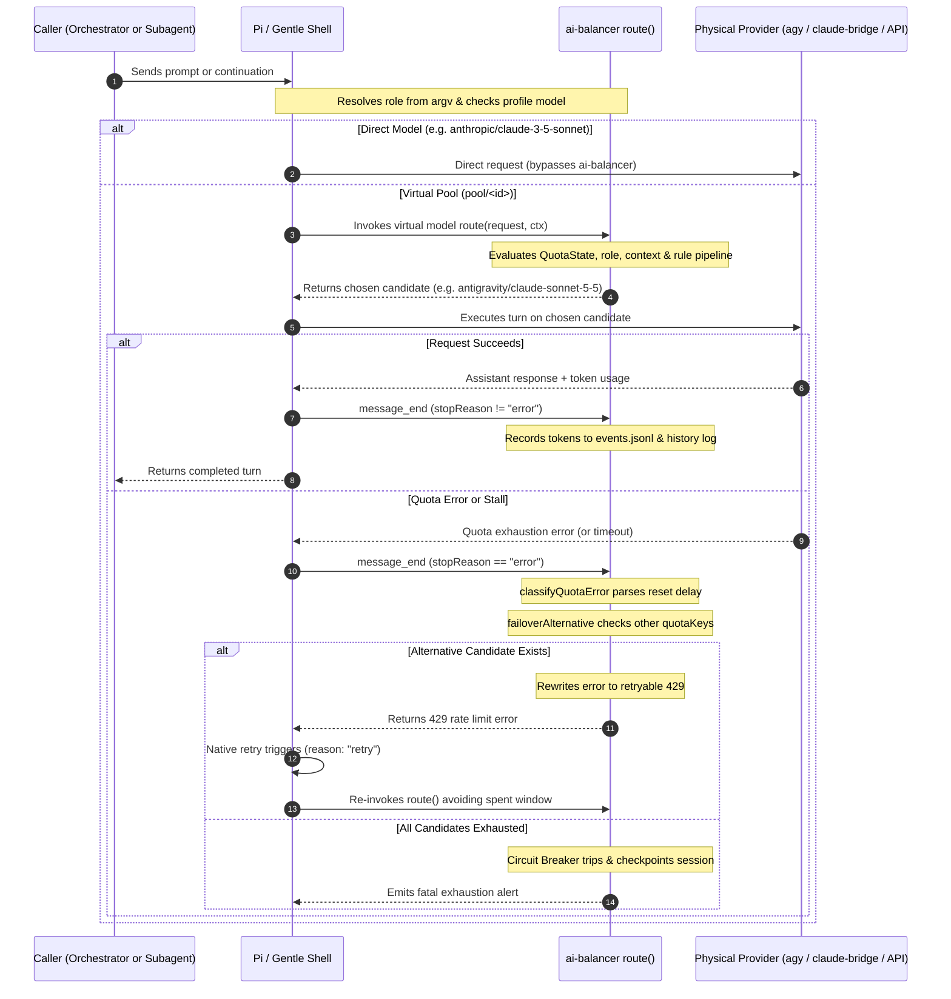
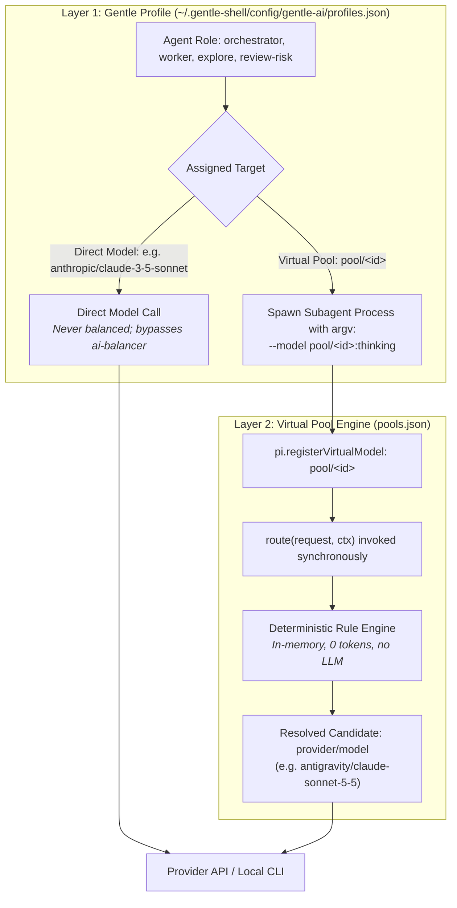
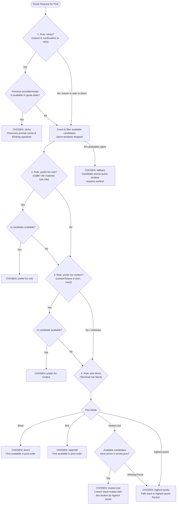
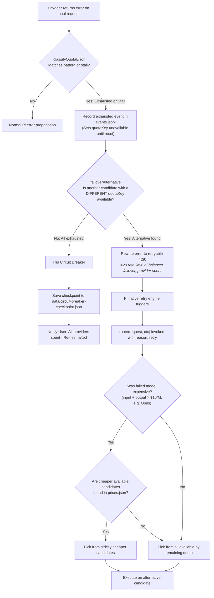

# Complete Guide to ai-balancer

[Versión en español](guide.es.md)

`ai-balancer` is a Gentle Shell / Pi extension that brings deterministic virtual model routing, quota-aware load balancing, prompt cache preservation, automatic failover, and operational telemetry to coding-agent workflows.

It is **not** limited to a single bridge: `ai-balancer` discovers, unifies, and balances across any provider exposed to Gentle Shell, including:
- **Google AI Pro (Antigravity / `agy`)**: Claude Opus 5.5, Claude Sonnet 5.5, Gemini 4 Argon, Gemini 3.8 Flash.
- **Claude Pro / Max (`claude-bridge`)**: Claude Opus 5.5, Claude Sonnet 5.5, Claude 3.7 Sonnet.
- **Claude Code CLI (`claude-code`)**: Claude 3.7 Sonnet.
- **OpenCode Engine (`opencode`)**: opencode-code-v1.
- **Local LLMs via Ollama (`ollama`)**: Qwen 2.5 Coder, Llama 3.2, DeepSeek Coder.
- **Direct Paid APIs**: Anthropic (`ANTHROPIC_API_KEY`) and Google Gemini (`GEMINI_API_KEY`).
- **Any Pi Provider**: Any model reachable through Pi's Model Registry declared in `pools.json`.

---

## Table of Contents

1. [Architectural Overview & Request Lifecycle](#1-architectural-overview--request-lifecycle)
2. [Two-Layer Model Assignment (Gentle Profiles vs. Virtual Pools)](#2-two-layer-model-assignment-gentle-profiles-vs-virtual-pools)
3. [Deterministic Request Routing](#3-deterministic-request-routing)
4. [The Rule Pipeline Specification](#4-the-rule-pipeline-specification)
5. [Quota Interception, Failover & Circuit Breaker](#5-quota-interception-failover--circuit-breaker)
6. [Cost Containment Strategies](#6-cost-containment-strategies)
7. [Adding a New Provider Step-by-Step](#7-adding-a-new-provider-step-by-step)
8. [Worked Example: Multi-Role Agent Team Configuration](#8-worked-example-multi-role-agent-team-configuration)
9. [Reading Routing Traces to Tune Context Thresholds](#9-reading-routing-traces-to-tune-context-thresholds)
10. [Installation & Interactive Setup Hub](#10-installation--interactive-setup-hub)
11. [Control Center & TUI Dashboards](#11-control-center--tui-dashboards)
12. [Full Commands Reference](#12-full-commands-reference)
13. [Keybindings & Shortcuts](#13-keybindings--shortcuts)
14. [Troubleshooting & FAQ](#14-troubleshooting--faq)

---

## 1. Architectural Overview & Request Lifecycle

`ai-balancer` operates strictly in-process inside Pi. It evaluates routing rules synchronously before each LLM turn, intercepting responses to detect quota exhaustion.



### Turn Progression
1. **Turn Ingestion**: A request begins either from the interactive user prompt or an autonomous subagent child session.
2. **Role Detection**: `src/roles.ts` reads `process.argv` to determine the caller's agent role (e.g., `gentle-ai-explore`, `gentle-ai-worker`, or `orchestrator`).
3. **Profile Lookup**: Gentle Shell looks up the model assigned to that role in the active profile (`profiles.json`).
4. **Pool Route Hook**: If the target is a virtual pool (`pool/<id>`), `pi.registerVirtualModel` executes the `route()` hook.
5. **Candidate Resolution**: The rule pipeline evaluates candidate health, stickiness, role preferences, context sizes, and cost rates, returning a concrete `provider/model`.
6. **Execution & Telemetry**: The turn runs on the selected provider. On completion (`message_end`), token usage (`input`, `output`, `cacheRead`, `cacheWrite`) is appended to local append-only journals.
7. **Transparent Failover**: If the provider fails with a quota limit or stall, `ai-balancer` rewrites the error into a retryable `429` status code, triggering an immediate retry on an alternative healthy candidate.

---

## 2. Two-Layer Model Assignment (Gentle Profiles vs. Virtual Pools)

Model configuration is cleanly decoupled into two independent layers:



| Layer | Responsibility | Configuration File | Key Concept |
|---|---|---|---|
| **Layer 1: Role → Model** | Gentle Shell | `~/.gentle-shell/config/gentle-ai/profiles.json` | Assigns each agent role a target model string (`direct` or `pool/<id>`) and thinking budget (`low`, `medium`, `high`). Passed to child processes via `--model target:thinking`. |
| **Layer 2: Pool → Candidate** | `ai-balancer` | `pools.json` | Defines the candidates backing each `pool/<id>` and the rule pipeline that chooses among them. |

> [!IMPORTANT]
> **Only roles assigned to a virtual pool (`pool/<id>`) are balanced.**
> If a role is configured with a direct model (e.g. `anthropic/claude-3-5-sonnet` or `antigravity/gemini-3-8-flash`), Gentle Shell calls that provider directly. `ai-balancer` is bypassed completely, and automatic quota failover will not occur.

---

## 3. Deterministic Request Routing

The router (`src/router.ts`) is completely deterministic. It never invokes an LLM, makes no network calls, and runs in microseconds before every request.

### Request Reasons
Pi provides a `reason` parameter on every virtual model routing call:

- **`user`**: The initial turn of an interactive or subagent session. Evaluates role preferences, context sizes, and strategy pickers (`highest-quota`, `lowest-cost`, or `waterfall`).
- **`continuation`**: A follow-up turn in an existing session. Handled by the `sticky` rule to protect prompt caches.
- **`retry`**: A retry triggered when the previous attempt failed. Handled by the `sticky` rule (if the failure was transient) or failover logic (if quota was exhausted). When an expensive model fails, retries filter for cheaper candidates.
- **`direct`**: A direct programmatic request to the pool outside standard conversational flow. Bypasses heuristics and selects the first available candidate in pool order.

### Real-Time Role Detection (`src/roles.ts`)
Subagents run in isolated Pi child processes. While Gentle Shell logs completed task metadata to disk after a task finishes, routing decisions happen *before* the first turn runs.

`ai-balancer` resolves roles in real time:
- **Main orchestrator**: If the process is not a child process, it resolves to `orchestrator` (`source: "none"`).
- **Subagent child**: Inspects `process.argv` for the `--append-system-prompt` flag. Gentle Shell points this flag to a path formatted as:
  ```
  .../gentle-pi-subagent-<role>-<hash>/instructions.md
  ```
  The regex extracts `<role>` (e.g., `gentle-ai-worker`, `gentle-ai-explore`, `review-risk`) with `source: "argv"`.
- **Historical reconciliation**: When reading past history, `readAgentTasks` joins session IDs with task files in `~/.gentle-shell/agent/gentle-agents/tasks/*.json` to reconcile any unknown child roles.

### Cached Quota State (`src/state.ts`)
The routing engine checks candidate availability against `QuotaState`:
- `isAvailable(quotaKey, now)`: Returns `false` if the quota window has been marked exhausted and the reset timestamp (`availableAt`) has not elapsed.
- `remainingFraction(quotaKey)`: Returns the last known remaining capacity fraction (`0.0` to `1.0`).
- `availableAt(quotaKey, now)`: Returns the epoch millisecond timestamp when a spent window reopens.

---

## 4. The Rule Pipeline Specification

Pools can define an explicit `rules` array in `pools.json`. When present, rules are evaluated sequentially in array order until one chooses a candidate.



### Rule Blocks Catalog

| Rule Block | Parameters | Behavior |
|---|---|---|
| `sticky` | *(none)* | Matches the provider and model of the previous successful turn on `continuation` or `retry`. If that candidate is available, picks it immediately to preserve prompt cache hits. May appear at most once. |
| `prefer-for-role` | `role`, `candidate` | If the caller's role matches `role` and `candidate` is healthy, picks it immediately. `candidate` must belong to the pool. |
| `prefer-for-context` | `candidate`, `minTokens`?, `maxTokens`? | Matches session context length: `tokens >= minTokens` (inclusive) and `tokens < maxTokens` (exclusive). Requires at least one bound. Skipped if context size is unknown or out of range. |
| `pick` | `mode` (`"first"` \| `"highest-quota"` \| `"lowest-cost"`) | Terminal rule block. **Must appear exactly once at the end of the rules array.** |

### Terminal Pick Modes
- **`first` (Waterfall)**: Picks the first available candidate in pool order.
- **`highest-quota` (Hybrid default)**: Compares the remaining quota fraction (`0.0` to `1.0`) across all available candidates. The candidate with the highest remaining quota wins. Ties are broken by pool candidate order.
- **`lowest-cost`**: Computes the token rate (`input + output` USD per million tokens) from `prices.json`. Picks the candidate with the lowest cost rate. Ties are broken by highest remaining quota fraction. **If any available candidate lacks a price in `prices.json`, this mode automatically falls back to `highest-quota`.**

### Built-In Fixed Guarantees
Two guarantees cannot be removed or reordered:
1. **Available Filtering**: Any candidate whose quota window is spent (`!isAvailable`) is omitted before evaluating role, context, or pick rules.
2. **Earliest-Reset Fallback**: If every candidate in the pool is exhausted, the router selects the candidate whose quota window reopens earliest (`availableAt`). This ensures the final rejection comes from the provider that will become usable first.

---

## 5. Quota Interception, Failover & Circuit Breaker



### Quota Error Classification (`src/quota-errors.ts`)
Standard coding harnesses treat quota exhaustion as fatal non-retryable errors. `ai-balancer` intercepts assistant messages before completion.

Recognized patterns:
- **Google AI Pro (Antigravity)**: `"Individual quota reached. Please upgrade... Resets in 154h55m28s"` or `"hit your weekly limit"`.
- **Claude Bridge**: `"Claude quota exceeded — rate limit... resets..."`.
- **Claude Code CLI**: `"You're out of extra usage · resets 6:30pm"`.
- **Generic Rate Limits**: `"resource_exhausted"`, `"usage limit reached"`.
- **Process Stalls & Timeouts**: CLI or bridge processes that hang without output trigger a stall classification with a 3-minute cooldown (`DEFAULT_STALL_COOLDOWN_MS = 180_000`).

### The 429 Rewrite Trick
When a quota failure is recognized, `ai-balancer` rewrites the error message into:
```
429 rate limit: ai-balancer failover, <provider> subscription window is spent
```
This specific string guarantees that Pi's retry classifier recognizes the error as a retryable rate limit while avoiding non-retryable keywords (`"quota exceeded"`, `"billing"`, `"insufficient_quota"`).

### Failover by Quota Key
`failoverAlternative` checks candidates by their **`quotaKey`**, not merely their provider name. This distinction is critical because a single provider can serve multiple independent quota windows (e.g., Antigravity's `gemini-weekly` window remains 100% available even when its `3p-weekly` Claude window is 0%).

### Expensive Model Retries (`EXPENSIVE_RATE = 15`)
If a failed candidate was expensive (`input + output > $15/M`, such as Claude Opus at $4 input + $20 output = $24/M), retries filter candidates with `cheaperThanFailed`. The router strictly restricts the retry candidate pool to cheaper available models (e.g., Sonnet or Argon). If no cheaper model is available or prices are missing, remaining quota decides.

### Circuit Breaker (`src/circuit-breaker.ts`)
If all candidates in a pool are exhausted simultaneously, automated retries would loop endlessly. The Circuit Breaker activates:
1. Detects that `failoverAlternative` returned `undefined`.
2. Trips into `tripped = true`.
3. Saves a persistent checkpoint in `data/circuit-breaker-checkpoint.json` with the session ID, project name, timestamp, and earliest reset deadline.
4. Halts the retry loop and alerts the user in the UI.

---

## 6. Cost Containment Strategies

1. **Keep Expensive Models Out of General Pools**:
   - Use high-cost models (e.g. Claude Opus) sparingly. Place them only in specialized audit pools or bind them to specific roles (e.g. `review-risk`).
2. **Setup Advisor Opus Exclusion**:
   - The interactive setup advisor (`src/setup-advisor.ts`) includes a strict regex filter (`OPUS = /opus/i`).
   - Opus targets are stripped before prompts are sent to the advisor model and rejected if returned in recommendations. Cost containment is enforced by code, never left to LLM discretion.
3. **Context-Aware Tiering**:
   - Configure `prefer-for-context` rules in `pools.json` so that large context sessions automatically route to cheaper high-context models (such as Gemini Argon or Flash), avoiding expensive per-token processing on premium models.

---

## 7. Adding a New Provider Step-by-Step

To incorporate a new provider (e.g., a custom corporate OpenAI gateway or local runner):

### Step 1: Register or Detect the Provider
Ensure the provider is exposed to Pi's model registry. If it is a bridge or local runner, confirm its CLI or package is accessible.

### Step 2: Define Quota Key Adapter (`src/providers/registry.ts`)
In `src/providers/registry.ts`, register the provider's quota key mapping:
```typescript
registerProviderAdapter("my-provider", {
  quotaKey(model: string): string {
    return `my-provider/${model}`;
  }
});
```

### Step 3: Add Pricing Entry in `prices.json`
Add the model's official USD rates per million tokens under `models` in `prices.json`:
```json
{
  "models": {
    "my-custom-model": {
      "input": 1.5,
      "output": 6.0,
      "cacheRead": 0.15,
      "cacheWrite": 1.5
    }
  }
}
```

### Step 4: Add Candidate to `pools.json`
Add `"my-provider/my-custom-model"` to the desired pool's candidate list:
```json
{
  "id": "orchestrator",
  "name": "Orchestrator Pool",
  "strategy": "hybrid",
  "candidates": [
    "antigravity/gemini-4-argon",
    "my-provider/my-custom-model",
    "claude-bridge/claude-sonnet-5-5"
  ]
}
```

### Step 5: Assign Roles in `profiles.json`
Point the relevant roles to `pool/orchestrator` in `~/.gentle-shell/config/gentle-ai/profiles.json`.

---

## 8. Worked Example: Multi-Role Agent Team Configuration

Here is a complete, production-tested configuration separating an agent team into:
- **Explorer** (`gentle-ai-explore`): Fast, low-cost code exploration using Gemini Flash.
- **Worker** (`gentle-ai-worker`): Mid-tier balanced pool using Sonnet and Argon.
- **Reviewers & Judges** (`review-risk`, `jd-judge-a`, `gentle-ai-verify`): High-reasoning models with higher thinking levels.

### `pools.json`
```json
{
  "pools": [
    {
      "id": "orchestrator-pool",
      "name": "Orchestrator & Exploration Pool",
      "candidates": [
        "antigravity/gemini-3-8-flash",
        "antigravity/gemini-4-argon",
        "claude-bridge/claude-sonnet-5-5"
      ],
      "strategy": "hybrid",
      "rules": [
        { "rule": "sticky" },
        { "rule": "prefer-for-role", "role": "gentle-ai-explore", "candidate": "antigravity/gemini-3-8-flash" },
        { "rule": "prefer-for-context", "candidate": "antigravity/gemini-4-argon", "minTokens": 50000 },
        { "rule": "pick", "mode": "highest-quota" }
      ]
    },
    {
      "id": "worker-pool",
      "name": "Implementation Worker Pool",
      "candidates": [
        "antigravity/claude-sonnet-5-5",
        "claude-bridge/claude-sonnet-5-5",
        "antigravity/gemini-4-argon"
      ],
      "strategy": "hybrid",
      "rules": [
        { "rule": "sticky" },
        { "rule": "pick", "mode": "highest-quota" }
      ]
    },
    {
      "id": "audit-pool",
      "name": "Deep Review & Verification Pool",
      "candidates": [
        "antigravity/claude-sonnet-5-5",
        "claude-bridge/claude-sonnet-5-5"
      ],
      "strategy": "waterfall",
      "rules": [
        { "rule": "sticky" },
        { "rule": "pick", "mode": "first" }
      ]
    }
  ]
}
```

### `profiles.json` (`~/.gentle-shell/config/gentle-ai/profiles.json`)
```json
{
  "kind": "gentle-pi.agent_model_profiles",
  "version": 1,
  "profiles": {
    "balanced-team": {
      "orchestrator": {
        "model": "pool/orchestrator-pool",
        "thinking": "medium"
      },
      "gentle-ai-explore": {
        "model": "pool/orchestrator-pool",
        "thinking": "low"
      },
      "gentle-ai-worker": {
        "model": "pool/worker-pool",
        "thinking": "medium"
      },
      "gentle-ai-verify": {
        "model": "pool/audit-pool",
        "thinking": "medium"
      },
      "review-risk": {
        "model": "pool/audit-pool",
        "thinking": "high"
      },
      "jd-judge-a": {
        "model": "pool/audit-pool",
        "thinking": "high"
      }
    }
  }
}
```

---

## 9. Reading Routing Traces to Tune Context Thresholds

Whenever `ai-balancer` makes a routing decision where the candidate or decided rule changes, it records an explainable trace in `data/history/YYYY-MM-DD.jsonl`:

```json
{
  "kind": "route",
  "ts": 1729987200000,
  "session": "39aa04bb-dda2-43e2-a54f-78f7205ecf66",
  "project": "my-project",
  "pool": "orchestrator-pool",
  "reason": "continuation",
  "role": { "role": "gentle-ai-worker", "source": "argv" },
  "contextTokens": 62450,
  "candidate": { "provider": "antigravity", "model": "gemini-4-argon" },
  "trace": {
    "decidedBy": "prefer-for-context",
    "steps": [
      { "rule": "sticky", "result": "skipped", "why": "antigravity/claude-sonnet-5-5 spent until 2026-10-27T04:00:00.000Z" },
      { "rule": "available", "result": "2 of 3", "why": "antigravity/claude-sonnet-5-5 spent until 2026-10-27T04:00:00.000Z" },
      { "rule": "prefer-for-role", "result": "skipped", "why": "role is gentle-ai-worker, not gentle-ai-explore" },
      { "rule": "prefer-for-context", "result": "chosen", "why": "context 62450 tokens is at least 50000, prefers antigravity/gemini-4-argon" }
    ],
    "candidates": [
      { "provider": "antigravity", "quotaKey": "antigravity/claude", "available": false, "remaining": 0 },
      { "provider": "antigravity", "quotaKey": "antigravity/gemini-argon", "available": true, "remaining": 0.85 },
      { "provider": "claude-bridge", "quotaKey": "claude-bridge/claude-sonnet-5-5", "available": true, "remaining": 0.42 }
    ]
  }
}
```

### Tuning Thresholds
1. **Inspect Historical Context Sizes**: Check `data/history/` or run `/balancer usage` (Tab 4: Sessions) to observe typical context inflection points.
2. **Evaluate Cache Switch Penalty**: Run `/balancer switch-cost` to evaluate whether switching providers on a 60k context costs more in cold-cache retransmission than waiting for reset.
3. **Adjust Boundaries**:
   - If sessions regularly switch prematurely, raise `minTokens` in `prefer-for-context`.
   - If large sessions overflow smaller models, set `maxTokens` to redirect heavy contexts to large-window models.

---

## 10. Installation & Interactive Setup Hub

### Installation
```bash
gentle-shell install <path-to-repo>
```

### Interactive Setup Hub (`/balancer setup`)
Running `/balancer setup` starts the wizard:
1. **Auto-Detection**: Probes installed CLI tools (`agy`, `claude`, `opencode`, `ollama`), NPM packages, and environment keys.
2. **Strategy Selection**: Choose `hybrid` (recommended) or `waterfall`.
3. **Profile Resolution**:
   - **Active profile detected**: Prompts `"Tenés un perfil activo: '<name>'. ¿Querés armar uno personalizado con el balanceador?"`, allowing you to keep the existing profile or generate a fresh `balanceador_<id>` profile.
   - **No active profile**: Prompts `"profiles.json: No active profile found. ¿Creamos un perfil para vos?"` to bootstrap a `balanceador_<id>` profile.
4. **Candidate Reordering**: Move candidates up or down (`u`/`d`), toggle candidates on or off.
5. **Role Assignment Advisor**: Run the lightweight heuristic or AI advisor (~350 tokens) to configure role targets.
6. **Hub Menu**: Access custom balancer profile creation (`👤 ¿Creamos un perfil para vos? / Nuevo perfil (balanceador_<id>)…`) at any time.
7. **Atomic Writing**: Writes `pools.json`, `integrations.json`, and `profiles.json` with timestamped backups (`.bak`).

---

## 11. Control Center & TUI Dashboards

### Side Panel & Control Center (`Ctrl+Alt+B` or `/balancer panel`)
- **Tab 1 `[Overview]`**: Active profile, routed candidates, subscription meters, and quota status.
- **Tab 2 `[Roles]`**: Interactive role matrix across all 11 catalog roles. Press `m` to cycle models, `t` to adjust thinking, and `a` to apply AI recommendations.
- **Tab 3 `[Pools]`**: Inspect candidates and priorities in real time. Press `Space` to toggle, `u`/`d` to adjust rank, `s` to toggle hybrid/waterfall.
- **Tab 4 `[Advisor]`**: View and apply role recommendations.

### Usage Console (`Ctrl+Alt+U` or `/balancer usage`)
- **Now**: Active session tokens, context meter, 24h hourly histogram, active quota cards.
- **Quotas**: 30-day peak histograms, fill counts, time-to-fill, and blocking durations.
- **Days**: 30-day token breakdown and daily table with provider shares and API-equivalent costs.
- **Sessions**: Historical sessions ranked by consumption and peak context.
- **HUD**: Compact HUD overview.

### Terminal HUD (`/hud`)
Operational overlay showing real-time subscription burn velocity (`+X%/h`), reset deadlines, API spend, top consumer sessions, and optimization suggestions.

---

## 12. Full Commands Reference

| Command | Arguments | Description |
|---|---|---|
| `/balancer` | *(none)* | Opens interactive command menu. |
| `/balancer panel` | *(none)* | Toggles sidebar overlay and Control Center (`Ctrl+Alt+B`). |
| `/balancer usage` | *(none)* | Opens 5-tab usage and quota console (`Ctrl+Alt+U`). |
| `/balancer setup` | *(none)* | Launches interactive setup wizard. |
| `/balancer refresh` | *(none)* | Triggers immediate poll of Antigravity usage. |
| `/balancer report` | *(none)* | Generates standalone offline HTML report (`report.html`). |
| `/balancer serve` | `[port]` | Starts local web dashboard (default port: 8787). |
| `/balancer serve lan` | `[port]` | Starts web dashboard bound to private LAN. |
| `/balancer serve setup` | *(none)* | Runs LAN/TLS configuration wizard. |
| `/balancer serve status` | *(none)* | Reports active web server URL and mode. |
| `/balancer serve stop` | *(none)* | Stops active web server. |
| `/balancer lab` | *(none)* | Inspects active lab draft status. |
| `/balancer lab new` | *(none)* | Creates sandbox copies of configuration in `data/lab/`. |
| `/balancer lab diff` | *(none)* | Compares draft rules against live files. |
| `/balancer lab simulate` | *(none)* | Replays 30-day history against sandbox draft. |
| `/balancer lab apply` | *(none)* | Atomically applies lab draft with backup creation. |
| `/balancer lab undo` | *(none)* | Reverts last applied lab configuration. |
| `/balancer lab discard` | *(none)* | Discards active sandbox draft. |
| `/balancer switch-cost` | *(none)* | Generates cache retention vs. switching cost report. |
| `/balancer loans` | *(none)* | Opens temporary model loan console. |
| `/balancer permissions` | *(none)* | Lists active autonomous model loan permissions. |
| `/balancer lang` | `[es\|en\|auto]` | Inspects or sets UI language. |
| `/hud` | *(none)* | Opens terminal Heads-Up Display. |

---

## 13. Keybindings & Shortcuts

| Keybinding | Scope | Action |
|---|---|---|
| `Ctrl+Alt+B` | Global | Toggle side panel / Control Center. |
| `Ctrl+Alt+U` | Global | Open Usage Console. |
| `1` – `5` | Usage Console | Switch tabs: Now, Quotas, Days, Sessions, HUD. |
| `1` – `4` | Control Center | Switch tabs: Overview, Roles, Pools, Advisor. |
| `Tab` | Overlays | Cycle active tab. |
| `PgUp` / `PgDn` | Overlays | Scroll viewport vertically. |
| `q` or `Esc` | Overlays | Close overlay or cancel dialog. |
| `m` | Roles Tab | Cycle model target for highlighted role. |
| `t` | Roles Tab | Cycle thinking level (`low` → `medium` → `high`). |
| `a` | Roles / Advisor | Apply AI Advisor recommendations. |
| `s` | Pools Tab | Toggle pool strategy (`hybrid` ↔ `waterfall`). |
| `u` / `d` | Pool Candidates | Move candidate priority up or down. |
| `x` | HUD Sessions | Compact selected session. |
| `f` | HUD Sessions | Fork and compact into a fresh session. |

---

## 14. Troubleshooting & FAQ

### Q: Why did my session fail over to another model mid-turn?
**A**: The active candidate encountered a quota exhaustion limit or process stall. `ai-balancer` classified the error, checked `QuotaState`, rewrote the rejection to a retryable `429`, and Pi smoothly failed over to the next healthy candidate in the pool without dropping turn context.

### Q: Why are my token counts in millions when the model only output a few paragraphs?
**A**: LLMs re-send the full conversation context on every single turn. In a 20-turn session with an 80k token context, over 1.6 million tokens are transmitted. Most of these are `cacheRead` tokens, which are cheaper but still count against quota rate limits. Run `/compact` to shrink conversation context.

### Q: How do I force an agent role to bypass balancing completely?
**A**: In `~/.gentle-shell/config/gentle-ai/profiles.json`, configure the role with a direct physical model (e.g. `"model": "anthropic/claude-3-5-sonnet"`) instead of a `"pool/..."` string. Direct models bypass `ai-balancer` completely.

### Q: What happens if every provider in a pool runs out of quota?
**A**: The Circuit Breaker activates immediately. It halts automated retries, writes an emergency checkpoint to `data/circuit-breaker-checkpoint.json`, and alerts the user with the earliest reopening time.
